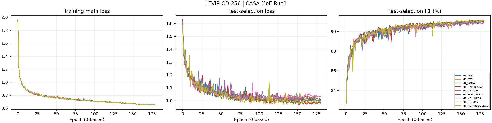
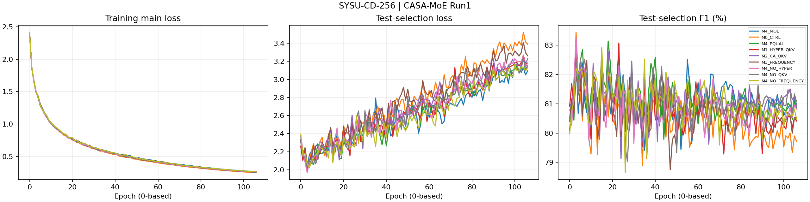
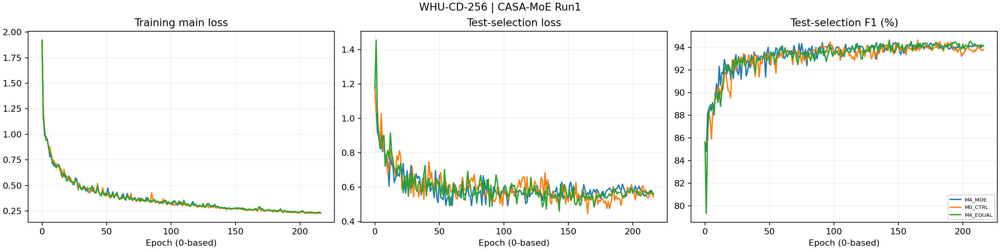
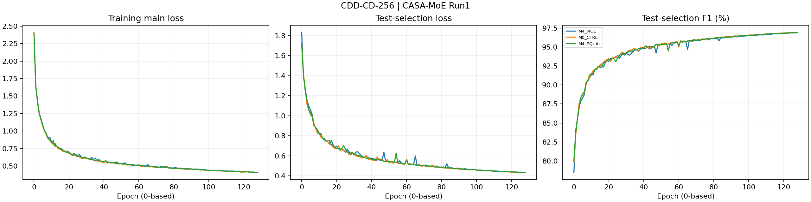

# CASA-MoE / Run1 完整训练记录

24项正式实验，物理GPU1；2026-10-28 12:51:18至2026-10-29 20:51:42 CST。

epoch使用日志的0起始索引。每epoch在test选模，最终结果为同一test集上的最佳checkpoint复测，不是独立盲测。探针与停止项不计入正式指标。

| 数据集 | 变体 | best_epoch | F1 (%) | 记录 |
|---|---|---:|---:|---|
| LEVIR | M4_MOE | 153 | 90.9058 | [日志](M4_MOE/LEVIR-CD-256/train_log.txt) · [逐轮](M4_MOE/LEVIR-CD-256/epochs.csv) · [诊断](M4_MOE/LEVIR-CD-256/module_diagnostics.jsonl) |
| LEVIR | M0_CTRL | 171 | 91.1112 | [日志](M0_CTRL/LEVIR-CD-256/train_log.txt) · [逐轮](M0_CTRL/LEVIR-CD-256/epochs.csv) · [诊断](M0_CTRL/LEVIR-CD-256/module_diagnostics.jsonl) |
| LEVIR | M4_EQUAL | 171 | 91.1899 | [日志](M4_EQUAL/LEVIR-CD-256/train_log.txt) · [逐轮](M4_EQUAL/LEVIR-CD-256/epochs.csv) · [诊断](M4_EQUAL/LEVIR-CD-256/module_diagnostics.jsonl) |
| LEVIR | M1_HYPER_QKV | 145 | 91.1552 | [日志](M1_HYPER_QKV/LEVIR-CD-256/train_log.txt) · [逐轮](M1_HYPER_QKV/LEVIR-CD-256/epochs.csv) · [诊断](M1_HYPER_QKV/LEVIR-CD-256/module_diagnostics.jsonl) |
| LEVIR | M2_CA_QKV | 152 | 90.9999 | [日志](M2_CA_QKV/LEVIR-CD-256/train_log.txt) · [逐轮](M2_CA_QKV/LEVIR-CD-256/epochs.csv) · [诊断](M2_CA_QKV/LEVIR-CD-256/module_diagnostics.jsonl) |
| LEVIR | M3_FREQUENCY | 145 | 91.0440 | [日志](M3_FREQUENCY/LEVIR-CD-256/train_log.txt) · [逐轮](M3_FREQUENCY/LEVIR-CD-256/epochs.csv) · [诊断](M3_FREQUENCY/LEVIR-CD-256/module_diagnostics.jsonl) |
| LEVIR | M4_NO_HYPER | 146 | 91.0415 | [日志](M4_NO_HYPER/LEVIR-CD-256/train_log.txt) · [逐轮](M4_NO_HYPER/LEVIR-CD-256/epochs.csv) · [诊断](M4_NO_HYPER/LEVIR-CD-256/module_diagnostics.jsonl) |
| LEVIR | M4_NO_QKV | 180 | 90.9771 | [日志](M4_NO_QKV/LEVIR-CD-256/train_log.txt) · [逐轮](M4_NO_QKV/LEVIR-CD-256/epochs.csv) · [诊断](M4_NO_QKV/LEVIR-CD-256/module_diagnostics.jsonl) |
| LEVIR | M4_NO_FREQUENCY | 161 | 91.1805 | [日志](M4_NO_FREQUENCY/LEVIR-CD-256/train_log.txt) · [逐轮](M4_NO_FREQUENCY/LEVIR-CD-256/epochs.csv) · [诊断](M4_NO_FREQUENCY/LEVIR-CD-256/module_diagnostics.jsonl) |
| SYSU | M4_MOE | 15 | 82.7541 | [日志](M4_MOE/SYSU-CD-256/train_log.txt) · [逐轮](M4_MOE/SYSU-CD-256/epochs.csv) · [诊断](M4_MOE/SYSU-CD-256/module_diagnostics.jsonl) |
| SYSU | M0_CTRL | 3 | 83.4342 | [日志](M0_CTRL/SYSU-CD-256/train_log.txt) · [逐轮](M0_CTRL/SYSU-CD-256/epochs.csv) · [诊断](M0_CTRL/SYSU-CD-256/module_diagnostics.jsonl) |
| SYSU | M4_EQUAL | 18 | 83.1369 | [日志](M4_EQUAL/SYSU-CD-256/train_log.txt) · [逐轮](M4_EQUAL/SYSU-CD-256/epochs.csv) · [诊断](M4_EQUAL/SYSU-CD-256/module_diagnostics.jsonl) |
| SYSU | M1_HYPER_QKV | 23 | 83.0695 | [日志](M1_HYPER_QKV/SYSU-CD-256/train_log.txt) · [逐轮](M1_HYPER_QKV/SYSU-CD-256/epochs.csv) · [诊断](M1_HYPER_QKV/SYSU-CD-256/module_diagnostics.jsonl) |
| SYSU | M2_CA_QKV | 18 | 82.7794 | [日志](M2_CA_QKV/SYSU-CD-256/train_log.txt) · [逐轮](M2_CA_QKV/SYSU-CD-256/epochs.csv) · [诊断](M2_CA_QKV/SYSU-CD-256/module_diagnostics.jsonl) |
| SYSU | M3_FREQUENCY | 8 | 82.4704 | [日志](M3_FREQUENCY/SYSU-CD-256/train_log.txt) · [逐轮](M3_FREQUENCY/SYSU-CD-256/epochs.csv) · [诊断](M3_FREQUENCY/SYSU-CD-256/module_diagnostics.jsonl) |
| SYSU | M4_NO_HYPER | 3 | 83.2600 | [日志](M4_NO_HYPER/SYSU-CD-256/train_log.txt) · [逐轮](M4_NO_HYPER/SYSU-CD-256/epochs.csv) · [诊断](M4_NO_HYPER/SYSU-CD-256/module_diagnostics.jsonl) |
| SYSU | M4_NO_QKV | 15 | 82.7622 | [日志](M4_NO_QKV/SYSU-CD-256/train_log.txt) · [逐轮](M4_NO_QKV/SYSU-CD-256/epochs.csv) · [诊断](M4_NO_QKV/SYSU-CD-256/module_diagnostics.jsonl) |
| SYSU | M4_NO_FREQUENCY | 15 | 82.9183 | [日志](M4_NO_FREQUENCY/SYSU-CD-256/train_log.txt) · [逐轮](M4_NO_FREQUENCY/SYSU-CD-256/epochs.csv) · [诊断](M4_NO_FREQUENCY/SYSU-CD-256/module_diagnostics.jsonl) |
| WHU | M4_MOE | 148 | 94.4335 | [日志](M4_MOE/WHU-CD-256/train_log.txt) · [逐轮](M4_MOE/WHU-CD-256/epochs.csv) · [诊断](M4_MOE/WHU-CD-256/module_diagnostics.jsonl) |
| WHU | M0_CTRL | 165 | 94.6293 | [日志](M0_CTRL/WHU-CD-256/train_log.txt) · [逐轮](M0_CTRL/WHU-CD-256/epochs.csv) · [诊断](M0_CTRL/WHU-CD-256/module_diagnostics.jsonl) |
| WHU | M4_EQUAL | 143 | 94.6313 | [日志](M4_EQUAL/WHU-CD-256/train_log.txt) · [逐轮](M4_EQUAL/WHU-CD-256/epochs.csv) · [诊断](M4_EQUAL/WHU-CD-256/module_diagnostics.jsonl) |
| CDD | M4_MOE | 128 | 96.8887 | [日志](M4_MOE/CDD-CD-256/train_log.txt) · [逐轮](M4_MOE/CDD-CD-256/epochs.csv) · [诊断](M4_MOE/CDD-CD-256/module_diagnostics.jsonl) |
| CDD | M0_CTRL | 128 | 96.9317 | [日志](M0_CTRL/CDD-CD-256/train_log.txt) · [逐轮](M0_CTRL/CDD-CD-256/epochs.csv) · [诊断](M0_CTRL/CDD-CD-256/module_diagnostics.jsonl) |
| CDD | M4_EQUAL | 128 | 96.9145 | [日志](M4_EQUAL/CDD-CD-256/train_log.txt) · [逐轮](M4_EQUAL/CDD-CD-256/epochs.csv) · [诊断](M4_EQUAL/CDD-CD-256/module_diagnostics.jsonl) |

[全部指标CSV](summary.csv) · [结果分析](analysis.md) · [启动与性能记录](startup.md)

