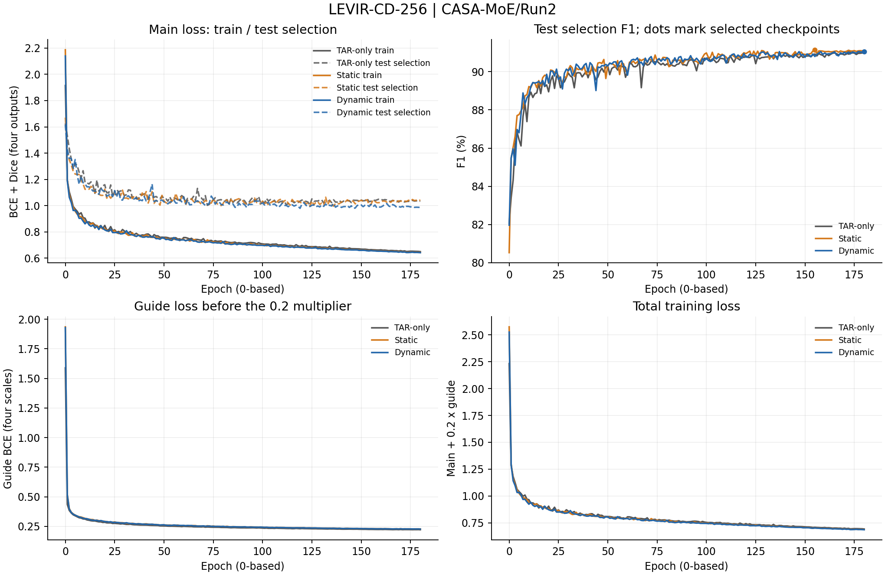
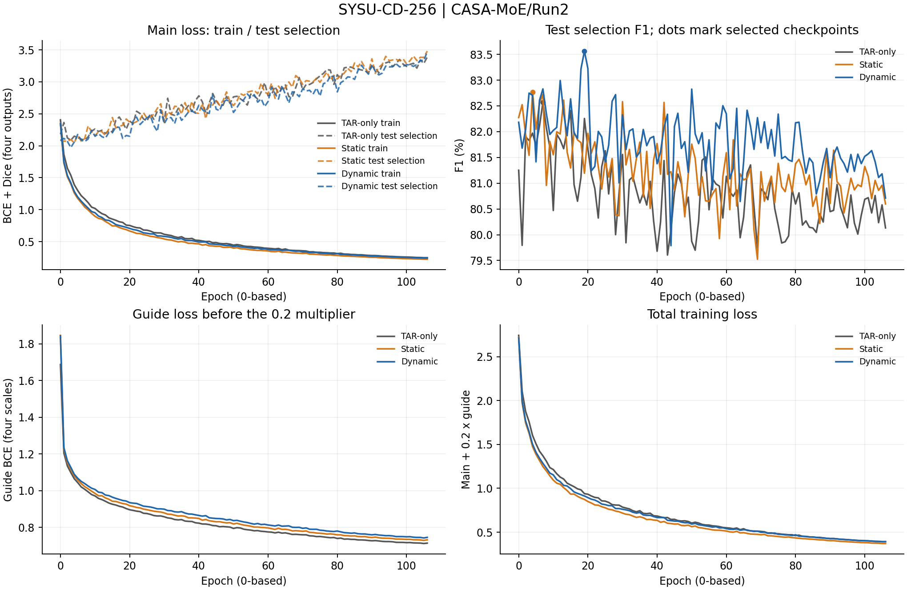

# CASA-MoE / Run2 完整结果

6/6项正式训练与测试完成，无失败；队列于2026-10-31 10:27:23 CST结束。按每epoch test F1选模并复测，不属于独立盲测。epoch为0起始。

冻结运行副本见runtime.json，实际源码归档在outputs/CASA-MoE/Run2/source_code.tar.gz；[冻结TXT](../../../temporary/models_and_metrics_CASA-MoE_Run2.txt)来自该归档。运行源码以冻结副本与归档为准。

| 数据集 | 变体 | best epoch | Recall (%) | Precision (%) | F1 (%) | IoU (%) | 实际记录 |
|---|---|---:|---:|---:|---:|---:|---|
| LEVIR | M_T_TAR | 172 | 90.5549 | 91.4990 | 91.0245 | 83.5275 | [日志](M_T_TAR/LEVIR-CD-256/train_log.txt) |
| LEVIR | M_S_STATIC | 155 | 90.5547 | 91.7547 | 91.1507 | 83.7404 | [日志](M_S_STATIC/LEVIR-CD-256/train_log.txt) |
| LEVIR | M_D_DYNAMIC | 180 | 90.0052 | 92.1499 | 91.0649 | 83.5956 | [日志](M_D_DYNAMIC/LEVIR-CD-256/train_log.txt) |
| SYSU | M_T_TAR | 7 | 79.9679 | 85.3375 | 82.5655 | 70.3077 | [日志](M_T_TAR/SYSU-CD-256/train_log.txt) |
| SYSU | M_S_STATIC | 4 | 82.2291 | 83.3090 | 82.7655 | 70.5983 | [日志](M_S_STATIC/SYSU-CD-256/train_log.txt) |
| SYSU | M_D_DYNAMIC | 19 | 80.5961 | 86.7580 | 83.5636 | 71.7676 | [日志](M_D_DYNAMIC/SYSU-CD-256/train_log.txt) |

完整日志、epochs.csv、模块诊断CSV/JSONL、配置与部署检查按实验保存；CSV的val_字段来自test逐epoch选模。probes为健康探针，不入正式指标。

## LEVIR-CD-256

## SYSU-CD-256

## 结果概况

动态融合相对TAR-only的F1在LEVIR提高0.0405pp、SYSU提高0.9981pp；静态融合分别提高0.1263pp、0.2001pp。收益目前集中于SYSU，LEVIR差异较小。单seed结果不作为稳定提升结论，WHU/CDD尚未开展。

[训练脚本](../../../../train_scripts/CASA-MoE/Run2/README.md)。
