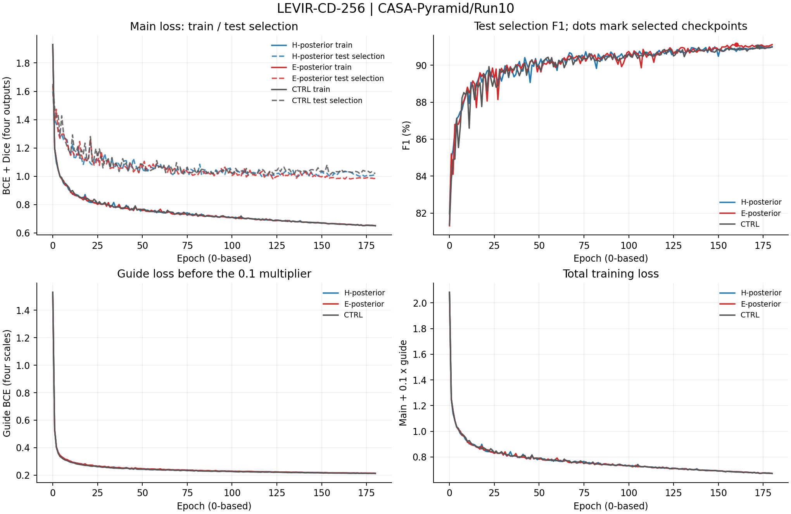
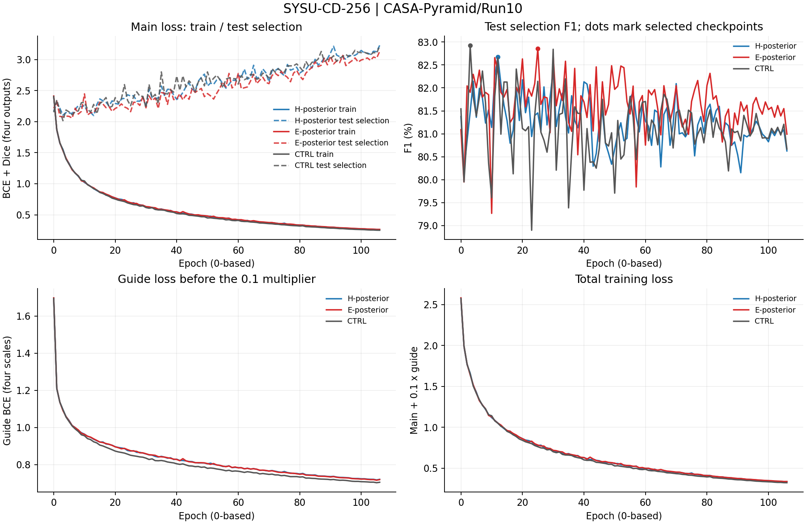
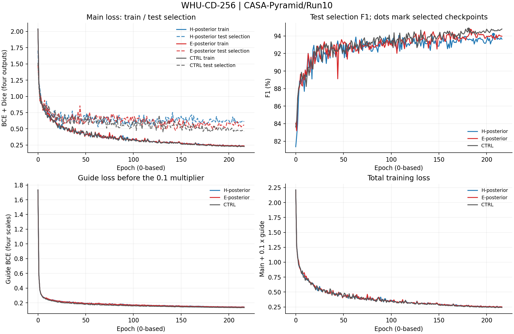
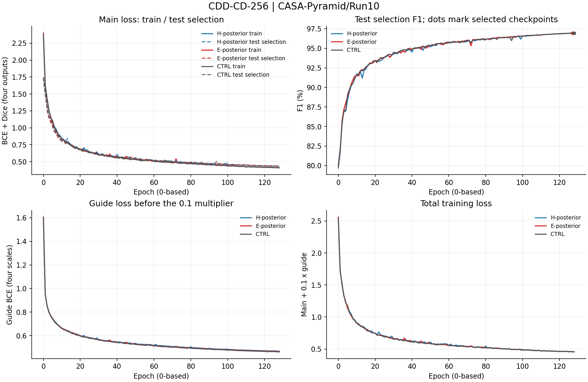

# CASA-Pyramid / Run10 完整训练记录

协议`casa_pyramid_40k_supervisedposterior_v10`，模型/训练源码基线`8e8e5599e546f7c8302eed2c27b79e621c9871aa`。本目录保存12项正式实验的实际日志、逐轮指标、模块诊断和最终测试，来源为`outputs/CASA-Pyramid/Run10`。本轮于2026-10-31 15:41:14 CST启动，2026-11-01 03:44:17 CST完成。

## 正式结果与最佳epoch

epoch沿用日志的0起始索引，例如177表示第178轮。每个epoch在test集评估并按最高F1选模，相同F1更新；最后用选中的checkpoint在同一test集复测。test参与checkpoint选择，最终数值不属于独立盲测。`summary.csv`提供选模split、独立测试标记、全部Recall/Precision/OA/F1/IoU/Kappa、参数与部署误差。

| 数据集 | 变体 | best_epoch (0起始) | 最佳test选模F1(%) | 最终test复测F1(%) | 实际记录 |
|---|---|---:|---:|---:|---|
| LEVIR | H_POSTERIOR | 174 | 91.011 | 91.011 | [日志](H_POSTERIOR/LEVIR-CD-256/train_log.txt) / [逐轮](H_POSTERIOR/LEVIR-CD-256/epochs.csv) / [结果](H_POSTERIOR/LEVIR-CD-256/result.json) |
| LEVIR | E_POSTERIOR | 160 | 91.115 | 91.116 | [日志](E_POSTERIOR/LEVIR-CD-256/train_log.txt) / [逐轮](E_POSTERIOR/LEVIR-CD-256/epochs.csv) / [结果](E_POSTERIOR/LEVIR-CD-256/result.json) |
| LEVIR | M0_CTRL | 172 | 91.006 | 91.006 | [日志](M0_CTRL/LEVIR-CD-256/train_log.txt) / [逐轮](M0_CTRL/LEVIR-CD-256/epochs.csv) / [结果](M0_CTRL/LEVIR-CD-256/result.json) |
| SYSU | H_POSTERIOR | 12 | 82.674 | 82.675 | [日志](H_POSTERIOR/SYSU-CD-256/train_log.txt) / [逐轮](H_POSTERIOR/SYSU-CD-256/epochs.csv) / [结果](H_POSTERIOR/SYSU-CD-256/result.json) |
| SYSU | E_POSTERIOR | 25 | 82.857 | 82.856 | [日志](E_POSTERIOR/SYSU-CD-256/train_log.txt) / [逐轮](E_POSTERIOR/SYSU-CD-256/epochs.csv) / [结果](E_POSTERIOR/SYSU-CD-256/result.json) |
| SYSU | M0_CTRL | 3 | 82.928 | 82.928 | [日志](M0_CTRL/SYSU-CD-256/train_log.txt) / [逐轮](M0_CTRL/SYSU-CD-256/epochs.csv) / [结果](M0_CTRL/SYSU-CD-256/result.json) |
| WHU | H_POSTERIOR | 207 | 94.185 | 94.185 | [日志](H_POSTERIOR/WHU-CD-256/train_log.txt) / [逐轮](H_POSTERIOR/WHU-CD-256/epochs.csv) / [结果](H_POSTERIOR/WHU-CD-256/result.json) |
| WHU | E_POSTERIOR | 183 | 94.647 | 94.647 | [日志](E_POSTERIOR/WHU-CD-256/train_log.txt) / [逐轮](E_POSTERIOR/WHU-CD-256/epochs.csv) / [结果](E_POSTERIOR/WHU-CD-256/result.json) |
| WHU | M0_CTRL | 181 | 94.804 | 94.804 | [日志](M0_CTRL/WHU-CD-256/train_log.txt) / [逐轮](M0_CTRL/WHU-CD-256/epochs.csv) / [结果](M0_CTRL/WHU-CD-256/result.json) |
| CDD | H_POSTERIOR | 128 | 96.934 | 96.934 | [日志](H_POSTERIOR/CDD-CD-256/train_log.txt) / [逐轮](H_POSTERIOR/CDD-CD-256/epochs.csv) / [结果](H_POSTERIOR/CDD-CD-256/result.json) |
| CDD | E_POSTERIOR | 127 | 96.949 | 96.948 | [日志](E_POSTERIOR/CDD-CD-256/train_log.txt) / [逐轮](E_POSTERIOR/CDD-CD-256/epochs.csv) / [结果](E_POSTERIOR/CDD-CD-256/result.json) |
| CDD | M0_CTRL | 128 | 96.946 | 96.946 | [日志](M0_CTRL/CDD-CD-256/train_log.txt) / [逐轮](M0_CTRL/CDD-CD-256/epochs.csv) / [结果](M0_CTRL/CDD-CD-256/result.json) |

## 文件与数值口径

- 每项的`train_log.txt`是完整原始日志，包括训练后期、test选模评估行、实际MODULE-DIAG及最终TEST RESULTS。
- `epochs.csv`保存每轮训练总损失、主损失、评分损失、学习率，以及test选模Loss/Recall/Precision/OA/F1/IoU/Kappa和耗时；指标沿用日志的0～1单位。逐轮评估从epoch0开始。
- CSV沿用`val_`列名前缀和`best_val_F1_pct`字段，数据来源由`summary.csv`及manifest的`selection_split`明确：本轮为`test`。字段前缀不表示独立验证集。
- `module_diagnostics.jsonl`按epoch保存四级完整诊断；`module_diagnostics.csv`按epoch/stage展开温度各头、gamma、归一化注意力熵、原型分配TV、预测变化概率、分支RMS、跨尺度注意力质量，以及双曲半径和裁剪比例。源日志未记录的量不补造。
- MODULE-DIAG来自当轮test选模的首个batch，不是整个评估集的统计。温度跨四尺度共享；`scale_mass_head0_source1`表示第0头分配给第1尺度KV的注意力质量。CTRL没有注意力模块，诊断JSONL为空。
- `result.json`保留完整精度的正式测试与实际最佳epoch；`run_manifest.json`、`evaluation_manifest.json`和`deploy_check.json`给出配置及折叠检查，`placement.json`记录物理GPU。`arch.json`记录结构配置。
- 根目录的`environment.json`、`source_manifest.json`、`pipeline_status.json`、`pipeline.log`及`scheduling.json`保存实际环境、源码基线和调度记录；`profile.json`与`inference_benchmark.json`记录显存和推理测量。
- `probes/`保存0项成功健康探针的完整日志、逐轮损失和任务梯度；探针不作为正式指标。

## 完整训练与test选模曲线

曲线逐epoch绘制，不平滑、不省略后期。主损失图比较相同定义的训练/test选模BCE+Dice；评分损失单独展示，总训练损失为main+0.1×guide。圆点为实际选中checkpoint的test选模F1；最终折叠模型的复测结果单独保存在result.json。

### LEVIR-CD-256

### SYSU-CD-256

### WHU-CD-256

### CDD-CD-256

## 关联材料

[运行说明](../../../../train_scripts/CASA-Pyramid/Run10/README.md)、[冻结源码与指标](../../../temporary/models_and_metrics_CASA-Pyramid_Run10.txt)。

## 正式结论与机制记录

双曲版同轮四库平均F1净增益−0.2199pp，匹配欧式−0.0291pp；本轮未形成全面改善。[详细结果分析](RESULT_ANALYSIS.md)给出边界、后期泛化、几何诊断与历史对照。结构公式见[模型说明](../../../../models/HYPERBOLIC_DESIGN.md)，短训见[配对记录](selection/centered/probe_comparison.md)。

H/E实际辅助目标为0.05 raw-guide BCE＋0.05 posterior BCE，日志train_guide为两者平均；CTRL为0.1 raw-guide BCE。retrieval记录为未加权诊断，训练系数为0。
