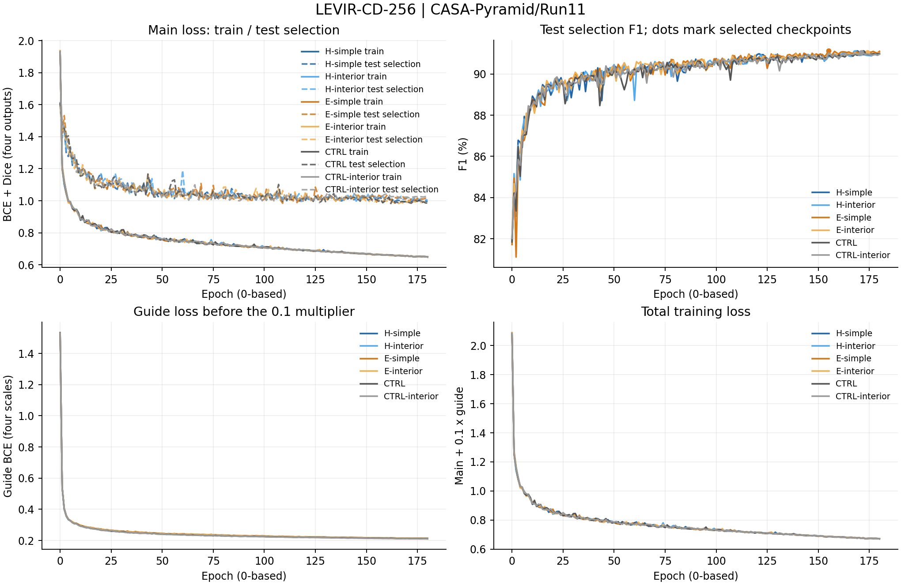
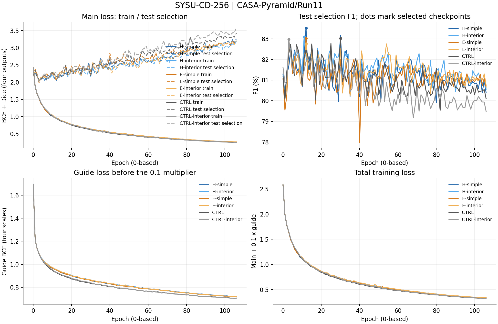
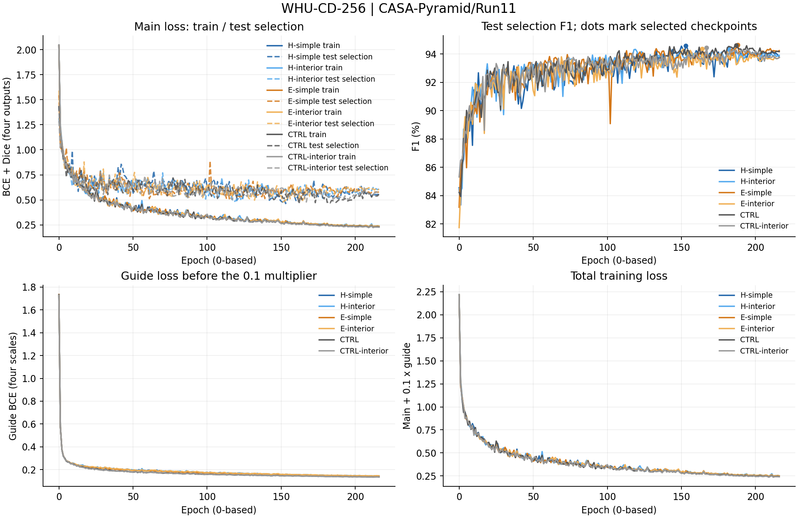
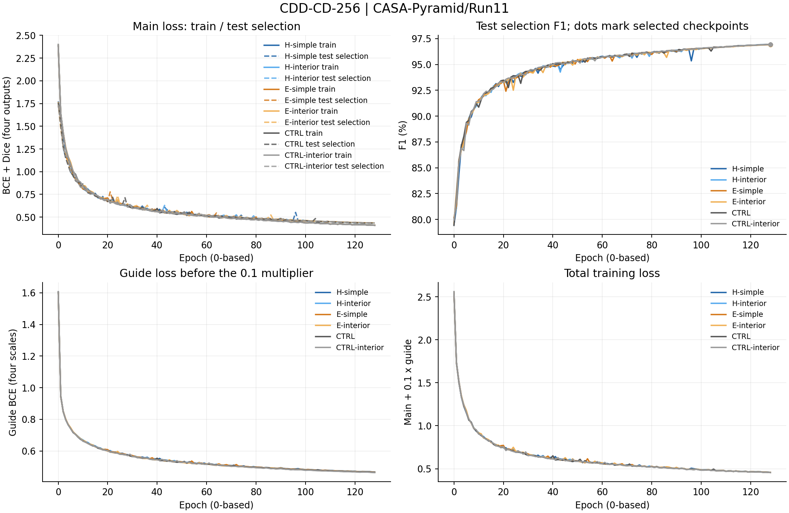

# CASA-Pyramid / Run11 完整训练记录

协议`casa_pyramid_40k_linearpool_interior_v11`，模型/训练源码基线`832d17d4c2d186b9e6d51755efbdc758384a0acd`。本目录保存24项正式实验的实际日志、逐轮指标、模块诊断和最终测试，来源为`outputs/CASA-Pyramid/Run11`。本轮于2026-11-06 10:23:43 CST启动，2026-11-10 10:36:14 CST完成。

## 训练接续

LEVIR 六组完成后暂停队列，2026-11-09 12:13:36 CST 恢复。SYSU 的 E_SIMPLE 和 E_INTERIOR 分别从 23,250 和 19,500 步接续，恢复优化器及随机状态。续训组 `result.json` 的 `elapsed_seconds` 仅计恢复后的会话，`optimizer_steps` 记录全程总步数。原始日志保留接续前后记录，逐轮 CSV 使用对应轮次最后记录的训练值。

[续训记录](user_resume.json) · [初期健康](initial_health.json) · [模型验证](validation_result.json) · [正式结果分析](RESULT_ANALYSIS.md)

## 正式结果与最佳epoch

epoch沿用日志的0起始索引，例如177表示第178轮。每个epoch在test集评估并按最高F1选模，相同F1更新；最后用选中的checkpoint在同一test集复测。test参与checkpoint选择，最终数值不属于独立盲测。`summary.csv`提供选模split、独立测试标记、全部Recall/Precision/OA/F1/IoU/Kappa、参数与部署误差。

| 数据集 | 变体 | best_epoch (0起始) | 最佳test选模F1(%) | 最终test复测F1(%) | 实际记录 |
|---|---|---:|---:|---:|---|
| LEVIR | H_SIMPLE | 169 | 91.039 | 91.039 | [日志](H_SIMPLE/LEVIR-CD-256/train_log.txt) / [逐轮](H_SIMPLE/LEVIR-CD-256/epochs.csv) / [结果](H_SIMPLE/LEVIR-CD-256/result.json) |
| LEVIR | H_INTERIOR | 168 | 91.041 | 91.041 | [日志](H_INTERIOR/LEVIR-CD-256/train_log.txt) / [逐轮](H_INTERIOR/LEVIR-CD-256/epochs.csv) / [结果](H_INTERIOR/LEVIR-CD-256/result.json) |
| LEVIR | E_SIMPLE | 155 | 91.136 | 91.136 | [日志](E_SIMPLE/LEVIR-CD-256/train_log.txt) / [逐轮](E_SIMPLE/LEVIR-CD-256/epochs.csv) / [结果](E_SIMPLE/LEVIR-CD-256/result.json) |
| LEVIR | E_INTERIOR | 174 | 91.038 | 91.038 | [日志](E_INTERIOR/LEVIR-CD-256/train_log.txt) / [逐轮](E_INTERIOR/LEVIR-CD-256/epochs.csv) / [结果](E_INTERIOR/LEVIR-CD-256/result.json) |
| LEVIR | M0_CTRL | 172 | 91.046 | 91.046 | [日志](M0_CTRL/LEVIR-CD-256/train_log.txt) / [逐轮](M0_CTRL/LEVIR-CD-256/epochs.csv) / [结果](M0_CTRL/LEVIR-CD-256/result.json) |
| LEVIR | CTRL_INTERIOR | 171 | 91.040 | 91.040 | [日志](CTRL_INTERIOR/LEVIR-CD-256/train_log.txt) / [逐轮](CTRL_INTERIOR/LEVIR-CD-256/epochs.csv) / [结果](CTRL_INTERIOR/LEVIR-CD-256/result.json) |
| SYSU | H_SIMPLE | 12 | 83.520 | 83.520 | [日志](H_SIMPLE/SYSU-CD-256/train_log.txt) / [逐轮](H_SIMPLE/SYSU-CD-256/epochs.csv) / [结果](H_SIMPLE/SYSU-CD-256/result.json) |
| SYSU | H_INTERIOR | 11 | 83.086 | 83.086 | [日志](H_INTERIOR/SYSU-CD-256/train_log.txt) / [逐轮](H_INTERIOR/SYSU-CD-256/epochs.csv) / [结果](H_INTERIOR/SYSU-CD-256/result.json) |
| SYSU | E_SIMPLE | 12 | 83.025 | 83.025 | [日志](E_SIMPLE/SYSU-CD-256/train_log.txt) / [逐轮](E_SIMPLE/SYSU-CD-256/epochs.csv) / [结果](E_SIMPLE/SYSU-CD-256/result.json) |
| SYSU | E_INTERIOR | 12 | 82.766 | 82.766 | [日志](E_INTERIOR/SYSU-CD-256/train_log.txt) / [逐轮](E_INTERIOR/SYSU-CD-256/epochs.csv) / [结果](E_INTERIOR/SYSU-CD-256/result.json) |
| SYSU | M0_CTRL | 30 | 83.023 | 83.023 | [日志](M0_CTRL/SYSU-CD-256/train_log.txt) / [逐轮](M0_CTRL/SYSU-CD-256/epochs.csv) / [结果](M0_CTRL/SYSU-CD-256/result.json) |
| SYSU | CTRL_INTERIOR | 3 | 82.969 | 82.969 | [日志](CTRL_INTERIOR/SYSU-CD-256/train_log.txt) / [逐轮](CTRL_INTERIOR/SYSU-CD-256/epochs.csv) / [结果](CTRL_INTERIOR/SYSU-CD-256/result.json) |
| WHU | H_SIMPLE | 153 | 94.592 | 94.592 | [日志](H_SIMPLE/WHU-CD-256/train_log.txt) / [逐轮](H_SIMPLE/WHU-CD-256/epochs.csv) / [结果](H_SIMPLE/WHU-CD-256/result.json) |
| WHU | H_INTERIOR | 182 | 94.329 | 94.329 | [日志](H_INTERIOR/WHU-CD-256/train_log.txt) / [逐轮](H_INTERIOR/WHU-CD-256/epochs.csv) / [结果](H_INTERIOR/WHU-CD-256/result.json) |
| WHU | E_SIMPLE | 188 | 94.640 | 94.640 | [日志](E_SIMPLE/WHU-CD-256/train_log.txt) / [逐轮](E_SIMPLE/WHU-CD-256/epochs.csv) / [结果](E_SIMPLE/WHU-CD-256/result.json) |
| WHU | E_INTERIOR | 164 | 94.367 | 94.366 | [日志](E_INTERIOR/WHU-CD-256/train_log.txt) / [逐轮](E_INTERIOR/WHU-CD-256/epochs.csv) / [结果](E_INTERIOR/WHU-CD-256/result.json) |
| WHU | M0_CTRL | 187 | 94.617 | 94.617 | [日志](M0_CTRL/WHU-CD-256/train_log.txt) / [逐轮](M0_CTRL/WHU-CD-256/epochs.csv) / [结果](M0_CTRL/WHU-CD-256/result.json) |
| WHU | CTRL_INTERIOR | 167 | 94.440 | 94.440 | [日志](CTRL_INTERIOR/WHU-CD-256/train_log.txt) / [逐轮](CTRL_INTERIOR/WHU-CD-256/epochs.csv) / [结果](CTRL_INTERIOR/WHU-CD-256/result.json) |
| CDD | H_SIMPLE | 128 | 96.931 | 96.931 | [日志](H_SIMPLE/CDD-CD-256/train_log.txt) / [逐轮](H_SIMPLE/CDD-CD-256/epochs.csv) / [结果](H_SIMPLE/CDD-CD-256/result.json) |
| CDD | H_INTERIOR | 128 | 96.944 | 96.944 | [日志](H_INTERIOR/CDD-CD-256/train_log.txt) / [逐轮](H_INTERIOR/CDD-CD-256/epochs.csv) / [结果](H_INTERIOR/CDD-CD-256/result.json) |
| CDD | E_SIMPLE | 128 | 96.930 | 96.930 | [日志](E_SIMPLE/CDD-CD-256/train_log.txt) / [逐轮](E_SIMPLE/CDD-CD-256/epochs.csv) / [结果](E_SIMPLE/CDD-CD-256/result.json) |
| CDD | E_INTERIOR | 128 | 96.910 | 96.910 | [日志](E_INTERIOR/CDD-CD-256/train_log.txt) / [逐轮](E_INTERIOR/CDD-CD-256/epochs.csv) / [结果](E_INTERIOR/CDD-CD-256/result.json) |
| CDD | M0_CTRL | 128 | 96.939 | 96.939 | [日志](M0_CTRL/CDD-CD-256/train_log.txt) / [逐轮](M0_CTRL/CDD-CD-256/epochs.csv) / [结果](M0_CTRL/CDD-CD-256/result.json) |
| CDD | CTRL_INTERIOR | 128 | 96.935 | 96.935 | [日志](CTRL_INTERIOR/CDD-CD-256/train_log.txt) / [逐轮](CTRL_INTERIOR/CDD-CD-256/epochs.csv) / [结果](CTRL_INTERIOR/CDD-CD-256/result.json) |

## 文件与数值口径

- 每项的`train_log.txt`是完整原始日志，包括训练后期、test选模评估行、实际MODULE-DIAG及最终TEST RESULTS。
- `epochs.csv`保存每轮训练总损失、主损失、评分损失、学习率，以及test选模Loss/Recall/Precision/OA/F1/IoU/Kappa和耗时；指标沿用日志的0～1单位。逐轮评估从epoch0开始。
- CSV沿用`val_`列名前缀和`best_val_F1_pct`字段，数据来源由`summary.csv`及manifest的`selection_split`明确：本轮为`test`。字段前缀不表示独立验证集。
- `module_diagnostics.jsonl`按epoch保存四级完整诊断；`module_diagnostics.csv`按epoch/stage展开温度各头、gamma、归一化注意力熵、原型分配TV、预测变化概率、分支RMS、跨尺度注意力质量，以及双曲半径和裁剪比例。源日志未记录的量不补造。
- MODULE-DIAG来自当轮test选模的首个batch，不是整个评估集的统计。温度跨四尺度共享；`scale_mass_head0_source1`表示第0头分配给第1尺度KV的注意力质量。CTRL没有注意力模块，诊断JSONL为空。
- `result.json`保留完整精度的正式测试与实际最佳epoch；`run_manifest.json`、`evaluation_manifest.json`和`deploy_check.json`给出配置及折叠检查，`placement.json`记录物理GPU。`arch.json`记录结构配置。
- 根目录的`environment.json`、`source_manifest.json`、`pipeline_status.json`、`pipeline.log`及`scheduling.json`保存实际环境、源码基线和调度记录；`profile.json`与`inference_benchmark.json`记录显存和推理测量。
- `probes/`保存8项成功健康探针的完整日志、逐轮损失和任务梯度；探针不作为正式指标。

## 完整训练与test选模曲线

曲线逐epoch绘制，不平滑、不省略后期。主损失图记录各组实际优化的训练BCE+Dice及test选模未加权BCE+Dice。评分损失单独展示，总训练损失为main+0.1×guide。圆点为实际选中checkpoint的test选模F1；最终折叠模型的复测结果单独保存在result.json。

### LEVIR-CD-256

### SYSU-CD-256

### WHU-CD-256

### CDD-CD-256

## 关联材料

[运行说明](../../../../train_scripts/CASA-Pyramid/Run11/README.md)、[冻结源码与指标](../../../temporary/models_and_metrics_CASA-Pyramid_Run11.txt)。
