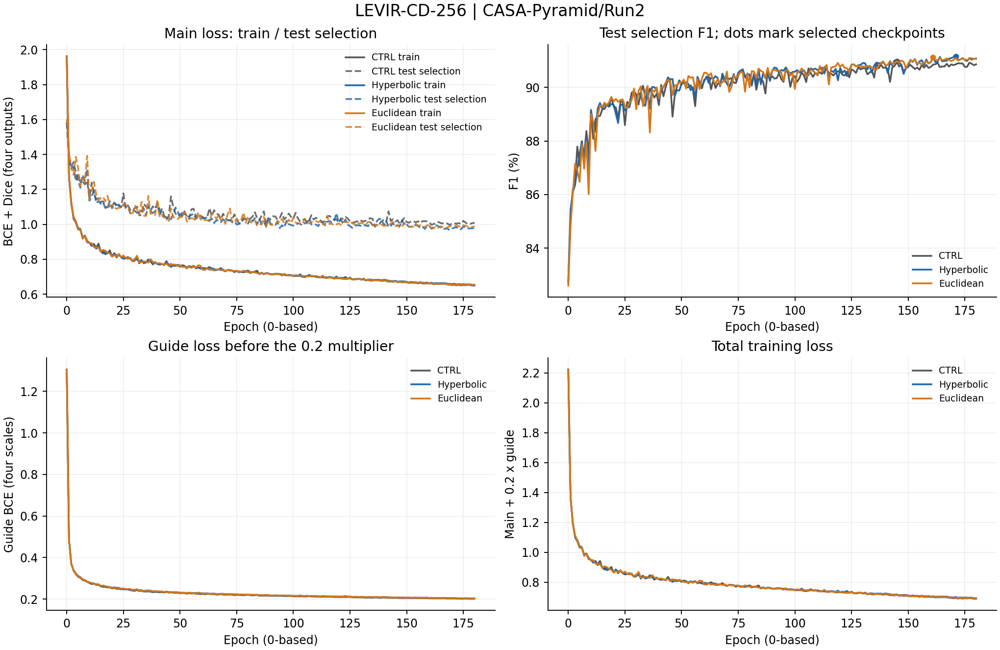
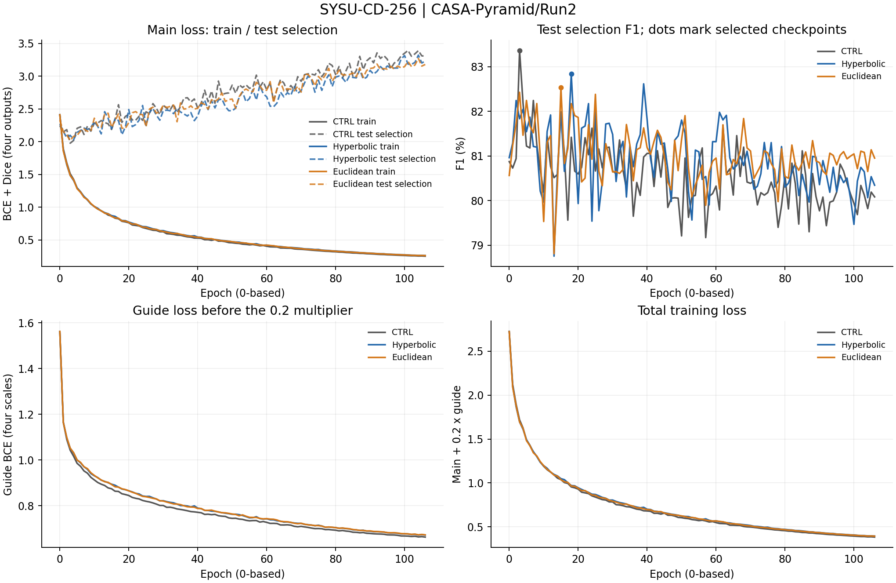
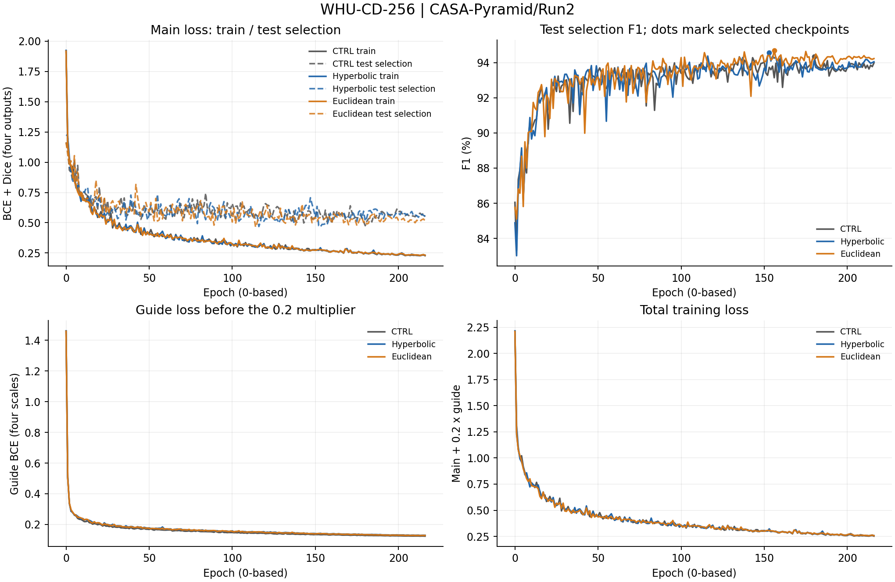
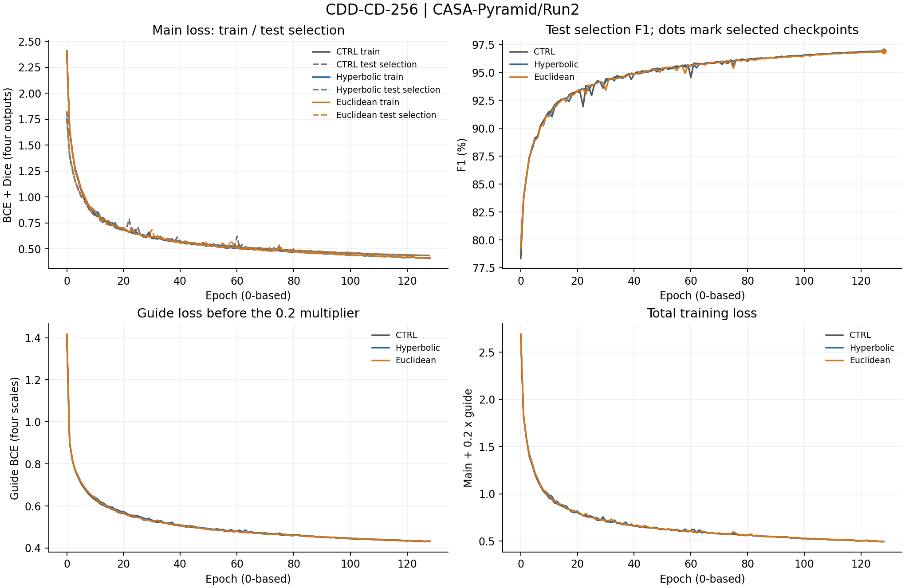

# CASA-Pyramid / Run2 完整训练记录

协议`casa_pyramid_40k_reliableqk_testselect_v2`，模型/训练源码基线`9f515ef`。本目录保存12项正式实验的实际日志、逐轮指标、模块诊断和最终测试，来源为`outputs/CASA-Pyramid/Run2`。本轮于2026-10-25 13:58:47 CST启动，2026-10-25 21:35:15 CST完成。

## 正式结果与最佳epoch

epoch沿用日志的0起始索引，例如177表示第178轮。每个epoch在test集评估并按最高F1选模，相同F1更新；最后用选中的checkpoint在同一test集复测。test参与checkpoint选择，最终数值不属于独立盲测。`summary.csv`提供选模split、独立测试标记、全部Recall/Precision/OA/F1/IoU/Kappa、参数与部署误差。

| 数据集 | 变体 | best_epoch (0起始) | 最佳test选模F1(%) | 最终test复测F1(%) | 实际记录 |
|---|---|---:|---:|---:|---|
| LEVIR | M0_CTRL | 145 | 90.978 | 90.978 | [日志](M0_CTRL/LEVIR-CD-256/train_log.txt) / [逐轮](M0_CTRL/LEVIR-CD-256/epochs.csv) / [结果](M0_CTRL/LEVIR-CD-256/result.json) |
| LEVIR | M1_HYPER_QKV | 171 | 91.163 | 91.163 | [日志](M1_HYPER_QKV/LEVIR-CD-256/train_log.txt) / [逐轮](M1_HYPER_QKV/LEVIR-CD-256/epochs.csv) / [结果](M1_HYPER_QKV/LEVIR-CD-256/result.json) |
| LEVIR | M2_CA_QKV | 161 | 91.126 | 91.126 | [日志](M2_CA_QKV/LEVIR-CD-256/train_log.txt) / [逐轮](M2_CA_QKV/LEVIR-CD-256/epochs.csv) / [结果](M2_CA_QKV/LEVIR-CD-256/result.json) |
| SYSU | M0_CTRL | 3 | 83.367 | 83.367 | [日志](M0_CTRL/SYSU-CD-256/train_log.txt) / [逐轮](M0_CTRL/SYSU-CD-256/epochs.csv) / [结果](M0_CTRL/SYSU-CD-256/result.json) |
| SYSU | M1_HYPER_QKV | 18 | 82.838 | 82.838 | [日志](M1_HYPER_QKV/SYSU-CD-256/train_log.txt) / [逐轮](M1_HYPER_QKV/SYSU-CD-256/epochs.csv) / [结果](M1_HYPER_QKV/SYSU-CD-256/result.json) |
| SYSU | M2_CA_QKV | 15 | 82.535 | 82.535 | [日志](M2_CA_QKV/SYSU-CD-256/train_log.txt) / [逐轮](M2_CA_QKV/SYSU-CD-256/epochs.csv) / [结果](M2_CA_QKV/SYSU-CD-256/result.json) |
| WHU | M0_CTRL | 180 | 94.352 | 94.353 | [日志](M0_CTRL/WHU-CD-256/train_log.txt) / [逐轮](M0_CTRL/WHU-CD-256/epochs.csv) / [结果](M0_CTRL/WHU-CD-256/result.json) |
| WHU | M1_HYPER_QKV | 153 | 94.565 | 94.565 | [日志](M1_HYPER_QKV/WHU-CD-256/train_log.txt) / [逐轮](M1_HYPER_QKV/WHU-CD-256/epochs.csv) / [结果](M1_HYPER_QKV/WHU-CD-256/result.json) |
| WHU | M2_CA_QKV | 156 | 94.698 | 94.698 | [日志](M2_CA_QKV/WHU-CD-256/train_log.txt) / [逐轮](M2_CA_QKV/WHU-CD-256/epochs.csv) / [结果](M2_CA_QKV/WHU-CD-256/result.json) |
| CDD | M0_CTRL | 128 | 96.909 | 96.909 | [日志](M0_CTRL/CDD-CD-256/train_log.txt) / [逐轮](M0_CTRL/CDD-CD-256/epochs.csv) / [结果](M0_CTRL/CDD-CD-256/result.json) |
| CDD | M1_HYPER_QKV | 128 | 96.930 | 96.930 | [日志](M1_HYPER_QKV/CDD-CD-256/train_log.txt) / [逐轮](M1_HYPER_QKV/CDD-CD-256/epochs.csv) / [结果](M1_HYPER_QKV/CDD-CD-256/result.json) |
| CDD | M2_CA_QKV | 128 | 96.865 | 96.865 | [日志](M2_CA_QKV/CDD-CD-256/train_log.txt) / [逐轮](M2_CA_QKV/CDD-CD-256/epochs.csv) / [结果](M2_CA_QKV/CDD-CD-256/result.json) |

## 文件与数值口径

- 每项的`train_log.txt`是完整原始日志，包括训练后期、test选模评估行、实际MODULE-DIAG及最终TEST RESULTS。
- `epochs.csv`保存每轮训练总损失、主损失、评分损失、学习率，以及test选模Loss/Recall/Precision/OA/F1/IoU/Kappa和耗时；指标沿用日志的0～1单位。逐轮评估从epoch0开始。
- CSV沿用`val_`列名前缀和`best_val_F1_pct`字段，数据来源由`summary.csv`及manifest的`selection_split`明确：本轮为`test`。字段前缀不表示独立验证集。
- `module_diagnostics.jsonl`按epoch保存四级完整诊断；`module_diagnostics.csv`按epoch/stage展开温度各头、gamma、归一化注意力熵、原型分配TV、预测变化概率、分支RMS、跨尺度注意力质量，以及双曲半径和裁剪比例。源日志未记录的量不补造。
- MODULE-DIAG来自当轮test选模的首个batch，不是整个评估集的统计。温度跨四尺度共享；`scale_mass_head0_source1`表示第0头分配给第1尺度KV的注意力质量。CTRL没有注意力模块，诊断JSONL为空。
- `result.json`保留完整精度的正式测试与实际最佳epoch；`run_manifest.json`、`evaluation_manifest.json`和`deploy_check.json`给出配置及折叠检查，`placement.json`记录物理GPU。`arch.json`记录结构配置。
- 根目录的`environment.json`、`source_baseline.json`、`pipeline_status.json`、`pipeline.log`及`scheduling.json`保存实际环境、源码基线和调度记录；`profile.json`与`inference.json`记录显存和推理测量。
- `probes/`保存四项成功健康探针的完整日志、逐轮损失和任务梯度；探针不作为正式指标。

## 完整训练与test选模曲线

曲线逐epoch绘制，不平滑、不省略后期。主损失图比较相同定义的训练/test选模BCE+Dice；评分损失单独展示，总训练损失为main+0.2×guide。圆点为实际选中checkpoint的test选模F1；最终折叠模型的复测结果单独保存在result.json。

### LEVIR-CD-256

### SYSU-CD-256

### WHU-CD-256

### CDD-CD-256

## 关联材料

[运行说明](../../../../train_scripts/CASA-Pyramid/Run2/README.md)、[冻结源码与指标](../../../temporary/models_and_metrics_CASA-Pyramid_Run2.txt)。
