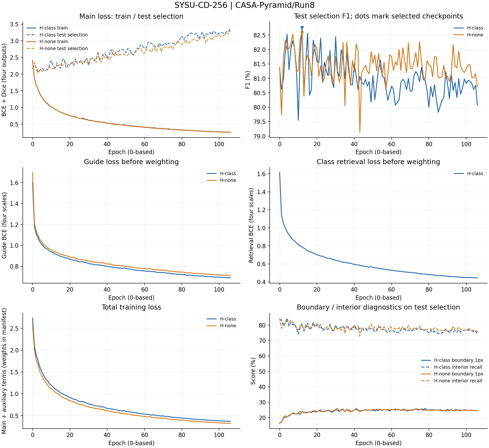
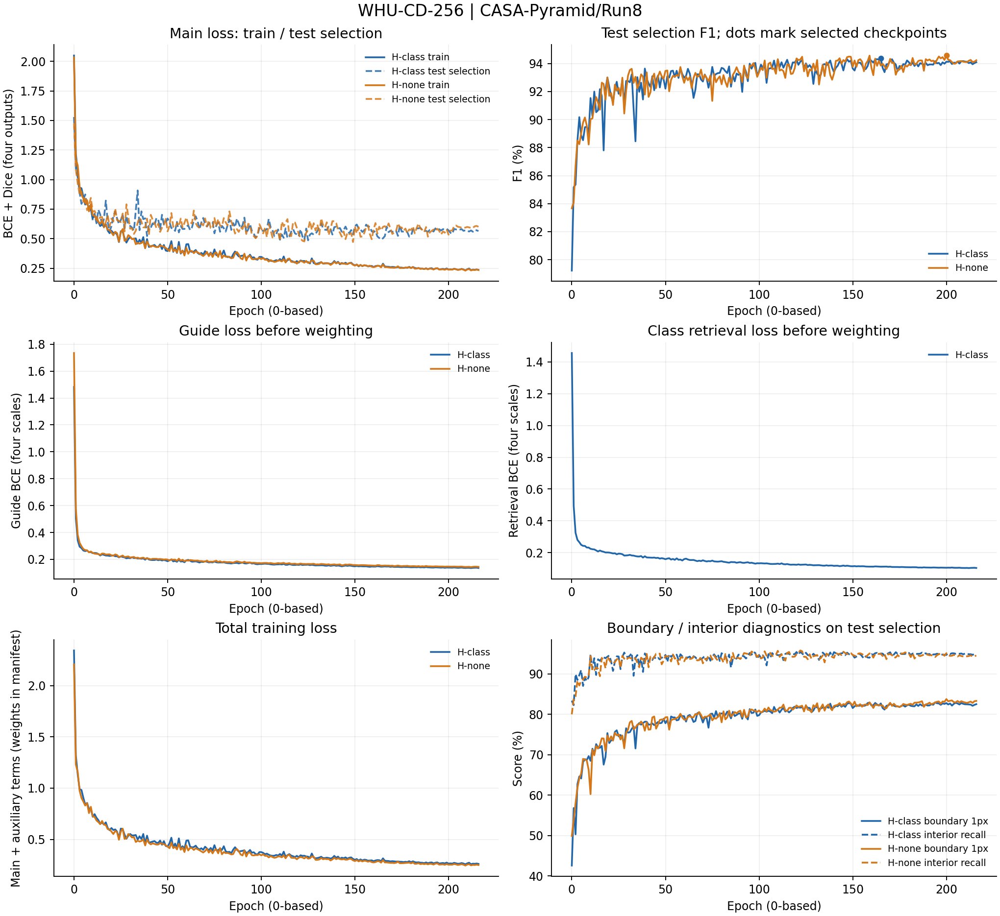

# CASA-Pyramid / Run8 完整训练记录

协议`casa_pyramid_40k_attribution_v8`，模型/训练源码基线`dea8421965a9d97d66b71c5a24475797cf7effba`。本目录保存4项正式实验的实际日志、逐轮指标、模块诊断和最终测试，来源为`outputs/CASA-Pyramid/Run8`。本轮于2026-10-30 19:06:54 CST启动，2026-10-31 01:03:56 CST完成。

## 正式结果与最佳epoch

epoch沿用日志的0起始索引，例如177表示第178轮。每个epoch在test集评估并按最高F1选模，相同F1更新；最后用选中的checkpoint在同一test集复测。test参与checkpoint选择，最终数值不属于独立盲测。`summary.csv`提供选模split、独立测试标记、全部Recall/Precision/OA/F1/IoU/Kappa、参数与部署误差。

| 数据集 | 变体 | best_epoch (0起始) | 最佳test选模F1(%) | 最终test复测F1(%) | 实际记录 |
|---|---|---:|---:|---:|---|
| SYSU | H_CLASS | 12 | 82.774 | 82.774 | [日志](H_CLASS/SYSU-CD-256/train_log.txt) / [逐轮](H_CLASS/SYSU-CD-256/epochs.csv) / [结果](H_CLASS/SYSU-CD-256/result.json) |
| SYSU | H_NONE | 12 | 82.615 | 82.615 | [日志](H_NONE/SYSU-CD-256/train_log.txt) / [逐轮](H_NONE/SYSU-CD-256/epochs.csv) / [结果](H_NONE/SYSU-CD-256/result.json) |
| WHU | H_CLASS | 165 | 94.362 | 94.362 | [日志](H_CLASS/WHU-CD-256/train_log.txt) / [逐轮](H_CLASS/WHU-CD-256/epochs.csv) / [结果](H_CLASS/WHU-CD-256/result.json) |
| WHU | H_NONE | 200 | 94.569 | 94.569 | [日志](H_NONE/WHU-CD-256/train_log.txt) / [逐轮](H_NONE/WHU-CD-256/epochs.csv) / [结果](H_NONE/WHU-CD-256/result.json) |

## 文件与数值口径

- 每项的`train_log.txt`是完整原始日志，包括训练后期、test选模评估行、实际MODULE-DIAG及最终TEST RESULTS。
- `epochs.csv`保存每轮训练总损失、主损失、评分损失、学习率，以及test选模Loss/Recall/Precision/OA/F1/IoU/Kappa和耗时；指标沿用日志的0～1单位。逐轮评估从epoch0开始。
- `train_auxiliary`为按辅助系数归一化的加权BCE：H_CLASS为两项平均，H_NONE仅为guide；`train_guide`与`train_retrieval`为各自原始BCE。H_NONE记录的retrieval仅作诊断、不进入总损失；CTRL无该项。
- CSV沿用`val_`列名前缀和`best_val_F1_pct`字段，数据来源由`summary.csv`及manifest的`selection_split`明确：本轮为`test`。字段前缀不表示独立验证集。
- `module_diagnostics.jsonl`按epoch保存四级完整诊断；`module_diagnostics.csv`按epoch/stage展开温度各头、gamma、归一化注意力熵、原型分配TV、预测变化概率、分支RMS、跨尺度注意力质量，以及双曲半径和裁剪比例。源日志未记录的量不补造。
- MODULE-DIAG来自当轮test选模的首个batch，不是整个评估集的统计。温度跨四尺度共享；`scale_mass_head0_source1`表示第0头分配给第1尺度KV的注意力质量。CTRL没有注意力模块，诊断JSONL为空。
- `result.json`保留完整精度的正式测试与实际最佳epoch；`run_manifest.json`、`evaluation_manifest.json`和`deploy_check.json`给出配置及折叠检查，`placement.json`记录物理GPU。`arch.json`记录结构配置。
- 根目录的`environment.json`、`source_manifest.json`、`pipeline_status.json`、`pipeline.log`及`scheduling.json`保存实际环境、源码基线和调度记录；`profile.json`与`inference_benchmark.json`记录显存和推理测量。
- `probes/`保存4项成功健康探针的完整日志、逐轮损失和任务梯度；探针不作为正式指标。

## 完整训练与test选模曲线

曲线逐epoch绘制，不平滑、不省略后期。主损失图比较相同定义的训练/test选模BCE+Dice；guide与类别检索BCE分别展示未乘权重值，权重由各项manifest的auxiliary_weights给出，总训练损失为H-class: main+0.1×guide+0.1×retrieval；H-none: main+0.1×guide+0×retrieval。圆点为实际选中checkpoint的test选模F1；最终折叠模型的复测结果单独保存在result.json。

### SYSU-CD-256

### WHU-CD-256

## 关联材料

[运行说明](../../../../train_scripts/CASA-Pyramid/Run8/README.md)、[冻结源码与指标](../../../temporary/models_and_metrics_CASA-Pyramid_Run8.txt)。

[本轮归因分析](analysis.md) · [训练前冻结诊断](pretraining_analysis.md)。
