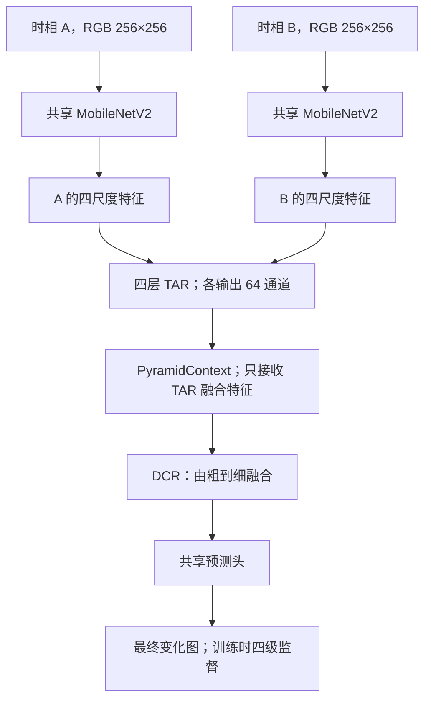
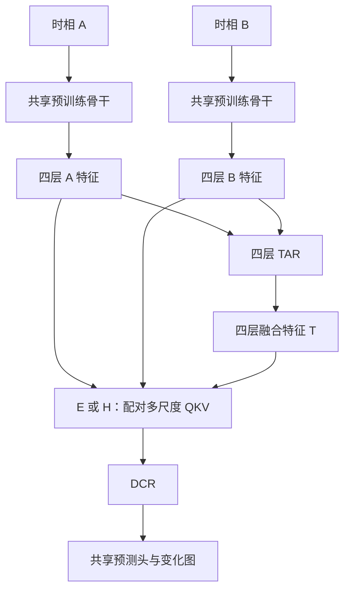
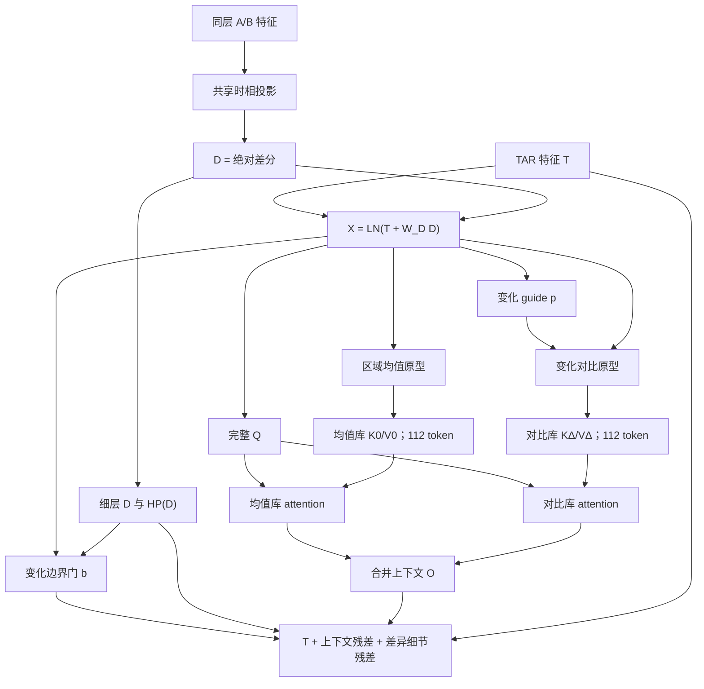
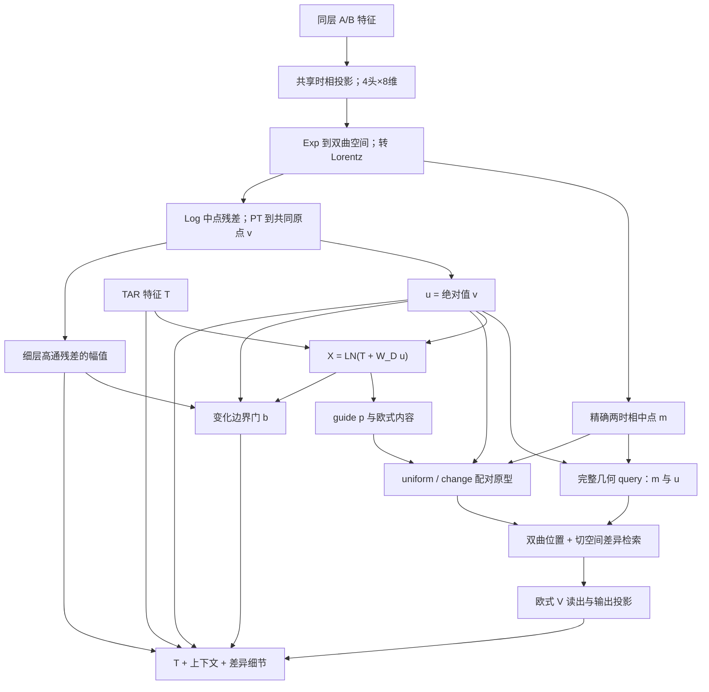

# CASA-CD：Run2 完整分析与双曲／普通 QKV 重设计

**核查日期：2026-10-26（北京时间）**  
**仓库版本：`922a3040ac827151c5779e5161e100021d29c1cb`**  
**Run2 实际训练源码基线：`9f515ef`**  
**适用任务：预训练轻量骨干、RGB 双时相、全监督像素级二值变化检测。**

---

## 结论与最终建议

**Run2 的问题不是两个 QKV 没有工作，而是当前检索机制提供的有效信息不足，且 SYSU 上还存在三组共同的明显泛化退化。** 下一版应同时处理“训练后期漏检增加”和“模块没有充分表达双时相关系”这两件事。

本轮四库平均 F1：CTRL **91.4016%**、双曲 **91.3740%**、普通 **91.3062%**。双曲／普通相对 CTRL 在 SYSU 分别下降 **0.5289／0.8315 个百分点**；在 LEVIR、WHU 仅有小幅提升，CDD 基本持平。与此同时，单样本推理中位延迟由 CTRL 的 **3.681 ms** 增至 **6.418／5.469 ms**。当前准确率收益不足以支撑这部分成本。[C5][C9]

但 SYSU 有一个必须正确解释的细节：**CTRL 的最高分出现在 epoch 3；两个模块虽然没有超过这个最高点，后期平均表现却优于 CTRL。** 因而不能继续把问题解释成“QKV 失活”“双曲全部贴边”或“QKV 加重了后期过拟合”。日志不支持这些结论。

本报告确定以下两条独立设计，不再要求两版共用同一种 KV 压缩：

| 版本 | 核心机制 | 为什么这样改 |
|---|---|---|
| **普通 E：区域均值—变化对比双库 QKV** | 输入原始 A/B 同层特征与 TAR 特征；完整 Q；区域均值与变化对比分成两个 KV 库，分别检索；细层保留未压缩差异与变化边界细节 | 同时照顾大片区域内部、小目标与变化／背景区分，减少所有类别原型在同一个 softmax 中相互挤占 |
| **双曲 H：双时相中点—差异联合 QKV** | A/B 映射到双曲空间，构造精确两点 Fréchet 中点和对数残差；统一切空间后表达差异；联合检索共同参考与变化幅度；细层提取差异场的空间细节 | 让双曲几何真正参与双时相关系表示，不再仅对融合后的特征替换距离函数 |

两版均保持：

- 共享预训练 MobileNetV2、四层 TAR、DCR 和现有单输出部署接口。
- **完整 Q、压缩 KV**；四尺度总计 5,440 个 query 位置、224 个上下文 token。
- 模块仍位于 TAR 之后、DCR 之前，但额外接收编码器 A/B 特征。
- 细尺度直接保留差异信息；边界门只调制细节增强，区域主路径始终存在。
- 按下文固定规格估算，普通版部署约 **1.975M**、双曲版约 **1.962M** 参数。参数量是设计计算值，新增模型尚未实现和训练，延迟也尚未测量。

**对你提出的 Fréchet 均值／对数差值：方向是对的。** 准确对应“内蕴均值—对数残差分解”和“流形值数据的多分辨率表示”。但双时相的共同参考／差异，与空间的低频／高频不是同一件事。推荐先做前者，再在统一切空间中的差异场上做轻量空间分解；不必在所有像素上迭代求多点 Fréchet 均值。

---

## 1. 核查范围与结果口径

### 1.1 本次实际核对了什么

本次重新读取了最新 README、AGENTS、`docs/ChatGPT_Project_Settings.md`、当前模型代码、训练／数据／部署代码、模型来源说明，以及 Run2 的全部公开记录。相关下载材料共 186 个文件，包括：

- `models/` 的全部 17 个 Python 文件及配套说明。
- Run2 十二项正式训练的完整 `train_log.txt`、`result.json`、manifest、epoch 表、模块诊断、部署检查。
- 调度状态、四项健康短训、训练与推理效率记录。
- Run2 冻结源码快照及对应训练脚本。
- 与本次设计直接相关的项目论文、官方论文页面、作者代码和数据集样例。

从完整日志重新解析了 **1,902 个训练／选模 epoch**、**5,072 条模块 stage 诊断**。原始日志与导出 CSV／JSONL 一致；十二项各有一个完整正式 TEST 区块；最终结果文件在日志保留精度内与 TEST 区块一致。各 `best_epoch` 均对应该次运行记录中的最高选模 F1。[C1][C4][C5]

当前 17 个模型 Python 文件与 Run2 冻结源码提取结果在规范化文件边界空白后逐文件一致，因此本报告可以用当前模型实现解释 Run2。这里的“完整查看”指**当前实现及 Run2 全部公开训练证据**，不把历史参考仓库中的每个文件都声称为本轮逐字阅读对象。[C2][C3]

### 1.2 一个统一的评价说明

Run2 按项目当前指定协议，**每个 epoch 在 test 上评价并按最高 F1 选权重，再在同一 test 上复测**。所以：

- 正式结果是 **test 参与选模后的结果**，不是独立盲测。
- 本轮 `epochs.csv` 的 `val_*` 列实际上记录 test 选模数据。
- 模块诊断来自**每轮第一个 test batch**，不能当作全测试集的条件统计。
- Run1 使用 val 选模，且结构、损失接口、数据处理、warmup 等也有变化；跨轮差值不能直接当成某一个模块的收益。

下文正式指标使用最后完整 TEST 区块核对后的结果文件精度；训练曲线使用日志中逐轮记录的精度。两者因部署复测与浮点设置可能有末位差别，不能据此判为结果错误。[C1][C4]

本报告只基于已公开源码、日志、资料与样例分析；没有读取服务器训练权重或重新训练模型。现有资料没有 Run2 的逐图预测误差图、边界指标或按目标大小分组的指标，因此这些部分给出的是**有机制依据的诊断与设计**，不冒充已经证实的空间错误分布。

---

## 2. 当前模型到底在做什么

### 2.1 当前整体框图



在 256×256 输入下：

| 尺度 | 原始 A/B 通道数 | 分辨率 | TAR 输出 | Q 数量 | 网格 | 当前 KV 数量 |
|---|---:|---:|---:|---:|---:|---:|
| S1 | 24 | 64×64 | 64 通道 | 4,096 | 8×8 | 128 |
| S2 | 32 | 32×32 | 64 通道 | 1,024 | 4×4 | 32 |
| S3 | 96 | 16×16 | 64 通道 | 256 | 4×4 | 32 |
| S4 | 320 | 8×8 | 64 通道 | 64 | 4×4 | 32 |
| 合计 | — | — | — | **5,440** | 112 个区域 | **224** |

四个 attention head 是每个 query 的四组特征子空间；四个尺度是四种空间分辨率。**多头和多尺度是两个不同维度**，当前实现已经同时使用二者。[C2][C6]

骨干还输出 16 通道、128×128 的浅层特征，但当前 `encoder(...)[1:]` 丢弃了这一层。最终最细预测特征从 64×64 上采样到 256×256。这限制了可用于精细定位的最高原生分辨率，但不能仅凭这一点认定全部 SYSU 漏检都是边界问题。[C2]

### 2.2 当前普通与双曲模块的共同部分

对 TAR 特征 $T_i$ 做通道 LayerNorm，再用共享 guide 得到变化概率：

$$
X_i=\operatorname{LN}(T_i),\qquad p_i=\sigma(g(X_i)).
$$

每个区域分别用 $p$ 和 $1-p$ 加权形成变化／背景原型：

$$
w_j^{+}=\frac{p_j}{\sum_kp_k},\qquad
w_j^{-}=\frac{1-p_j}{\sum_k(1-p_k)}.
$$

代码中对 membership 有 $10^{-6}$ 下限。每个区域两个原型，四尺度合计 224 个。V 是池化后再做欧式线性投影；原型分配保持梯度。

两版都使用：

$$
\ell_{qk}
=
-\frac{\operatorname{distance}(q,k)}{\tau}
+b_{h,i,s(k)}
-\log M_{s(k)}
+\log r_k,
$$

$$
r=\frac{\sum_jm_j^2}{\sum_jm_j},\quad m=p\ \text{或}\ 1-p.
$$

其中 $b$ 是来源尺度偏置，$-\log M_s$ 校正各尺度 token 数量不同带来的先验差异。读出后通过每尺度零初始化的 $\gamma_i$ 加回 TAR：

$$
T_i'=T_i+\gamma_iW_O\bigl(\operatorname{softmax}(\ell)V\bigr).
$$

CTRL 也保留 guide 和辅助监督，只不做上下文检索。[C6]

### 2.3 两版真正的区别

| 项目 | 当前普通 E | 当前双曲 H |
|---|---|---|
| Q | 完整空间位置的线性投影 | 完整投影后 Exp 到 Poincaré 球 |
| K | 池化特征后投影 | 对同一批完整双曲 Q 做 Lorentz 质心压缩 |
| Q/K 投影 | 共享同一 `qk` | 共享同一 `qk` |
| 相似度 | 负欧氏距离 | 负双曲距离的一半 |
| V | 欧式 | 欧式 |
| 时相关系来源 | TAR 隐式融合 | TAR 隐式融合 |
| 显式 A/B 几何比较 | 无 | **无** |

当前双曲版不是“对 A/B 两个时相计算测地差异”。它是在**已经融合的变化表征上**建立双曲检索关系。TAR 可以隐式编码变化，但此时模块拿不到对应的 A/B 点，无法直接定义它们的测地中点、双时相对数残差或共同参考下的差异场。[C2][C6][C7]

这正是本轮最值得改变的输入接口。

---

## 3. Run2 全部指标与训练轨迹

### 3.1 十二项正式结果

单位均为 **%**；epoch 从 0 开始。来源为全部正式 TEST 区块与结果文件交叉核对。[C4][C5]

| 数据集 | 模型 | 最佳 epoch | Recall | Precision | OA | F1 | IoU | Kappa |
|---|---|---:|---:|---:|---:|---:|---:|---:|
| LEVIR | CTRL | 145 | 89.7372 | 92.2534 | 99.0933 | 90.9779 | 83.4490 | 90.5007 |
| LEVIR | 双曲 H | 171 | 90.3832 | 91.9565 | 99.1074 | 91.1631 | 83.7612 | 90.6931 |
| LEVIR | 普通 E | 161 | 90.2869 | 91.9807 | 99.1042 | 91.1259 | 83.6985 | 90.6543 |
| SYSU | CTRL | 3 | 81.5956 | 85.2163 | 92.3215 | 83.3667 | 71.4776 | 78.3784 |
| SYSU | 双曲 H | 18 | 79.5314 | 86.4309 | 92.2284 | 82.8377 | 70.7035 | 77.8259 |
| SYSU | 普通 E | 15 | 80.3387 | 84.8552 | 91.9818 | 82.5352 | 70.2638 | 77.3367 |
| WHU | CTRL | 180 | 92.6450 | 96.1245 | 99.5600 | 94.3527 | 89.3092 | 94.1239 |
| WHU | 双曲 H | 153 | 92.6905 | 96.5165 | 99.5773 | 94.5648 | 89.6900 | 94.3450 |
| WHU | 普通 E | 156 | 93.1103 | 96.3411 | 99.5863 | 94.6981 | 89.9302 | 94.4830 |
| CDD | CTRL | 128 | 96.8669 | 96.9512 | 99.2373 | 96.9090 | 94.0034 | 96.4740 |
| CDD | 双曲 H | 128 | 96.8295 | 97.0313 | 99.2430 | 96.9303 | 94.0434 | 96.4985 |
| CDD | 普通 E | 128 | 96.8377 | 96.8930 | 99.2264 | 96.8654 | 93.9213 | 96.4241 |

相对同轮 CTRL，差值单位为**百分点**：

| 数据集 | H ΔF1 | E ΔF1 | H ΔRecall / ΔPrecision | E ΔRecall / ΔPrecision |
|---|---:|---:|---:|---:|
| LEVIR | +0.1852 | +0.1480 | +0.6461 / −0.2969 | +0.5497 / −0.2727 |
| SYSU | **−0.5289** | **−0.8315** | **−2.0642 / +1.2146** | **−1.2569 / −0.3611** |
| WHU | +0.2121 | +0.3454 | +0.0455 / +0.3920 | +0.4652 / +0.2165 |
| CDD | +0.0213 | −0.0437 | −0.0374 / +0.0801 | −0.0292 / −0.0582 |

四库等权 Macro F1 的双曲／普通增益分别是 **−0.0276／−0.0954 个百分点**。这里是四个数据集 F1 的平均，不是把所有测试像素合并后的总体 F1。

指标应这样一起看：

- **Recall** 指向真实变化被漏掉多少；**Precision** 指向预测变化中有多少误报。
- **OA** 也受大量未变化像素影响，不能用接近 99% 的 OA 代替变化类检测能力。
- 同一个二值正类混淆矩阵下，$F1=2IoU/(1+IoU)$；F1 和 IoU 是关联指标，不是两份独立的机制证据。
- **Kappa** 对预测与真实边际分布作机会一致性校正。SYSU 的 Kappa 同样下降，说明问题并非只在某一种指标上显现。

### 3.2 SYSU：共同的后期泛化下降，主要表现为漏检增加

逐轮日志给出的 best→last 变化如下。这里的 best 是训练时选模点，末轮为 epoch 106；与上表部署后复测可能有微小尾数差异。[C10][C11][C12]

| 模型 | best F1 → last F1 | 最后 20 轮平均 F1 | 主训练损失 best→last | 选模集主损失 best→last |
|---|---:|---:|---:|---:|
| CTRL | 83.3667 → 80.0819 | 80.0808 | 1.509546 → 0.251542 | 1.975378 → 3.304289 |
| H | 82.8377 → 80.3435 | 80.4328 | 0.795820 → 0.261404 | 2.106030 → 3.229672 |
| E | 82.5353 → 80.9519 | 80.9338 | 0.857903 → 0.260159 | 2.219965 → 3.177576 |

| 模型 | Recall best→last | Precision best→last |
|---|---:|---:|
| CTRL | 81.5951 → 73.3623 | 85.2169 → 88.1566 |
| H | 79.5311 → 73.6275 | 86.4313 → 88.4077 |
| E | 80.3397 → 74.1722 | 84.8543 → 89.0957 |

**训练损失下降、选模损失上升、Recall 持续降低**，是共同泛化问题的强证据。继续增加训练轮数不对应当前主要矛盾。

但还要把“峰值比较”和“整条训练轨迹”分开：

- H、E 分别在 **75/107、80/107** 个相同 epoch 比较中高于 CTRL。
- 最后 20 轮均值，H、E 分别比 CTRL 高 **0.3520、0.8529 个百分点**。
- CTRL 的第二高分是 epoch 7 的 **82.2447%**，比最高点低 **1.1220 个百分点**。
- 十二项训练均正确加载了记录中的最佳权重，不能说最终成绩差是因为误用了最后一轮。

因此，当前证据支持的是：**模块没有超过 CTRL 的最高分，同时没有解决三组共同的泛化退化。** 不支持“模块整个训练期间都更差”。

从正式结果再看两版的差别：

- H 的 Precision 更高、Recall 更低，呈现更保守的变化判别。
- E 的 Precision 和 Recall 同时下降，不能只靠“阈值更保守”解释。
- 尚无逐图错误分解，不能把这些 FN 全部归到边缘、小目标或某一个类别。

### 3.3 LEVIR：有小幅、较持续的召回增益

两个模块 Recall 增加约 0.55～0.65 个百分点，Precision 下降约 0.27～0.30 个百分点，形成小幅 F1 净收益。最后 20 轮平均 F1：

| CTRL | H | E |
|---:|---:|---:|
| 90.8454 | 91.0535 | 91.0488 |

这说明 LEVIR 的收益不完全依赖某一个最高点。但还不能从全局 R/P 推断“具体改善的是小建筑还是边界”；下一版需要对象面积和边界分组才能证明这一点。[C4]

### 3.4 WHU：普通版较好，后期主要关注误报

WHU 上 E 同时改善 Recall 与 Precision；H 的收益主要来自 Precision。最后 20 轮平均 F1 为 CTRL **93.7873%**、H **93.8975%**、E **94.2789%**。

与 SYSU 不同，WHU 从最佳点到末期的 Precision 有下降，Recall 则略升。下一版不能把“提高 Recall”作为所有数据集统一的唯一方向；WHU 需要保住已有的误报抑制能力。[C4]

### 3.5 CDD：已经较高，但新增模块没有产生实质收益

三组都在最后一个 epoch 128 达到本轮最高分。H 的 +0.0213 pp、E 的 −0.0437 pp，应视作基本持平，不能称稳定提升。

双曲 CDD 最佳点的 Q 半径均值仅为：

$$
[0.1641,\ 0.1940,\ 0.2614,\ 0.2532],
$$

query attention TV 为：

$$
[0.1204,\ 0.1403,\ 0.1955,\ 0.2014].
$$

相较其他库，几何幅度和 query 间差异较弱，近原点欧式近似更值得检查；但这不是数值失效的证据，也不意味着应强行把半径推大。[C4][C7]

### 3.6 效率：少参数并没有转化成低开销

Run2 官方单输出 `predict()`、折叠后、双时相 256×256、batch 1、RTX 5090、FP32，30 次 warmup、100 次同步测量；cuDNN TF32 开启、matmul TF32 关闭，随机权重 profile。[C9]

| 模型 | 训练参数 M | 部署参数 M | 已统计 FLOPs G | 推理中位延迟 ms | 相对 CTRL 延迟 |
|---|---:|---:|---:|---:|---:|
| CTRL | 2.047125 | 1.935810 | 1.734140 | 3.680863 | — |
| H | 2.059485 | 1.948170 | 2.165436 | 6.417695 | +74.35% |
| E | 2.059485 | 1.948170 | 2.155635 | 5.468714 | +48.57% |

FLOPs 统计并未完整覆盖双曲逐元素运算，不能将表中差值理解为全部真实计算差值。训练 batch 32 的 reserved peak 显存约为 **8,200／13,518／11,966 MiB**，单步约 **54.01／103.80／81.53 ms**，顺序为 CTRL/H/E。[C9b]

下一版需要同时压住 attention 矩阵、内存搬运和几何逐元素开销；只继续强调“新增 1 万多参数”没有说服力。

---

## 4. 当前最可能的问题在哪里

### 4.1 优先级判断

| 问题 | 目前证据强度 | 本次判断 | 对应修改 |
|---|---|---|---|
| SYSU 的共同后期泛化退化 | 强：三组完整曲线一致 | 是必须处理的共同问题，不能由一个 QKV 模块包办 | 单独验证预训练骨干较小学习率；观察内部与边界 Recall 的时间轨迹 |
| 模块没有显式 A/B 几何输入 | 强：源码直接确定 | 当前双曲能力未充分发挥的主要结构缺口 | 将 A/B 同层特征与 TAR 一起输入 |
| 压缩后只有区域低阶统计，细节读出受限 | 强：操作形式确定；具体错误位置待量化 | 增加 KV 数量不能替代未压缩差异通路 | 保留细层 dense D/u 与空间细节 |
| `log(r)` 对低置信变化的先验压制 | 机制明确；因果影响待验证 | 对 SYSU 模糊变化、混合边界有风险 | 从新方案中移除，改各自的原型构造与检索 |
| Q/K 共享负距离、同尺度检索偏好 | 源码＋首 batch 诊断支持 | 可能更擅长相似表征回填，互补跨层关系不足 | E 独立 Q/K；H 直接匹配双时相几何描述 |
| 边界与区域内部没有明确分工 | 结构与数据特征支持 | 值得改，但不等于全部 FN 都在边缘 | 完整区域上下文＋受变化边界监督的局部细节 |
| 双曲贴边、完全均匀注意力、选模错误 | 当前证据不支持 | 不作为本轮主因 | 不围绕这些假设继续堆稳定器 |

### 4.2 为什么 TAR 后只输入融合特征不够

TAR 已将 A/B 的拼接、和、差等信息变换到 64 通道。这个表示适合送入解码器，但不等价于保留了两个独立时相的几何点。

如果随后只对 $T_i$ 做 Exp：

$$
z_i=\operatorname{Exp}_o(WT_i),
$$

得到的是“融合表征的双曲嵌入”。它没有显式回答：

- 同一个位置在 A 和 B 中分别是什么状态？
- 共同参考位于哪里？
- 两时相之间的变化量多大、方向如何？
- 某个局部细节来自变化残差，还是单时相纹理？

因此，新输入应该是：

$$
\operatorname{Context}
\left(
\{F_i^A\}_{i=1}^{4},
\{F_i^B\}_{i=1}^{4},
\{T_i\}_{i=1}^{4}
\right).
$$

这不要求推翻 TAR。TAR 仍提供已经学习到的变化语义，原始 A/B 提供可显式操作的成对证据。

### 4.3 `log(r)` 的具体问题，不应笼统称为“小目标面积惩罚”

对区域内 membership $m$，令均值为 $\mu$，则：

$$
r=\frac{\mathbb E[m^2]}{\mathbb E[m]}
=\mu+\frac{\operatorname{Var}(m)}{\mu}.
$$

所以 $r$ 同时受均值和分布尖锐程度影响。稀疏、非常高置信的变化点确实可以得到较高 $r$，并非所有小目标都会被按面积压制。

风险在于：**guide 使用面积平均后的变化标签监督，低概率有时表示混合像素中的低占比，而不一定表示“这个原型不可信”。**

例如某区域内预测近似常量 $p=0.1$，则变化／背景两类的 prior 分别为 $\log 0.1$ 和 $\log 0.9$，变化原型在进入几何匹配前就少了：

$$
\log(0.1/0.9)\approx-2.197
$$

的 logit。真实弱变化、细边界或混合格点可能因此承担额外不利先验。这是代码可推导出的机制，不是已经量化出的 SYSU 因果贡献。[C6][C8]

SYSU 最佳点的统计也确实有类别支持度差异：

| 版本 | 四源尺度变化可靠度 | 四源尺度背景可靠度 | 四 query 尺度对变化原型的注意力总量 |
|---|---|---|---|
| H | 0.3714 / 0.4429 / 0.4409 / 0.2686 | 0.7765 / 0.7923 / 0.8251 / 0.8439 | 26.41% / 31.66% / 27.33% / 27.13% |
| E | 0.3436 / 0.4044 / 0.3806 / 0.3130 | 0.7871 / 0.8161 / 0.8379 / 0.8037 | 24.66% / 32.42% / 25.88% / 28.60% |

但这里混合了大量背景 query，可靠度与注意力也不是同一条件统计。因此不能由表直接宣布“真正变化位置都被背景压制”。需要在 val 上按真实变化内部、边界、未变化区域分别统计，或用同一权重关闭该 prior 做有限干预。

**新设计选择移除 `log(r)` 的理由是避免把类别面积／置信程度直接作为所有 query 的检索惩罚，并非宣称它已被证明是唯一主因。**

### 4.4 full Q 不等于压缩内容没有丢失

当前每个 query 都还在，但它读出的内容只能由 224 个 V 原型组合而来。一个区域内多个小建筑、细道路、边界两侧或不同类型变化，可能进入同一个均值。

区域均值擅长概括，无法完整保存区域内位置与高频细节。TAR 残差主路确实保留了原特征，因此不是“整个模型完全丢掉局部信息”；真正的问题是**新增上下文支路未给出明确的细节保留机制**。

新方案以两个动作解决：

1. 使压缩内容更符合任务：E 分开区域均值与变化对比，H 分开共同几何参考与变化幅度。
2. 在细尺度让未压缩的 D/u 和高频残差直接进入回写，避免只能从均值原型重建小目标证据。

### 4.5 当前模块是有效参与的，问题在于参与方式

SYSU best 的诊断：

| 版本 | 四尺度残差／主特征 RMS | 四尺度 query attention TV | 双曲 Q 半径均值 |
|---|---|---|---|
| H | 0.1659 / 0.2821 / 0.3193 / 0.4467 | 0.4454 / 0.4333 / 0.5295 / 0.5344 | 0.6325 / 0.5863 / 0.6654 / 0.6753 |
| E | 0.1935 / 0.2574 / 0.2809 / 0.3848 | 0.4657 / 0.5090 / 0.5699 / 0.5495 | — |

这里的 TV 是各 query 注意力与该图该 head 的平均 query 注意力之间的总变差，**不是 KL**。它们并不接近零，残差也不是可以忽略的量。SYSU H 全程记录的 Q 裁剪比例为零。[C11][C12]

部署折叠检查全部通过，记录的最大绝对误差约 $3.934\times10^{-6}$，检查样本上的二值差为零。训练主损失正确使用原始 logits 的 BCEWithLogits，Dice 使用 sigmoid 概率，评价 threshold 与接口也一致。未发现足以解释 SYSU 差距的 logits/probability 混用或折叠灾难。[C4][C8]

数据链已按 Run2 源码核实为 RGB 读取、除以 255、ImageNet RGB 均值／标准差归一化，A/B/label 同步几何增强；标签采用 gray≥128，包含 CDD 的 JPEG mask 中间灰度。附件提到的 ChangeViT 特定归一化约定不能直接套到当前 MobileNetV2。当前公开证据不支持把通道顺序或 CDD 阈值错误当作本轮主因。[C1][C8][D0]

### 4.6 Run2 的来源偏好与 Run1 不同

SYSU best 的来源矩阵如下。行是 query 尺度，列是 KV 来源尺度，均按 head 平均，单位 %：

| H | S1 | S2 | S3 | S4 |
|---|---:|---:|---:|---:|
| Q1 | 49.73 | 19.98 | 17.33 | 12.96 |
| Q2 | 13.74 | 53.83 | 19.27 | 13.16 |
| Q3 | 9.62 | 10.48 | 64.28 | 15.62 |
| Q4 | 9.90 | 11.37 | 31.60 | 47.13 |

| E | S1 | S2 | S3 | S4 |
|---|---:|---:|---:|---:|
| Q1 | 50.53 | 17.50 | 16.18 | 15.80 |
| Q2 | 13.44 | 51.82 | 17.24 | 17.50 |
| Q3 | 9.08 | 9.68 | 60.15 | 21.09 |
| Q4 | 10.73 | 12.22 | 33.28 | 43.76 |

四 query 尺度等权平均的同尺度质量，H 从 best 的 **53.74%** 到 last 的 **57.90%**；E 从 **51.56%** 到 **55.13%**。最粗 S4 来源质量仅约 H **22.22%→24.25%**、E **24.54%→25.91%**。

因此，不能照搬 Run1 的“后期全部漂向最粗尺度”解释。Run2 更值得检查的是：**检索是否偏向返回同尺度的相似均值，而没有充分提供互补的跨层变化证据。** 对角较高本身不等于错误，仍需输出与误差对照来判断其作用。[C11][C12]

---

## 5. 结合数据集样子，应该分别解决什么

### 5.1 SYSU：边界重要，大片内部也重要

本次实际查看了 SYSU 官方 A/B/变化标签样例。官方六类变化包括新增城市建筑、郊区扩张、施工前土地整理、植被变化、道路扩张、海上建设。可见样例同时包含大块多边形区域、细长道路、港口／海岸变化，以及小船、小建筑。[D1]

[查看 SYSU 官方双时相与标签样例](https://github.com/liumency/SYSU-CD/blob/master/images/dataset.jpg)

由这些图像特点可得出三个设计重点：

1. **大片区域完整性。** 土地整理、植被或港口区域可能需要成片召回。只增强边缘不会恢复内部漏检。
2. **细长结构与小对象。** 道路、局部建筑、小船不能只靠粗尺度原型。必须保留细尺度差异位置。
3. **变化边界与纹理边界分开。** 树冠、阴影、屋顶、地表纹理中的高频并不都应变成正类。边界监督应来自变化 mask。

官方示例的一些标签是区域性多边形，区域内部的每条 RGB 纹理都不应成为预测轮廓。这里描述的是公开样例，不是对全库标注精度的统计。

结合 Run2 的 Recall 下降，SYSU 最合适的主方向是：

> **用区域上下文维持内部完整性，用双时相语义差异识别真实变化，用受变化 mask 约束的细节路径改善边界与小目标。**

这比单独增加 Sobel、Haar、边缘损失或更大的双曲半径更贴合现有证据。

### 5.2 四库的差异化重点

项目既有数据说明提供以下裁剪后划分和训练变化像素占比；这是既有统计，不是本轮重新扫描服务器所得。官方原始大图数量与本项目 256 裁剪数量不能混用。[C1][D0]

| 数据集 | 本项目 train / val / test | 训练变化像素占比 | 主要特征与优先项 |
|---|---:|---:|---|
| LEVIR | 7,120 / 1,024 / 2,048 | 约 4.1% | 建筑出现／消失；保小建筑与完整轮廓，控制背景误报 |
| SYSU | 12,000 / 4,000 / 4,000 | 约 21.1% | 多类地表变化；同时关注大片内部、细结构、弱变化和伪变化 |
| WHU | 5,947 / 743 / 744 | 约 3.4% | 建筑变化与稀疏正类；保持当前较好的 Precision，再补细小漏检 |
| CDD | 10,000 / 2,998 / 3,000 | 约 11.9% | 季节／成像外观差异；优先抑制伪变化，避免全图高频增益 |

LEVIR 官方资料明确为 0.5 m 建筑变化影像；CDD 的原始论文针对真实季节变化影像。WHU 必须按本项目实际切分说明成绩，不能直接搬用另一种裁剪协议下的作者数字。[D2][D3][D4]

**SYSU 的变化像素比例并非四库最低。** 所以“正类太少，统一加大正类 loss 权重”不是充分诊断。真正的困难更可能涉及变化类型多样、外观干扰、语义区分和泛化；这些问题需要表示与检索机制共同处理。

---

## 6. 文献调研：哪些证据真正支持本次设计

### 6.1 采用的调研标准

按照最新项目设置，优先 2024–2026 年相关高水平工作，基础理论引用更早原始研究；核对正式题名、年份、venue、任务和可核验的官方代码。以下区分直接像素 BCD、邻近密集预测以及基础几何，不把非同任务、不同预训练或更大模型的成绩当作 CASA 的同预算证据。[C1]

### 6.2 最直接的变化检测与边界研究

| 工作 | 正式状态与适用范围 | 核验到的机制 | 对本次设计的实际用途 |
|---|---|---|---|
| **EGAFNet: Edge-Guided Adaptive Fusion Network With Spatial–Frequency Interaction for Remote Sensing Change Detection** | IEEE TGRS 2026；像素 BCD | 官方代码使用 ImageNet 预训练 MobileNetV2；浅深双时相差分生成变化边缘，边界监督来自变化 mask | 最贴近本项目的边界依据：从变化差分与语义中识别边缘，边界增强与区域路径协同。[L1] |
| **Feature Spectrum Learning for Remote Sensing Change Detection（FeaSpect）** | CVPR 2025 主会；像素 BCD | 可学习的特征频谱／风格对齐，针对成像环境造成的伪变化 | 频域处理应兼顾伪变化抑制，不能把所有高频一律增强。[L2] |
| **Detect Changes Like Humans: Incorporating Semantic Priors for Improved Change Detection（SA-CD）** | IEEE TGRS 2025；像素 BCD | 语义感知与差异感知双流；FastSAM 与额外语义预训练 | 支持把单时相语义证据和差分共同用于决策；本项目借鉴信息组织，不照搬大模型与额外预训练。[L3] |
| **MaskCD: A Remote Sensing Change Detection Network Based on Mask Classification** | IEEE TGRS 2024；像素 BCD | 区域 mask 与类别联合预测；官方代码加载预训练 Mask2Former | 说明完整区域建模的重要性；本项目用区域均值上下文保持内部，不引入大型 mask decoder。[L4] |
| **RGCDNet: Radiometric–Geometric Collaborative Learning for Change Detection in Remote Sensing** | IEEE TGRS 2026；像素 BCD | 辐射差异与双向形变配准协同 | 提醒检查阴影与错位伪变化；其 “Geometric” 指配准，不是黎曼或双曲几何。[L5] |

EGAFNet 的作者实验室与代码确认正式发表和 MobileNetV2 预训练；本次读取了实际 forward、边缘模块与出版资料，但未取得可完整读取的出版社全文。它工作宽度为 128，还含其他频域结构，不能把作者成绩视为与 CASA 64 通道、约 2M 参数的同预算对照。FeaSpect 的正式页面与摘要已核验，预训练加载细节和官方代码在本次检索中未确认；这里仅使用其已核验的机制方向。

### 6.3 双曲表示：有相关依据，但任务边界要写准确

| 工作 | 状态 | 与 CASA 的关系 | 本次采用的启发 |
|---|---|---|---|
| **Hyperboloid-Embedded Siamese Network for Change Detection in Remote Sensing Images（HES-Net）** | IEEE JSTARS 2024 | 直接像素 BCD；原文实际使用 Poincaré ball；报告卷积 Kaiming 初始化，未报告 ImageNet 预训练 | 双曲关系应作用于显式 A/B 特征；不能凭标题写成 Lorentz 实现，也不直接横比数值。[L6] |
| **HyperCLIP-CD: Hyperbolic Multimodal Representation Enhancement for Remote Sensing Change Detection** | IEEE TGRS 2026 | 包含 BCD，结合 CLIP、文本层级和图文对齐；非本项目同预算路线 | 几何应有明确语义结构；本次不引入语言编码器。正式条目已核实，全文、官方代码及成本细节未完整核实。[L7] |
| **Deep Change Monitoring: A Hyperbolic Representative Learning Framework and a Dataset for Long-term Fine-grained Tree Change Detection** | CVPR 2025 主会 | 单树 ROI 成对状态识别，不是像素级二值分割 | 借鉴对内在变化与环境变化的区分，不把其 ROI 分类结果当 SYSU 分割证据。[L8] |
| **Flattening the Parent Bias: Hierarchical Semantic Segmentation in the Poincaré Ball** | CVPR 2024 主会 | 层级语义分割 | 四层尺度不自动构成语义树，双曲半径也不自动表示变化强弱或小目标重要性。[L9] |
| **Hyperbolic Prototype Learning with Uncertainty-Aware Consistency for Continual Test-Time Segmentation** | CVPR 2026 主会 | 持续测试时语义分割适应 | 稳定内部与不确定边界采用不同约束；启发本设计区分区域检索和边界细节，不引入测试时自适应。[L10] |
| **Fully Hyperbolic Convolutional Neural Networks for Computer Vision** | ICLR 2024 | 全双曲视觉算子与网络 | 可参考 Lorentz 运算实现；本项目保留预训练欧式骨干，不整体替换为全双曲网络。[L11] |

文献没有证明“只要把边缘／小目标映射到双曲空间就一定提升”。本次真正可检验的假设是：**双时相几何分解提供了比融合特征距离替换更有任务含义的关系变量，并与未压缩局部信息互补。**

### 6.4 频率与压缩：最值得借鉴的不是再加一个大模块

| 工作 | 正式状态／任务 | 对本次设计的意义 |
|---|---|---|
| **Frequency-aware Feature Fusion for Dense Image Prediction（FreqFusion）** | IEEE TPAMI 2024；通用密集预测 | 区域内部抑制不必要高频、边界补回有效高频；支持“内部一致性＋边界细节”的分工。[L12] |
| **Wavelet Convolutions for Large Receptive Fields（WTConv）** | ECCV 2024；视觉骨干／下游任务 | 小波可用于多频率表示与大感受野；不代表必须把完整 WTConv 搬入两个 QKV。[L13] |
| **SAT: Selective Aggregation Transformer for Image Super-Resolution** | **CVPR 2026 Findings Track**；超分辨率 | 保留完整 Q、聚合 KV 的原则适用；其具体聚类与超分收益不能直接当 BCD 证据。[L14] |
| **Multiscale Representations for Manifold-Valued Data** | Multiscale Modeling & Simulation，卷年 2005 | 流形上的粗表示与切空间细节，是“均值＋对数残差”的基础来源。[L15] |
| **Differentiating through the Fréchet Mean** | ICML 2020 | 区分真正 Fréchet 均值、近似聚合及求导成本；支持本设计优先利用两点中点闭式解。[L16] |

SAT 的官方 arXiv 和作者仓库明确标注 **Findings**；项目中的 “CVPR2026” 文件名不能直接改写成 CVPR 主会。基础流形论文按卷年引用为 2005，SIAM 页面另有 2006 年在线日期。

**研究取舍：** 主设计采用固定 3×3 低通残差，服务于未压缩的差异场；完整方向小波、多点迭代 Fréchet、全双曲骨干、配准网络和大模型语义预训练都不是第一版的组成部分。这样方法重点仍是成对表示与压缩检索。

---

## 7. Fréchet 均值、对数残差与“类似小波”的准确关系

### 7.1 你记得的概念是什么

最接近的是：

> **内蕴均值—对数残差分解（intrinsic mean / log-map residual），以及由此构造的流形值数据多分辨率或小波式表示。**

对流形点 $x_j$ 和非负归一化权重 $w_j$，Fréchet 均值为：

$$
\mu=\underset{z\in\mathcal H}{\operatorname{argmin}}
\sum_j w_j\,d_{\mathcal H}(z,x_j)^2.
$$

细节不是直接做坐标减法，而是：

$$
r_j=\operatorname{Log}_{\mu}(x_j),\qquad
x_j=\operatorname{Exp}_{\mu}(r_j).
$$

均值留在流形上，残差位于均值处的切空间。对这里的双曲空间，在精确均值处有 $\sum_jw_jr_j=0$。不同基点的切向量不能不加处理就逐坐标相减；需要采用统一参考或适当平行移动。[L15][L16]

**均值操作本身只是聚合。** 要称为完整多分辨率／小波变换，还要说明粗层、细节、降采样和重建；不是写出一个 Fréchet mean 就自然完成了高低频分离。

### 7.2 两个时相有一个特别适合轻量模型的闭式情形

对两个等权双曲点 $z_A,z_B$，中点：

$$
m=\operatorname{Exp}_{z_A}
\left(\frac12\operatorname{Log}_{z_A}(z_B)\right)
$$

就是精确的两点 Fréchet 均值。定义：

$$
r=\operatorname{Log}_m(z_B)=-\operatorname{Log}_m(z_A).
$$

则：

$$
z_A=\operatorname{Exp}_m(-r),\qquad
z_B=\operatorname{Exp}_m(r),\qquad
\|r\|_m=\frac12d_{\mathcal H}(z_A,z_B).
$$

因此 $m$ 描述一对时相的**共同几何参考**，$r$ 描述相对该参考的**有向差异**。共同参考不等于已经证明的不变语义；阴影、成像差异也可能进入 $r$，仍需任务监督识别。

### 7.3 使用 Lorentz 坐标，避免反复迭代

曲率固定为 $-1$，采用：

$$
\langle x,y\rangle_L=-x_0y_0+\sum_{k=1}^{d}x_ky_k,\qquad
\langle x,x\rangle_L=-1,\quad x_0>0.
$$

令 $a=-\langle x,y\rangle_L$，则：

$$
d_{\mathcal H}(x,y)=\operatorname{arcosh}(a),
$$

$$
\operatorname{Log}_x(y)
=
\frac{\operatorname{arcosh}(a)}{\sqrt{a^2-1}}
(y-a x).
$$

两点中点直接写成：

$$
\boxed{
m=\frac{z_A+z_B}
{\sqrt{-\langle z_A+z_B,z_A+z_B\rangle_L}}
}
$$

无需为每个像素迭代求均值。将 $r$ 平行移动到统一原点 $o=(1,0,\ldots,0)$：

$$
v=\operatorname{PT}_{m\rightarrow o}(r),
$$

$$
\operatorname{PT}_{x\rightarrow y}(r)
=
r+
\frac{\langle y,r\rangle_L}
{1-\langle x,y\rangle_L}(x+y).
$$

此时 $v_0=0$，只保存空间分量即可。在 **Lorentz 原点切空间的这套坐标**下：

$$
\|v_{\mathrm{spatial}}\|_2
=
\|r\|_m
=
\frac12d_{\mathcal H}(z_A,z_B).
$$

这里不能混入 Poincaré 原点的坐标尺度：Poincaré 曲率 $-1$ 时 $g_0=4I$，同一切向量的坐标欧氏范数与上式不同。实现中应统一使用 Lorentz 切空间空间分量。

对一般多个点：

$$
\operatorname{Cent}_L(\{x_j,w_j\})
=
\frac{\sum_jw_jx_j}
{\sqrt{-\left\langle\sum_jw_jx_j,\sum_jw_jx_j\right\rangle_L}}
$$

是便宜的 Lorentz 归一化质心，**一般不等于**最小化平方测地距离的 Fréchet 均值。本方案只对两时相等权中点使用“精确 Fréchet”名称；区域压缩明确称 Lorentz centroid。

### 7.4 时间分解与空间分解要分两步

第一步是在**时间轴**上：

$$
(z_A,z_B)\longrightarrow(m,v).
$$

第二步才在**空间位置轴**上，对统一切空间中的 $v(p)$ 分解：

$$
v_{\mathrm{low}}(p)=\mathcal B(v)(p),\qquad
v_{\mathrm{high}}(p)=v(p)-v_{\mathrm{low}}(p).
$$

默认低通核：

$$
\mathcal B=\frac1{16}
\begin{bmatrix}
1&2&1\\
2&4&2\\
1&2&1
\end{bmatrix}.
$$

逐通道滤波，reflect padding，不降采样。它满足：

$$
v=v_{\mathrm{low}}+v_{\mathrm{high}},
$$

但不是正交小波变换，也不是对原 RGB 图像建立了严格的双曲傅里叶频谱。准确名称是**统一切空间中差异场的低通／高通残差分解**。

这种选择有三个实用理由：

- 所有像素位置保留，容易回写到原来的细尺度。
- 不需要求局部多点 Fréchet 均值或构建图谱。
- 没有额外可学习滤波器，便于观察收益是否来自成对几何与细节保留。

### 7.5 如果要用真正的 Haar，可以怎样做

在固定共同切空间，对 2×2 向量 $a,b,c,d$：

$$
L=(a+b+c+d)/2,
$$

$$
H_x=(a-b+c-d)/2,\quad
H_y=(a+b-c-d)/2,\quad
H_d=(a-b-c+d)/2.
$$

这是标准可逆二维 Haar。将低频置零再逆变换：

$$
H=\operatorname{IDWT}(0,H_x,H_y,H_d)
$$

可得到原分辨率的高频重建，而不是只把低分辨率高频幅值插值放大。若只需三方向合并的高通，等价地可用：

$$
H=v-\operatorname{Repeat}
\left(\operatorname{AvgPool}_{2\times2}(v)\right).
$$

第一版优先 3×3 binomial 残差，避免固定 2×2 分块带来的网格敏感性。只有在方向分量确实有额外帮助时，再把 Haar 作为单项替换实验。

### 7.6 哪些替代适合，哪些暂不值得加入

| 方法 | 能做什么 | 本项目取舍 |
|---|---|---|
| 两点测地中点＋Log 残差 | 精确表示一对双曲时相的共同参考与有向差异 | **主方案采用** |
| 统一切空间的 binomial 低／高通残差 | 保留空间位置，提取局部差异变化 | **主方案采用** |
| 统一切空间 Haar／lifting | 可逆、多方向细节分解 | 可做后续一个替换消融 |
| 局部多点 Fréchet 均值＋Log 残差 | 内蕴空间局部平滑与细节 | 理论自然，但迭代／求导成本不适合先铺满四层 |
| 基于双曲相似度的图热核／图小波 | 对图信号作多尺度滤波 | 是图谱滤波，不等同流形值小波；当前没有构图必要 |
| 先 Exp 到原点，再立刻 Log 回原点作差 | 未裁剪时还原原欧式向量差 | 不能把相消的 Exp/Log 包装成新的双曲差异 |

最后一种情况尤其要避免：

$$
\operatorname{Log}_o(\operatorname{Exp}_o(a))
-
\operatorname{Log}_o(\operatorname{Exp}_o(b))
=a-b
$$

在未截断时成立。本方案使用**随 A/B 变化的测地中点作为 Log 基点，再平行移动**，不是这个简单相消操作。

---

## 8. 新模型总设计：同层建立时相关系，跨层检索上下文

### 8.1 新整体框图



这里采用一个明确选择：

- **同层 A/B** 在相同网格位置建立时相差异，避免分辨率和语义层级混杂。
- 各层先投影到统一维度，再把四层压缩 KV 联合起来，让任意 query 可以检索跨层信息。
- 不直接计算未对齐的 $F_i^A-F_j^B$。如果以后需要显式跨层时相匹配，应先说明空间对齐与表示对齐；当前联合 KV 已提供低成本跨层交互。

两版实现为独立模块，各自决定压缩与相似度。共用的是输入／输出契约和可复用的基础张量操作，不要求共用一个复杂分支框架。

### 8.2 固定设计规格

| 项目 | 普通 E | 双曲 H |
|---|---|---|
| 输入 | 四层 A、B、TAR 特征 | 四层 A、B、TAR 特征 |
| A/B 投影 | 每层共享时相的 $C_i\to32$ | 每层共享时相的 $C_i\to32$ |
| 原始特征归一化 | 每层一套 LN($C_i$)，A/B 共用 | 同左 |
| TAR 工作维度 | 64 | 64 |
| Query | 4 头×16 维，完整位置 | 4 头，每头中点内蕴 8 维（Lorentz 坐标 9 维）＋差异幅度 8 维，完整位置 |
| 压缩 | 区域均值库 112＋变化对比库 112 | uniform／change 两类配对描述，共 224 |
| 相似度 | 独立 Q/K 的 scaled dot product | 双曲中点距离＋共同切空间差异距离 |
| V | 每个库 4 头×8 维，合并为 64 | 4 头×16 维，共 64 |
| attention 归一化 | 两个库分别 softmax | 一个 224-token softmax |
| 细节路径 | S1/S2：D 与 HP(D) | S1/S2：u 与 $\lvert HP(v)\rvert$ |
| 部署额外输出 | 无；边界分数用于内部调制 | 同左 |
| 推理输入标签 | 不需要 | 不需要 |

输入 LN 在投影之前；不要对双曲投影后的每个向量再强制单位范数，否则会削弱可学习的径向表达。

---

## 9. 普通 E：区域均值—变化对比双库 QKV

### 9.1 模块框图



### 9.2 先补回双时相差异

$$
A_i=P_i(\operatorname{LN}_{C_i}(F_i^A)),\qquad
B_i=P_i(\operatorname{LN}_{C_i}(F_i^B)),
$$

$$
D_i=|B_i-A_i|\in\mathbb R^{32\times H_i\times W_i},
$$

$$
X_i=\operatorname{LN}_{64}(T_i+W_DD_i).
$$

$P_i$ 每层独立，但同层 A/B 共用权重；$W_D:32\to64$ 跨尺度共享，无 bias。

采用残差形式 $T+W_DD$，不需要将 96 通道拼接后重新映射整个 TAR 表示。相对于无 bias 的 $96\to64$ 拼接投影，这个选择少 4,096 个参数、约 22.28M MAC（仅比较该投影，256 输入下）。

### 9.3 两类原型承担不同任务

guide：

$$
p_i=\sigma(g(X_i)).
$$

对一个含 $n$ 个位置的区域 $\mathcal R$：

$$
P_0=\frac1n\sum_{j\in\mathcal R}X_j.
$$

$P_0$ 是**区域均值上下文**，不称为不变语义，因为 $X$ 已包含差分和 TAR 信息。

为避免几乎不存在的类别仅靠极小概率噪声形成一个完整幅值的原型，给类别均值加入一个区域均值伪观测：

$$
P_+=\frac{\sum_jp_jX_j+P_0}{\sum_jp_j+1},
$$

$$
P_-=\frac{\sum_j(1-p_j)X_j+P_0}{\sum_j(1-p_j)+1},
$$

$$
\boxed{P_\Delta=P_+-P_-}.
$$

其中固定质量 **1** 是一个 feature 位置的伪计数，是明确的设计常数，不是数值 epsilon。四层区域内位置数分别为 64、64、16、4，因此它的相对平滑强度并非四层完全相同。

这个构造有两个清楚的性质：

- guide 在区域内为常量时，$P_+=P_-=P_0$，于是 $P_\Delta=0$。
- 缺少某类支持时，该类原型向区域均值收缩，避免在注意力 logits 上再统一惩罚弱变化。

它也有实际代价：只有一个有效位置支持的小前景，其类别均值相对 $P_0$ 的偏离会明显收缩，约减半。**这不是无损压缩。** 所以本方案在 S1/S2 显式回写未压缩 D，而不是指望全部小目标从 $P_\Delta$ 恢复。

### 9.4 用独立 Q/K 学习“需要什么”与“提供什么”

使用一套完整 Q，两套独立 K/V：

$$
Q_i=W_QX_i,\quad
K_0=W_{K0}P_0,\quad V_0=W_{V0}P_0,
$$

$$
K_\Delta=W_{K\Delta}P_\Delta,\quad
V_\Delta=W_{V\Delta}P_\Delta.
$$

- Q/K 总维度 64，每头 16。
- 每个 bank 的 V 总维度 32，每头 8。
- 所有投影无 bias。
- $V_\Delta$ 路径不额外插入带 affine bias 的 LN，保证 $P_\Delta=0\Rightarrow V_\Delta=0$。

对每个库 $b\in\{0,\Delta\}$：

$$
A_i^{(b)}
=
\operatorname{softmax}
\left(
\frac{Q_iK_b^\top}{\sqrt{16}}
+\beta^{(b)}_{h,i,s(k)}
-\log R_{s(k)}
\right).
$$

这里每个库的源尺度 token 数：

$$
R_s=(64,16,16,16).
$$

**两库分别 softmax。** 均值上下文和变化对比不在同一个分母中争夺总质量。两库都可以返回内容，再由输出投影决定如何使用：

$$
O_i=
W_O\operatorname{Concat}
\left(
\operatorname{MergeHeads}(A_i^{(0)}V_0),
\operatorname{MergeHeads}(A_i^{(\Delta)}V_\Delta)
\right).
$$

新 E 使用标准 dot product，只在 logits 除 $\sqrt{16}$，不再沿用旧实现中 Q、K 各自除 $\sqrt{d}$ 后又缩放的方式。第一版也不另加可学习温度。

### 9.5 在细层保留真正的局部内容

仅 S1、S2：

$$
H_i^E=D_i-\mathcal B(D_i),
$$

$$
e_i=f_e([X_i,D_i,H_i^E]),\qquad b_i=\sigma(e_i).
$$

$f_e$ 是共享的 $128\to1$ 的 1×1 卷积：64 通道 X、32 通道 D、32 通道 H。边界头用变化 mask 的边界监督。

最终：

$$
\boxed{
T_i'
=
T_i+\gamma_i^c O_i
+\gamma_i^dW_D\left(D_i+b_iH_i^E\right),
\quad i=1,2
}
$$

$$
\boxed{
T_i'=T_i+\gamma_i^cO_i,\quad i=3,4
}
$$

注意三个分工：

- $T_i$：已有区域表示。
- $O_i$：跨尺度上下文。
- $D_i+b_iH_i^E$：完整细层差异加受边界语义控制的细节。

边界概率没有乘掉整幅区域特征。大区域内部即使 $b$ 很小，也仍保留 TAR、上下文以及细层 D。

这一路使用的是 $HP(|A-B|)$，不是把每个时相先提所有纹理边缘再相减；它更直接处理“变化量在空间上的细节”。

### 9.6 普通版为什么值得这样改

相对 Run2，它增加的有效信息来自：

1. 未融合 A/B 差异直接进入表示，而非全部依赖 TAR 压缩结果。
2. 区域均值与区域内变化对比分开，兼顾 SYSU 大片区域和变化／背景区分。
3. Q/K 角色分开，能够学习互补关系，不被限制为同一个投影下的近邻距离。
4. 细层差异不必经过原型压缩才能回写，小目标不完全依赖 guide 的类别均值。
5. 边界门由变化标签学习，对 CDD、SYSU 的纹理伪变化更有针对性。

这些是本方案的设计动机与可检验机制，不是已经获得的训练提升。

---

## 10. 双曲 H：双时相中点—差异联合 QKV

### 10.1 模块框图



### 10.2 从 A/B 产生有意义的几何变量

每层：

$$
a_i=P_i(\operatorname{LN}_{C_i}(F_i^A)),\qquad
b_i=P_i(\operatorname{LN}_{C_i}(F_i^B)).
$$

分为四头，每头 8 维。为接近当前初始化的幅度约定，映射前除 $\sqrt8$，复用曲率 $-1$、切空间范数上限 2.3 的 Poincaré Exp，再转 Lorentz：

$$
z_i^A=\operatorname{Lorentz}
\left(\operatorname{Exp}_0(a_i/\sqrt8)\right),
$$

$$
z_i^B=\operatorname{Lorentz}
\left(\operatorname{Exp}_0(b_i/\sqrt8)\right).
$$

计算第 7 节的中点和残差：

$$
m_i=\operatorname{Mid}(z_i^A,z_i^B),
$$

$$
v_i=\operatorname{PT}_{m_i\to o}
\left(\operatorname{Log}_{m_i}(z_i^B)\right).
$$

保存 Lorentz 原点切向量的 8 个空间坐标，四头合并 32 通道。

### 10.3 为什么检索使用 $|v|$，但局部细节保留有向 $v$

区域内不同方向的变化可能抵消。例如一部分位置出现目标、另一部分位置消失目标，直接平均 signed $v$ 可能接近零。

因此检索使用：

$$
u_i=|v_i|.
$$

它表达选定共同坐标系中的无序变化幅度，避免 signed 均值的直接抵消。原有向 $v$ 仍保留给空间细节运算。

这有明确边界：

- A/B 交换时，理想成对几何中 $m$ 不变、$v$ 反号、$u$ 不变。
- $|v|$ 会丢失方向，例如 $(1,1)$ 与 $(1,-1)$ 不再区分。
- $(m,v)$ 的可逆性不延伸到 $(m,|v|)$、池化后的 token 或高频幅值。
- $|v|$ 是选定基底下的描述，不是任意双曲等距变换不变的内蕴标量。
- 整个网络仍有有序 TAR 与 guide，不能据此宣称全网严格时相交换不变。

这些性质使它适合当前的**无序二值变化判断**，但不应把它命名成完整保留出现／消失方向的表示。

### 10.4 与 TAR 融合，但不让 TAR 替代成对几何

$$
X_i=\operatorname{LN}_{64}(T_i+W_Du_i),
\qquad p_i=\sigma(g(X_i)).
$$

这样：

- 几何 query/key 保留 A/B 的显式关系。
- guide 与 V 使用 TAR 的融合语义和几何差异。
- 监督可以抑制“几何差异很大但属于阴影／外观干扰”的响应。

双曲差异不是语义真值，$m$ 也不是自动提取出的“完全不变特征”。把这两者与任务语义一起训练，才是本设计的关键。

### 10.5 双曲版独立压缩：整体参考＋变化参考

网格仍为 $(8,4,4,4)$，每区域两个 token：

**整体参考：**

$$
w_j^{(0)}=\frac1n.
$$

**变化参考：**

$$
w_j^{(c)}
=
\frac{p_j+\varepsilon}
{\sum_kp_k+n\varepsilon},
\qquad \varepsilon=10^{-6}.
$$

这里不加入普通 E 的单位伪计数。理由是 H 已有独立的 uniform token，变化参考应该优先保留稀疏变化的幅度；给它再混入一个完整区域均值，会明显稀释单个高置信变化位置。

对每种权重 $w^{(t)}$，构造一一对应的：

$$
k^{m,t}_{i,r}
=
\operatorname{Cent}_L
\left(\{m_{i,j},w_j^{(t)}\}_{j\in r}\right),
$$

$$
k^{u,t}_{i,r}
=
\sum_{j\in r}w_j^{(t)}u_{i,j},
$$

$$
V^{t}_{i,r}
=
W_V\left(\sum_{j\in r}w_j^{(t)}X_{i,j}\right).
$$

**同一 token 的中点、差异和 V 使用同一组权重。** 不把一个原型的几何位置与另一个原型的内容混配。

变化概率在区域内为常量时，change token 与 uniform token 重合；这只产生重复上下文，不凭空制造一个独立类别原型。极低但有噪声的 p 仍可能影响变化参考，因此质量要由学习到的关系匹配、语义 V 和训练监督共同约束，不能宣称完全没有低置信噪声风险。

### 10.6 完整 query 的联合检索

每个完整位置的 query 为：

$$
q_{i,p}=(m_{i,p},u_{i,p}).
$$

每头：

$$
\boxed{
\ell_{p,k}
=
-\frac{d_{\mathcal H}(m_p,k_k^m)}
{2\tau_{m,h}}
-\frac{\|u_p-k_k^u\|_2}
{\tau_{u,h}}
+\beta_{h,i,s(k)}
-\log M_{s(k)}
}
$$

其中：

$$
M_s=(128,32,32,32).
$$

用一个 224-token softmax，再读出欧式 V：

$$
O_i=W_O\operatorname{MergeHeads}
\left(\operatorname{softmax}(\ell_i)V\right).
$$

第一项比较共同参考的双曲关系，第二项比较变化幅度描述。这里是 **$\mathcal H^8\times\mathbb R^8$ 上的双曲—切空间联合关系评分**，不是一个纯粹的单一双曲测地距离，也不是未经证明的 Sasaki 度量。

$\tau_m,\tau_u$ 各为每头一个 softplus 正温度，初值均取 0.2。中点距离保留旧实现的 /2 约定；$v$ 已是半测地位移，u 项不再额外除 2。相同初值只是工程起点，不代表两项分布天然匹配；应记录两项 logits 的尺度与方差贡献。

### 10.7 双曲差异场的细节回写

仅 S1/S2：

$$
v_i^{H}=v_i-\mathcal B(v_i),\qquad
H_i^H=|v_i^{H}|,
$$

$$
e_i=f_e([X_i,u_i,H_i^H]),\qquad b_i=\sigma(e_i).
$$

最终：

$$
\boxed{
T_i'
=
T_i+\gamma_i^cO_i
+\gamma_i^dW_D\left(u_i+b_iH_i^H\right),
\quad i=1,2
}
$$

$$
T_i'=T_i+\gamma_i^cO_i,\quad i=3,4.
$$

$H_i^H$ 是几何差异场的局部变化强度，不能单独当作分割 logits。其取绝对值会丢失高通符号；TAR、dense u 和上下文负责区域内外语义，边界门控制细节注入。

最高原生分辨率仍为 stride 4，所以这一支路提升的是当前细尺度的表达与定位能力，不能保证恢复在编码器中已经完全消失的亚网格目标。

### 10.8 这次怎样更充分使用双曲空间

| 用户关心的能力 | 本方案的具体操作 | 能力边界 |
|---|---|---|
| 双时相差异识别与分离 | 成对中点 $m$＋基于中点的 Log 残差 $v$ | 差异也包含外观干扰，仍由任务语义识别 |
| 特征表达 | 每头共同参考与变化幅度联合检索 | 不假设四尺度天然组成语义树 |
| 小目标 | change 归一化加权保稀疏证据；细层 dense u 回写 | 仍是有损压缩；骨干已丢失的信息不能凭空重建 |
| 边界识别 | 共同切空间差异场高通＋变化 mask 边界门 | 高频幅值不是变化标签，不直接全图增强 |
| 跨尺度 | 四尺度统一表示后的联合配对 KV | 不对未对齐的原始跨层 A/B 直接作差 |

这套方法的重点是**成对几何表示、与其匹配的压缩和细节保留**，因此与当前“同一融合表征上的距离替换”有清楚的机制区别。

---

## 11. 训练支撑与 SYSU 的共同问题怎么处理

### 11.1 保持主损失，把边界监督作为小型支撑

主损失先沿用当前四级：

$$
L_{\mathrm{seg}}
=
\sum_{i=1}^{4}
\left[
\operatorname{BCEWithLogits}(s_i,Y)
+
\operatorname{Dice}(\sigma(s_i),Y)
\right].
$$

guide 仍使用面积平均标签与当前权重：

$$
L_{\mathrm{guide}}
=
0.2\sum_{i=1}^{4}
\operatorname{BCEWithLogits}
\left(g_i,\operatorname{AvgPool}_{H_i,W_i}(Y)\right).
$$

边界标签在原始 256×256 mask 上构造：

$$
Y_{\mathrm{edge}}
=
\operatorname{Dilate}_{3\times3}(Y)
-
\operatorname{Erode}_{3\times3}(Y).
$$

再用覆盖对应 feature footprint 的 max pooling 得到 S1/S2 的边界占据标签。这样细边界不会像面积平均那样被直接压成极小目标值。该标签是“此格点范围内是否有变化边界”，不是精确到输入单像素的轮廓。

形态学操作在图像外侧使用 replicate 处理，避免把裁剪图像外框自动标成变化轮廓。

边界辅助项建议起点：

$$
L_{\mathrm{edge}}
=
0.05\sum_{i=1}^{2}
\left[
\operatorname{BCEWithLogits}(e_i,Y_{\mathrm{edge},i})
+
\operatorname{Dice}(\sigma(e_i),Y_{\mathrm{edge},i})
\right].
$$

$$
L=L_{\mathrm{seg}}+L_{\mathrm{guide}}+L_{\mathrm{edge}}.
$$

0.05 是首版固定训练权重，不作为创新。边界头的预测进入内部细节门，标签只进入训练损失；推理不需要额外标注。当前主损失、guide 损失与边界支撑的贡献，通过后文 PairLocal 对照区分。

### 11.2 SYSU 的首要共同训练修正：减小预训练骨干的更新幅度

当前所有参数都使用 $5\times10^{-4}$ 基础学习率，SYSU 的最佳点却很早、后期召回下降明显。[C8][C10]

最优先验证的一项共同修正是：

| 参数组 | 建议初始学习率 |
|---|---:|
| 预训练 MobileNetV2 | $5\times10^{-5}$ |
| TAR、DCR、新上下文、预测头 | $5\times10^{-4}$ |

这是“过快破坏预训练表示可能加剧泛化退化”的假设检验，不是已经确诊了灾难性遗忘。比较时 CTRL、E、H 必须采用相同的骨干学习率策略，否则模型增益与训练策略混在一起。

**实现时必须同时修改每步学习率更新。** 当前训练循环会把所有 optimizer group 的学习率重新赋成同一个调度值；仅在 optimizer 初始化时设置骨干较小 LR，会从第一步开始被覆盖。[C8] 应为骨干各参数组保存 `lr_scale=0.1`、其他组保存 `lr_scale=1.0`，并在已有 warmup＋poly 调度后执行：

```python
for group in optimizer.param_groups:
    group["lr"] = scheduled_base_lr * group["lr_scale"]
```

先看 SYSU val 上前中期的区域内部 Recall、边界 Recall 与损失走势；若这项修改不能改善泛化，就不把它作为解释继续坚持。主损失和其他训练超参数保持一致，有利于判断模型设计自身效果。

### 11.3 增强应针对外观泛化，不能制造标签冲突

当前已使用同步裁剪、翻转、90 度旋转和时相交换，没有独立光度扰动。[C8]

若样例显示风格／光照域偏移明显，第二优先项是**对 A/B 施加相同参数的轻度颜色／亮度变化**，保留两时相相对差异，同时扩展共同成像风格。它应与第一项分开验证。

不将强烈、独立的 A/B 光度扰动默认加入 SYSU：植被／地表变化本就可能通过颜色与纹理体现，过强扰动会改变任务信息。这不是要求大量增强搜索，而是避免用一个统一增强规则抹掉真实变化。

### 11.4 边界增强之外的条件性措施

如果新模块改善边界指标，但 SYSU 内部 Recall 仍低，优先检查区域语义与训练泛化，不继续增加边缘损失。

如果错误明确集中在少于几个 stride-4 格点的小对象／细线，可以再考虑复用骨干现有 16 通道、128×128 的浅层输出，做一个轻量最终边界修正。它不属于首版主配置；这样能判断是否真的需要更高原生分辨率，而不是在尚未定位前扩展解码器。

如果误差主要沿 A/B 错位边缘成对出现，才进一步考虑局部对齐。RGCDNet 是这类问题的参考，但没有证据支持现在直接给全网加入光流／形变网络。[L5]

---

## 12. 代码层面的准确改动方案

以下是实施设计，不是已提交的代码变更。

### 12.1 文件与职责

| 文件 | 改什么 | 原因 |
|---|---|---|
| `models/model/casa_net.py` | 保留 `features_a/features_b`，把它们与 TAR 输出一起传给 context；分别实例化 E/H | 让新模块获得显式双时相输入 |
| `models/model/layers/paired_euclidean_context.py`（新） | 实现独立 Q/K、区域均值／变化对比双库、细层差异回写 | 普通版独立设计 |
| `models/model/layers/paired_hyperbolic_context.py`（新） | 实现中点／差异联合检索、uniform/change 压缩、差异场细节 | 双曲版独立设计 |
| `models/model/layers/lorentz_pair_ops.py`（新） | 两点 midpoint、Log、PT、Lorentz centroid、距离基础运算 | 几何含义与数值实现集中且清楚 |
| `models/model/layers/poincare_ops.py` | 复用现有 Exp、裁剪与坐标转换；按需补稳定基础运算 | 不重复发明一套不同尺度约定 |
| `models/train_CASA.py` | 接收 guide／edge aux；生成 mask 边界；参数组与每步 LR 更新共同保留骨干倍率 | 训练新结构并单独处理共同泛化假设 |
| `models/test_pyramid_context.py` | 对新语义检查几何恒等式、张量形状、初始恒等与正常梯度 | 验证新增操作的实际风险 |
| `models/profile_CASA.py` | 继续按折叠后单输出 `predict()` 测量 E/H | 避免只报告参数估算 |
| `models/SOURCES.md`、相关 README | 记录直接复用、数学来源、借鉴与本项目新组合 | 清楚呈现方法归属 |

TAR、DCR 和 MobileNetV2 主结构在首版继续使用现有实现。新方法的独立性来自上下文模块的表示与检索机制；既有组件的来源仍应准确保留。

### 12.2 网络接口伪代码

```python
def _decode(self, image_a, image_b):
    features_a = self.encoder(image_a)[1:]
    features_b = self.encoder(image_b)[1:]

    tar_features = self.tar(features_a, features_b)
    enhanced, aux = self.context(
        features_a, features_b, tar_features
    )
    pyramid = self.decoder.forward_pyramid(enhanced)
    return pyramid, aux
```

两版 context 统一返回：

```python
enhanced = [T1_new, T2_new, T3_new, T4_new]

aux = {
    "guide_logits": (g1, g2, g3, g4),
    "edge_logits": (e1, e2),
}
```

训练模式 `return_aux=True` 改为 `(seg_logits, aux)`，同步修改训练调用方；默认 forward 继续返回四级概率，`predict()` 继续只生成最终一级变化概率。

下方伪代码中的 `input_norm`／`feature_norm` 是按通道执行的 LN 封装：NCHW 先转 NHWC，执行 LN(C)，再转回。不能把 `nn.LayerNorm(C)` 直接用于 NCHW 的最后一个空间维。region／head helper 负责前述张量布局转换。

### 12.3 普通版伪代码

```python
def forward(self, fa, fb, tar):
    d, x, guide = [], [], []

    for i in range(4):
        a = self.pair_proj[i](self.input_norm[i](fa[i]))
        b = self.pair_proj[i](self.input_norm[i](fb[i]))
        di = (b - a).abs()
        xi = self.feature_norm(tar[i] + self.diff_proj(di))

        d.append(di)
        x.append(xi)
        guide.append(self.guide(xi))

    mean_tokens, contrast_tokens = [], []
    for xi, gi, grid in zip(x, guide, self.grids):
        cells = split_regions(xi, grid)
        p = split_regions(gi.sigmoid(), grid)

        p0 = cells.mean(pixel_axis)
        p_plus = ((p * cells).sum(pixel_axis) + p0) / (
            p.sum(pixel_axis) + 1.0
        )
        p_minus = (((1 - p) * cells).sum(pixel_axis) + p0) / (
            (1 - p).sum(pixel_axis) + 1.0
        )
        mean_tokens.append(p0)
        contrast_tokens.append(p_plus - p_minus)

    k0, v0 = project_compressed(mean_tokens, bank="mean")
    kd, vd = project_compressed(contrast_tokens, bank="contrast")

    enhanced, edge_logits = [], []
    for i in range(4):
        q = self.q(x[i])  # no extra division before scaled dot product
        c0 = retrieve(q, k0, v0, scale=i, bank="mean")
        cd = retrieve(q, kd, vd, scale=i, bank="contrast")
        context = self.out(concat_channels(c0, cd))
        yi = tar[i] + self.gamma_context[i] * context

        if i < 2:
            high = d[i] - binomial_blur(d[i], padding="reflect")
            ei = self.edge(concat_channels(x[i], d[i], high))
            local = self.diff_proj(d[i] + ei.sigmoid() * high)
            yi = yi + self.gamma_detail[i] * local
            edge_logits.append(ei)

        enhanced.append(yi)

    return enhanced, {"guide_logits": guide, "edge_logits": edge_logits}
```

这是表达数据流的伪代码；`split_regions`、head reshape、广播轴和 softmax mask 应按前述张量规格实现，不把这段直接当成已运行代码。

### 12.4 双曲版伪代码

```python
def forward(self, fa, fb, tar):
    midpoint, signed_diff, magnitude, x, guide = [], [], [], [], []

    for i in range(4):
        a = self.pair_proj[i](self.input_norm[i](fa[i]))
        b = self.pair_proj[i](self.input_norm[i](fb[i]))

        za = to_lorentz(expmap0(split_heads(a) / sqrt(8)))
        zb = to_lorentz(expmap0(split_heads(b) / sqrt(8)))

        m = lorentz_midpoint(za, zb)
        r = lorentz_logmap(m, zb)
        v = spatial_part(parallel_transport(m, lorentz_origin(m), r))
        u = v.abs()

        xi = self.feature_norm(tar[i] + self.diff_proj(merge_heads(u)))
        midpoint.append(m)
        signed_diff.append(v)
        magnitude.append(u)
        x.append(xi)
        guide.append(self.guide(xi))

    km, ku, values = [], [], []
    for m, u, xi, gi, grid in zip(
        midpoint, magnitude, x, guide, self.grids
    ):
        m_cells, u_cells, x_cells, p = split_all_regions(
            m, u, xi, gi.sigmoid(), grid
        )
        n = region_pixel_count(p)
        uniform = ones_like(p) / n
        changed = (p + 1e-6) / (
            p.sum(pixel_axis, keepdim=True) + n * 1e-6
        )

        for weights in (uniform, changed):
            km.append(lorentz_centroid(m_cells, weights))
            ku.append(weighted_mean(u_cells, weights))
            values.append(project_value_tokens(
                self.v, weighted_mean(x_cells, weights), heads=4
            ))

    km = concatenate_tokens(km)          # [B, 4, 224, 9]
    ku = concatenate_tokens(ku)          # [B, 4, 224, 8]
    values = concatenate_tokens(values)  # [B, 4, 224, 16]
    tau_mid = softplus(self.raw_tau_mid).view(1, 4, 1, 1)
    tau_diff = softplus(self.raw_tau_diff).view(1, 4, 1, 1)

    enhanced, edge_logits = [], []
    for i in range(4):
        qm = flatten_spatial(midpoint[i])  # [B, 4, N_i, 9]
        qu = flatten_spatial(magnitude[i]) # [B, 4, N_i, 8]
        logits = (
            - hyperbolic_pairwise(qm, km) / (2 * tau_mid)
            - euclidean_pairwise(qu, ku) / tau_diff
            + source_scale_bias(i)
            - log_source_token_counts()
        )
        context = self.out(merge_heads_to_map(
            softmax(logits, dim=-1) @ values, size=tar[i].shape[-2:]
        ))
        yi = tar[i] + self.gamma_context[i] * context

        if i < 2:
            v = merge_heads(signed_diff[i])
            u = merge_heads(magnitude[i])
            high = (v - binomial_blur(v, padding="reflect")).abs()
            ei = self.edge(concat_channels(x[i], u, high))
            local = self.diff_proj(u + ei.sigmoid() * high)
            yi = yi + self.gamma_detail[i] * local
            edge_logits.append(ei)

        enhanced.append(yi)

    return enhanced, {"guide_logits": guide, "edge_logits": edge_logits}
```

### 12.5 初始化和几何实现只保留必要处理

- $\gamma^c$ 四个、$\gamma^d$ 两个均零初始化；投影权重正常初始化。不要同时把残差系数和输出投影都置零。
- guide／edge 的辅助监督使相关输入表示和边界头可以先得到梯度；$\gamma=0$ 时，内部 attention 第一步受门控是预期现象。
- 几何运算使用 FP32；若将来混合精度训练，几何小段单独保持 FP32。
- 对 $a=-\langle x,y\rangle_L$ 作 $a\ge1$ 的数值域保护；$\operatorname{arcosh}(a)/\sqrt{a^2-1}$ 在 $a\to1$ 时用连续极限 1 处理。不能只在结果出现 NaN 后处理，也不能让未选中的除零分支污染梯度。
- 固定负曲率 $-1$，沿用已有映射范数限制。先明确几何任务含义，不再同时加入可学习曲率、多层径向约束和复杂稳定器。
- 新线性投影使用正常权重衰减；LN、bias、温度、gamma 等标量控制参数单独无衰减。参数名变化后不能漏掉新增投影。

本次已对上述 Lorentz 成对公式做了 **4,096 对、每头 8 维、float64 NumPy 代数检查**：两时相重建最大绝对误差约 $1.13\times10^{-12}$，PT 范数误差约 $1.21\times10^{-13}$；普通版常量 guide 的对比原型误差约 $5.55\times10^{-17}$。这验证公式与坐标约定，不替代实际 PyTorch 梯度、FP32、GPU 效率或训练验证。

---

## 13. 参数与计算预算

### 13.1 首版参数可明确计算

采用前述无 bias 投影、每层 A/B 共享输入 LN、跨尺度共享 64 维 feature LN／guide、S1/S2 共享 edge head：

| 项目 | E | H |
|---|---:|---:|
| 四层 $C_i\to32$ 投影 | 15,104 | 15,104 |
| 四层输入 LN | 944 | 944 |
| $W_D:32\to64$ | 2,048 | 2,048 |
| feature LN＋guide | 193 | 193 |
| Q 投影 | 4,096 | 0 |
| K 投影 | 8,192 | 0 |
| V 投影 | 4,096 | 4,096 |
| 输出投影 | 4,096 | 4,096 |
| 尺度 bias | 128 | 64 |
| 温度 | 0 | 8 |
| context／detail gamma | 6 | 6 |
| edge head | 129 | 129 |
| **新模块相关参数合计** | **39,032** | **26,688** |

新合计包括旧 CTRL 已有的 193 个 LN／guide 参数，因此与 CTRL 比较时先减去这 193：

| 模型 | 预计训练参数 | 预计部署参数 |
|---|---:|---:|
| 新 E | **2,085,964** | **1,974,649** |
| 新 H | **2,073,620** | **1,962,305** |

这说明方案在 ≤5M 的项目目标内有充分余量，不需要为了这次重设计改变骨干宽度。

### 13.2 主 attention 的计算规模

令总 query 数 $N=5,440$。

当前 Run2 的主要 QK 与 AV：

$$
2\times N\times224\times64
=155.976\ \text{M MAC}.
$$

新 E：

$$
\underbrace{2\times N\times112\times64}_{QK}
+
\underbrace{2\times N\times112\times32}_{AV}
=
116.982\ \text{M MAC}.
$$

即主要 attention 矩阵乘约下降 **25%**。双库会增加 softmax／调度开销，不能仅凭 MAC 保证延迟下降。

新 H 每头两组 8 维关系，四头合计主内积维度 64；V 仍为 64。因此主空间内积与 AV 的量级仍约 **155.976M MAC**，另有 Lorentz 时间分量操作、距离逐元素、Log／PT、池化等成本。

按朴素两次 $W_D$ 调用计算，新 E/H 的主要线性投影＋attention＋edge head 约 **196.477M／212.730M MAC**；普通 3×3 细层滤波另约 **1.475M MAC**。这些不是整网 FLOPs，也未计完整几何与归一化成本。

所有 attention 权重若同时按 batch 32、4 heads、5,440 queries、224 tokens、FP32 保存，仅这一份张量理论大小约 **595 MiB**；训练还要保存其他中间量和梯度。应继续按 query 尺度顺序处理，减少即时临时开销并避免重复构造等价大矩阵。训练时 autograd 仍可能保留此前尺度的 attention 用于反向，顺序 forward 不会自动消除上述保存需求。

### 13.3 可以直接采用的效率实现方式

- K/V 继续先池化再投影；不要把完整 dense K/V 又算一遍。
- E 两库共享完整 Q；每库 V 只有 32 维。
- 同一 layer 的 A/B 投影共享权重，所有几何点只计算一次并复用。
- H 两点 midpoint 使用闭式表达，不进行每像素迭代优化。
- 只在细两层做局部空间高通。
- E 可复用已算的 $W_DD$，并利用线性投影与固定逐通道滤波的可交换性减少重复计算；数值等价实现应保留相同 padding。
- 实际延迟沿用 Run2 的单输出、batch 1、同硬件口径测量，同时报告峰值显存。

---

## 14. 最少且有区分力的验证安排

### 14.1 先完成一个小而有用的 SYSU 诊断

如果取得本轮已训练权重，在 **val** 上做一次有条件的错误分解即可，不需要先启动大规模搜索：

| 检查 | 具体统计 | 它解决什么不确定性 |
|---|---|---|
| 边界与内部 | 分别采用 1 像素、2 像素容差的 Boundary F1；去掉固定边界带后的内部 Recall | 判断用户关注的边缘是否解释主要漏检，还是内部召回更严重 |
| 目标大小 | 按 GT 连通区域面积分桶；同时报区域个数、像素 Recall 和对象命中率 | 区分小对象完全漏掉与大对象局部缺失 |
| 条件 attention | 变化内部／变化边界／背景 query 各自的类别质量、来源质量 | 判断 `log(r)` 和原型检索是否具体损害真实变化 |
| 有限干预 | 同权重关闭 `log(r)`；将 context 残差置零 | 判断当前模型对 prior／上下文的依赖方向 |
| 外观类别 | 固定选取土地整理、植被、道路、建筑、阴影等 val 样例 | 把全局 R/P 问题落实到具体成因 |

同权重干预会改变模型所适应的分布，适合提示方向，不替代重新训练的消融。样例应有 A、B、GT、预测、FP/FN、边界和差异响应图；不要只展示最漂亮的几张。

目标大小统一按输入 256×256 mask 的像素面积分桶：1–64、65–256、257–1024、超过 1024 像素。GT 与预测使用 8 连通区域，按 IoU≥0.5 建立一对一匹配后计算区域召回，并同时报告各桶像素 Recall 和样本数；这衡量的是连通区域，不冒充已有物理实例标注。内部 Recall 默认在 GT 腐蚀 2 像素后的区域统计；被完全腐蚀掉的小区域归入小目标／边界统计，不把空内部记成漏检。

边界容差、对象分桶按训练／验证材料固定，然后一致使用。项目没有逐时相语义标签时，人工场景分组可用于解释样例，不伪装成完整的类别定量结果。

### 14.2 训练对照分两步，不把所有因素混在一次比较中

**第一步：共同训练问题。**

在 SYSU 上对 CTRL 验证骨干 LR 从 $5\times10^{-4}$ 改为 $5\times10^{-5}$ 的影响。固定新层 LR、seed、主要增强、损失和步数口径。确定是否值得作为下一轮三组共同协议。

**第二步：在同一确定协议下比较主模型。**

| 组别 | 用途 |
|---|---|
| CTRL | 新一轮共同训练基线 |
| PairLocal | 加 A/B 投影、dense 差异和边界支撑，但不加压缩检索；区分收益是否仅来自局部信息／aux |
| 新 E | 验证双库变化对比检索是否在 PairLocal 上继续获益 |
| 新 H | 验证成对几何与联合检索的完整效果 |
| H 的匹配欧式版本 | 保持相同输入、token、V、细节、训练，只将成对几何与中点关系换为欧式对应物；判断是否确有曲率收益 |

H 的匹配欧式版本应使用一致的近原点幅度约定。令 $x_A,x_B$ 为 H 实际送入 Poincaré Exp 的每头向量，包含相同的 $1/\sqrt8$ 缩放和同样的范数裁剪，则：

$$
m_E=(x_A+x_B)/2,\qquad v_E=x_B-x_A,\qquad u_E=|v_E|.
$$

欧式中点 key 使用同权重算术均值，匹配 score 为：

$$
\ell_E=
-\frac{\|m_{E,p}-k^m_{E,k}\|_2}{\tau_m}
-\frac{\|u_{E,p}-k^u_{E,k}\|_2}{\tau_u}
+\text{相同尺度项}.
$$

因为近原点的双曲距离约为对应 Poincaré 坐标欧氏距离的两倍，欧式第一项不再保留 H 的额外 `/2`；差异项也不另除 2。这样避免把人为幅度差异归因给曲率。

先在 SYSU 和 LEVIR 这两种不同任务特征上判断机制，再完整跑 WHU、CDD。之后只补与主结论直接相关的消融，例如 E 去掉变化对比库、H 去掉局部高通或交换检索项。无需一开始就铺满曲率、token 数、head 数、多个边界 loss 和多个骨干的组合。

正式结果继续按项目当前指定选模协议标注；结构选择与诊断主要依靠 train/val。若未来改用独立 val 选模，应单列协议，不将其与本轮峰值直接横比。

### 14.3 评估“是否真正解决问题”的标准

不预设一个没有实验依据的 F1 提升承诺。判断标准应对应具体目标：

| 目标 | 应看到的证据 |
|---|---|
| SYSU 泛化更好 | 内部 Recall 与边界 Recall 同时改善或有明确取舍；后期曲线不再只有训练损失下降 |
| 小目标增强有效 | 小面积连通区域命中率改善，而非只靠大区域像素数推高总体 F1 |
| 边界分支有效 | Boundary F1 改善，且内部 Recall／整体 Precision 没有明显损失 |
| 普通双库有价值 | 新 E 优于相同局部差异支撑的 PairLocal，并由对比库消融解释增益 |
| 双曲几何有价值 | H 超过匹配欧式版本，差异不能由额外通道、辅助监督或 token 数解释 |
| 轻量设计有价值 | 准确率与实测延迟／显存的取舍改善，而非只在参数表上很小 |

第一轮机制成立后，再补必要的独立 seed 复验，报告均值与波动；单 seed 的 0.02～0.2 pp 不足以支撑普适提升。

---

## 15. 最终实施意见

### 15.1 优先实施顺序

1. **改变输入接口**：把四层 A/B 与 TAR 一起传入两个独立 context。
2. **先完成普通 E**：区域均值／变化对比双库、完整 Q、细层 dense 差异与边界细节。
3. **完成双曲 H**：精确两点 midpoint、Log＋PT、unsigned 检索幅度、uniform/change 配对压缩、联合关系检索。
4. **补齐必要诊断**：分开记录 context 与 local 残差，边界／内部误差，H 两种距离项和压缩前后变化幅度。
5. **按相同训练与推理口径比较**：SYSU 共同训练修正单独核实，然后再判断两个新模块。

两版保留 HFEA 缺席的当前主线。局部差异与边界是新 QKV 内部的轻量信息通路，不再另起一套宽多分支增强网络。

### 15.2 本次最重要的设计判断

**SYSU 不能只靠“更强的边缘”解决，但边缘应该成为受变化语义约束、与区域内部互补的明确能力。**

普通版用区域均值与变化对比改善压缩内容，用完整差异回写保留局部证据；双曲版先构造真正的双时相几何变量，再围绕这些变量组织压缩与细节。这样，新增操作都有明确输入、数学含义、作用位置与验证方式，能够形成可归因的独立方法主线。

当前最值得做的是这两套结构及其匹配对照。是否继续增加语义槽、方向 Haar、更高分辨率修正或配准，应由具体残余错误决定。

---

## 附录 A. 可追溯的仓库证据

以下代码和 Run2 记录均固定到本次核查提交，避免后续 main 更新导致解释错位。

| 编号 | 资料 |
|---|---|
| C1 | [项目设置][C1] |
| C2 | [当前 CASANet 数据流][C2] |
| C3 | [Run2 实际源码冻结快照][C3] |
| C4 | [Run2 完整记录入口][C4] |
| C5 | [Run2 完整指标汇总 CSV][C5] |
| C6 | [当前 PyramidContext 实现][C6] |
| C7 | [当前 Poincaré 几何实现][C7] |
| C8 | [当前训练入口][C8] |
| C9 | [Run2 推理效率记录][C9]；[训练 profile][C9b] |
| C10 | [SYSU CTRL 完整日志][C10] |
| C11 | [SYSU 双曲完整日志][C11] |
| C12 | [SYSU 普通完整日志][C12] |
| C13 | [模型来源说明][C13] |
| C14 | [项目长期工作约定][C14] |

### 十二项完整训练日志

| 数据集 | CTRL | 双曲 H | 普通 E |
|---|---|---|---|
| LEVIR | [日志][log_l0] | [日志][log_lh] | [日志][log_le] |
| SYSU | [日志][C10] | [日志][C11] | [日志][C12] |
| WHU | [日志][log_w0] | [日志][log_wh] | [日志][log_we] |
| CDD | [日志][log_c0] | [日志][log_ch] | [日志][log_ce] |

[C1]: https://github.com/YuqiWang-code/CASA-CD/blob/922a3040ac827151c5779e5161e100021d29c1cb/docs/ChatGPT_Project_Settings.md
[C2]: https://github.com/YuqiWang-code/CASA-CD/blob/922a3040ac827151c5779e5161e100021d29c1cb/models/model/casa_net.py
[C3]: https://github.com/YuqiWang-code/CASA-CD/blob/922a3040ac827151c5779e5161e100021d29c1cb/docs/temporary/models_and_metrics_CASA-Pyramid_Run2.txt
[C4]: https://github.com/YuqiWang-code/CASA-CD/blob/922a3040ac827151c5779e5161e100021d29c1cb/docs/experiments/CASA-Pyramid/Run2/README.md
[C5]: https://github.com/YuqiWang-code/CASA-CD/blob/922a3040ac827151c5779e5161e100021d29c1cb/docs/experiments/CASA-Pyramid/Run2/summary.csv
[C6]: https://github.com/YuqiWang-code/CASA-CD/blob/922a3040ac827151c5779e5161e100021d29c1cb/models/model/layers/pyramid_context.py
[C7]: https://github.com/YuqiWang-code/CASA-CD/blob/922a3040ac827151c5779e5161e100021d29c1cb/models/model/layers/poincare_ops.py
[C8]: https://github.com/YuqiWang-code/CASA-CD/blob/922a3040ac827151c5779e5161e100021d29c1cb/models/train_CASA.py
[C9]: https://github.com/YuqiWang-code/CASA-CD/blob/922a3040ac827151c5779e5161e100021d29c1cb/docs/experiments/CASA-Pyramid/Run2/inference.json
[C9b]: https://github.com/YuqiWang-code/CASA-CD/blob/922a3040ac827151c5779e5161e100021d29c1cb/docs/experiments/CASA-Pyramid/Run2/profile.json
[C10]: https://github.com/YuqiWang-code/CASA-CD/blob/922a3040ac827151c5779e5161e100021d29c1cb/docs/experiments/CASA-Pyramid/Run2/M0_CTRL/SYSU-CD-256/train_log.txt
[C11]: https://github.com/YuqiWang-code/CASA-CD/blob/922a3040ac827151c5779e5161e100021d29c1cb/docs/experiments/CASA-Pyramid/Run2/M1_HYPER_QKV/SYSU-CD-256/train_log.txt
[C12]: https://github.com/YuqiWang-code/CASA-CD/blob/922a3040ac827151c5779e5161e100021d29c1cb/docs/experiments/CASA-Pyramid/Run2/M2_CA_QKV/SYSU-CD-256/train_log.txt
[C13]: https://github.com/YuqiWang-code/CASA-CD/blob/922a3040ac827151c5779e5161e100021d29c1cb/models/SOURCES.md
[C14]: https://github.com/YuqiWang-code/CASA-CD/blob/922a3040ac827151c5779e5161e100021d29c1cb/AGENTS.md
[log_l0]: https://github.com/YuqiWang-code/CASA-CD/blob/922a3040ac827151c5779e5161e100021d29c1cb/docs/experiments/CASA-Pyramid/Run2/M0_CTRL/LEVIR-CD-256/train_log.txt
[log_lh]: https://github.com/YuqiWang-code/CASA-CD/blob/922a3040ac827151c5779e5161e100021d29c1cb/docs/experiments/CASA-Pyramid/Run2/M1_HYPER_QKV/LEVIR-CD-256/train_log.txt
[log_le]: https://github.com/YuqiWang-code/CASA-CD/blob/922a3040ac827151c5779e5161e100021d29c1cb/docs/experiments/CASA-Pyramid/Run2/M2_CA_QKV/LEVIR-CD-256/train_log.txt
[log_w0]: https://github.com/YuqiWang-code/CASA-CD/blob/922a3040ac827151c5779e5161e100021d29c1cb/docs/experiments/CASA-Pyramid/Run2/M0_CTRL/WHU-CD-256/train_log.txt
[log_wh]: https://github.com/YuqiWang-code/CASA-CD/blob/922a3040ac827151c5779e5161e100021d29c1cb/docs/experiments/CASA-Pyramid/Run2/M1_HYPER_QKV/WHU-CD-256/train_log.txt
[log_we]: https://github.com/YuqiWang-code/CASA-CD/blob/922a3040ac827151c5779e5161e100021d29c1cb/docs/experiments/CASA-Pyramid/Run2/M2_CA_QKV/WHU-CD-256/train_log.txt
[log_c0]: https://github.com/YuqiWang-code/CASA-CD/blob/922a3040ac827151c5779e5161e100021d29c1cb/docs/experiments/CASA-Pyramid/Run2/M0_CTRL/CDD-CD-256/train_log.txt
[log_ch]: https://github.com/YuqiWang-code/CASA-CD/blob/922a3040ac827151c5779e5161e100021d29c1cb/docs/experiments/CASA-Pyramid/Run2/M1_HYPER_QKV/CDD-CD-256/train_log.txt
[log_ce]: https://github.com/YuqiWang-code/CASA-CD/blob/922a3040ac827151c5779e5161e100021d29c1cb/docs/experiments/CASA-Pyramid/Run2/M2_CA_QKV/CDD-CD-256/train_log.txt

---

## 附录 B. 数据集来源

- **D0：**项目提供的《RSML-3_服务器环境与变化检测数据统一说明.md》；裁剪划分、训练变化像素比例属于该文件既有统计，本报告未重新扫描服务器数据。
- **D1：**[SYSU-CD 官方仓库][D1]；[官方 A/B/GT 样例](https://github.com/liumency/SYSU-CD/blob/master/images/dataset.jpg)。
- **D2：**[LEVIR-CD 官方网站][D2]。
- **D3：**[WHU Building Dataset 官方入口][D3]；实际 CD 子集与裁剪 split 以项目材料为准。
- **D4：**[Seasonal change detection 原始论文，ISPRS Archives 2018][D4]。

[D0]: #附录-b-数据集来源
[D1]: https://github.com/liumency/SYSU-CD
[D2]: https://justchenhao.github.io/LEVIR/
[D3]: https://gpcv.whu.edu.cn/data/building_dataset.html
[D4]: https://isprs-archives.copernicus.org/articles/XLII-2/565/2018/

---

## 附录 C. 核验文献与官方来源

1. **L1 — EGAFNet: Edge-Guided Adaptive Fusion Network With Spatial–Frequency Interaction for Remote Sensing Change Detection.** Peng Wang et al. IEEE TGRS, 64, Article 5620817, 2026. DOI: [10.1109/TGRS.2026.3690504](https://doi.org/10.1109/TGRS.2026.3690504)。[作者实验室出版页][L1]；[IEEE](https://ieeexplore.ieee.org/document/11506587)；[官方代码](https://github.com/wpeng0166/EGAFNet)。

2. **L2 — Feature Spectrum Learning for Remote Sensing Change Detection.** Qi Zang et al. CVPR 2025, 12647–12657. [CVF 正式页面][L2]；[IEEE](https://ieeexplore.ieee.org/document/11095146/)。

3. **L3 — Detect Changes Like Humans: Incorporating Semantic Priors for Improved Change Detection.** Yuhang Gan et al. IEEE TGRS, 2025. DOI: [10.1109/TGRS.2025.3608816](https://doi.org/10.1109/TGRS.2025.3608816)。[作者原文][L3]；[IEEE](https://ieeexplore.ieee.org/document/11159523/)；[官方代码](https://github.com/thislzm/SA-CD)。

4. **L4 — MaskCD: A Remote Sensing Change Detection Network Based on Mask Classification.** IEEE TGRS, 2024. DOI: [10.1109/TGRS.2024.3424300](https://doi.org/10.1109/TGRS.2024.3424300)。[作者原文][L4]；[官方代码](https://github.com/AI4RS/MaskCD)。

5. **L5 — RGCDNet: Radiometric–Geometric Collaborative Learning for Change Detection in Remote Sensing.** Xia Zhang et al. IEEE TGRS, 64, 2026. [DOI 10.1109/TGRS.2026.3683370][L5]；[论文所列代码](https://github.com/4043-lab/Change-detection)。本次读取项目存放的论文全文。

6. **L6 — Hyperboloid-Embedded Siamese Network for Change Detection in Remote Sensing Images.** Qian Yang, Shujun Zhang, Jinsong Li, Yukang Sun, Qi Han, Yuanyuan Sun. IEEE JSTARS, 17:9240–9252, 2024. [DOI 10.1109/JSTARS.2024.3390427][L6]。本次读取项目存放的论文全文；官方代码未核实。

7. **L7 — HyperCLIP-CD: Hyperbolic Multimodal Representation Enhancement for Remote Sensing Change Detection.** Qian Yang et al. IEEE TGRS, 64, 2026. [IEEE 正式条目][L7]；[DOI 10.1109/TGRS.2026.3670127](https://doi.org/10.1109/TGRS.2026.3670127)。正式条目与摘要已核验，不将未取得的全文细节补写为事实。

8. **L8 — Deep Change Monitoring: A Hyperbolic Representative Learning Framework and a Dataset for Long-term Fine-grained Tree Change Detection.** Yante Li et al. CVPR 2025, 27346–27356. [CVF 正式页面][L8]；[作者原文](https://arxiv.org/html/2503.00643v1)；[官方代码](https://github.com/liyantett/Tree-Changes-Detection-with-Siamese-Hyperbolic-network)。

9. **L9 — Flattening the Parent Bias: Hierarchical Semantic Segmentation in the Poincaré Ball.** Simon Weber et al. CVPR 2024, 28223–28232. [CVF 正式页面][L9]；[arXiv](https://arxiv.org/abs/2404.03778)；[官方代码](https://github.com/tum-vision/hierahyp)。

10. **L10 — Hyperbolic Prototype Learning with Uncertainty-Aware Consistency for Continual Test-Time Segmentation.** Siddhant Gole et al. CVPR 2026, 34694–34703. [CVF 正式页面][L10]；[CVF 论文](https://openaccess.thecvf.com/content/CVPR2026/papers/Gole_Hyperbolic_Prototype_Learning_with_Uncertainty-Aware_Consistency_for_Continual_Test-Time_Segmentation_CVPR_2026_paper.pdf)。官方代码未核实。

11. **L11 — Fully Hyperbolic Convolutional Neural Networks for Computer Vision.** Ahmad Bdeir, Kristian Schwethelm, Niels Landwehr. ICLR 2024. [会议论文页][L11]；[官方代码](https://github.com/kschwethelm/HyperbolicCV)。

12. **L12 — Frequency-aware Feature Fusion for Dense Image Prediction.** Linwei Chen et al. IEEE TPAMI, 46(12):10763–10780, 2024. DOI: [10.1109/TPAMI.2024.3449959](https://doi.org/10.1109/TPAMI.2024.3449959)。[作者原文](https://arxiv.org/html/2408.12879v1)；[官方代码][L12]。

13. **L13 — Wavelet Convolutions for Large Receptive Fields.** Shahaf E. Finder, Roy Amoyal, Eran Treister, Oren Freifeld. ECCV 2024. [作者原文](https://arxiv.org/abs/2407.05848)；[官方代码][L13]。

14. **L14 — SAT: Selective Aggregation Transformer for Image Super-Resolution.** Dinh Phu Tran et al. CVPR 2026 **Findings Track**. [arXiv 与录用说明][L14]；[官方代码](https://github.com/PhuTran1005/SAT)。

15. **L15 — Multiscale Representations for Manifold-Valued Data.** Inam Ur Rahman, Iddo Drori, Victoria C. Stodden, David L. Donoho, Peter Schröder. Multiscale Modeling & Simulation, 4(4):1201–1232, 卷年 2005. [DOI 10.1137/050622729][L15]；[作者全文](https://stodden.net/papers/SymmPaper.pdf)。出版页面另列 online 日期 2006-07-26。

16. **L16 — Differentiating through the Fréchet Mean.** Aaron Lou, Isay Katsman, Qingxuan Jiang, Serge Belongie, Ser-Nam Lim, Christopher De Sa. ICML 2020, PMLR 119:6393–6403. [PMLR 正式论文与代码入口][L16]。

[L1]: https://zyclab.com/en/publications/egafnet
[L2]: https://openaccess.thecvf.com/content/CVPR2025/html/Zang_Feature_Spectrum_Learning_for_Remote_Sensing_Change_Detection_CVPR_2025_paper.html
[L3]: https://arxiv.org/html/2412.16918v1
[L4]: https://arxiv.org/html/2404.12081v1
[L5]: https://doi.org/10.1109/TGRS.2026.3683370
[L6]: https://doi.org/10.1109/JSTARS.2024.3390427
[L7]: https://ieeexplore.ieee.org/document/11419177/
[L8]: https://openaccess.thecvf.com/content/CVPR2025/html/Li_Deep_Change_Monitoring_A_Hyperbolic_Representative_Learning_Framework_and_a_CVPR_2025_paper.html
[L9]: https://openaccess.thecvf.com/content/CVPR2024/html/Weber_Flattening_the_Parent_Bias_Hierarchical_Semantic_Segmentation_in_the_Poincare_CVPR_2024_paper.html
[L10]: https://openaccess.thecvf.com/content/CVPR2026/html/Gole_Hyperbolic_Prototype_Learning_with_Uncertainty-Aware_Consistency_for_Continual_Test-Time_Segmentation_CVPR_2026_paper.html
[L11]: https://proceedings.iclr.cc/paper_files/paper/2024/hash/d0e83f2f6efb967577a7ec4239edefd5-Abstract-Conference.html
[L12]: https://github.com/Linwei-Chen/FreqFusion
[L13]: https://github.com/BGU-CS-VIL/WTConv
[L14]: https://arxiv.org/abs/2604.07994
[L15]: https://epubs.siam.org/doi/10.1137/050622729
[L16]: https://proceedings.mlr.press/v119/lou20a.html


