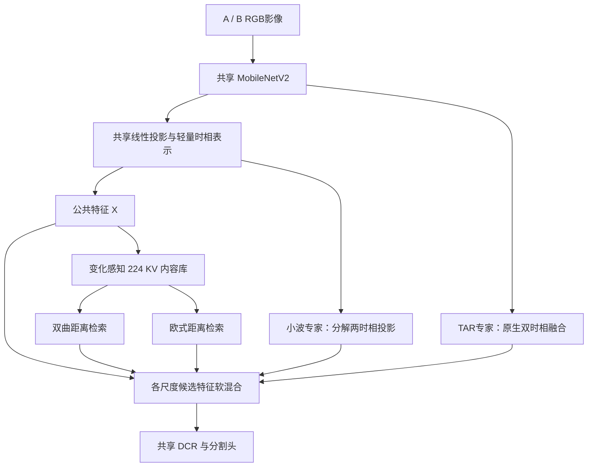
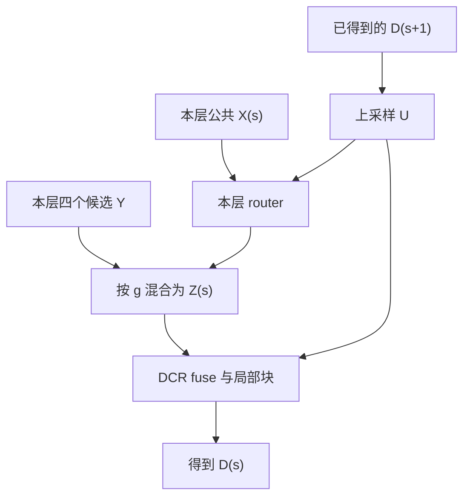

# CASA-MoE Run1 分析与四专家架构设计、调研及验证方案

日期：2026-10-30  
任务：普通 RGB 双时相、全监督二值变化检测；LEVIR / SYSU / WHU / CDD；256×256 输入。  
设计对象：双曲变化感知压缩 QKV、欧式变化感知压缩 QKV、小波高低频分工、TAR 四个动态专家。

**Run1 已完成 24 项正式实验，动态 MoE 在四库均低于同轮 CTRL 与固定等权融合。下一步优先缩减结构、核实路由贡献；四专家新架构保留为满足证据条件后再实施的候选。**

候选采用共享 MobileNetV2、轻量公共时相表示、H/E/W/T 四类专家、由粗到细的空间软路由和单一 DCR。H/E 共享内容及投影、仅距离不同；W 高频送浅层、低频送深层；完整 TAR 独立成为第四候选。这与已经训练的 Run1 不是同一架构。各候选输出均为欧式内容，完整 Q 位置保留。

研究问题是同一位置、同一解码阶段是否需要不同的检索度量或频率处理。保留几个专家由对照结果决定。

## 1. 证据范围与设计边界

### 1.1 当前状态、源码与协议

Run1 队列归档为 24/24 完成、失败 0、无活动项，更新时间 2026-10-29 20:51:42。24 份正式日志及结果 JSON 已保存本地；完成状态仅指该探索队列。实际源码见 `outputs/CASA-MoE/Run1/source_code.tar.gz`，运行目录 `runtime/20261028_115045`。对应的 `moe_context.py`、网络、训练、数据与增强五个关键文件与当前 `models_v1` 一致。

核心来源：[MoE 实现](../../models_v1/model/layers/moe_context.py)、[网络连接](../../models_v1/model/casa_net.py)、[训练脚本](../../models_v1/train_CASA.py)、[轮次归档](../experiments/CASA-MoE/Run1/README.md)、[项目准则](../ChatGPT_Project_Settings.md)。主线 Run7 的关联分析见[Run7 文档](CASA_Pyramid_Run7_深度分析_调研与改进方案.md)。两条线各自使用同轮 CTRL，不能交换基线。

Run1 协议为 `casa_moe_40k_dense_v1`：batch32、seed2333、Adam lr5e-4、200 step 学习率 warmup、poly^0.9；四级 BCE+Dice 加 0.2 guide，无 Run7 类别检索 BCE。四库实际步数为 40182/40125/40145/40248。每 epoch 用 test F1 选 best，最终 TEST 为该权重复测，**不属于独立盲测**。正式数值只取最后一个完整 TEST 区块，附录保留全部 24 项六指标。

§1.3–1.6 是 Run1 实测及代码结论；§2–9 是尚未训练的新架构规格；§11 决定其是否值得实施。后续路径不会把候选公式当成 Run1 训练源码。

### 1.2 Run7 给这条探索线的约束

Run7 双曲相对 CTRL 的 F1 变化依次为 +0.0258、+0.0932、−0.2197、−0.0474 个百分点，四库等权平均 −0.0370 个百分点；这些历史结果按 test 参与选模协议取得。它们说明“增加双曲上下文就会改善所有数据集”尚未成立，不能据此预设双曲专家应始终占主导。

上一份 Run7 审查还指出：类别检索辅助目标可以在原型内容缺乏空间区分时下降，不能单独证明检索到的 V 帮助了分割。因此本设计必须观察**送进解码器的实际内容、任务梯度与去除专家后的损失**，而不只看注意力热图、guide 精度或路由占比。

当前约 2M 参数，部署目标 ≤5M。参数空间容得下四类机制，但 Run7 已表明双曲逐元素运算会显著增加延迟；小参数量不能替代实测速度。

### 1.3 Run1 正式结果

| 数据集 | CTRL F1 (%) | 等权 F1 (%) | 动态MoE F1 (%) | 动态−CTRL (pp) | 动态−等权 (pp) |
|---|---:|---:|---:|---:|---:|
| LEVIR | 91.1112 | 91.1899 | 90.9058 | -0.2054 | -0.2841 |
| SYSU | 83.4342 | 83.1369 | 82.7541 | -0.6801 | -0.3828 |
| WHU | 94.6293 | 94.6313 | 94.4335 | -0.1958 | -0.1978 |
| CDD | 96.9317 | 96.9145 | 96.8887 | -0.0430 | -0.0258 |

动态 MoE 相对 CTRL 的四库等权平均差为 **−0.2811 pp**，相对等权为 **−0.2226 pp**。这是四个数据集的差值摘要，不是合并像素后的总体 F1。结论是当前单 seed、当前协议下四库方向一致，不能由这一组实验估计重复训练的方差。

LEVIR 的动态 MoE 精确率与 CTRL 接近，召回从 90.4138% 降至 89.9633%，F1 随之降低。SYSU 召回从 82.9641% 降至 81.4847%，精确率仅从 83.9097% 升至 84.0637%；主要问题是漏检增加，不能以 OA 或更高精确率替代 F1 解释。WHU 同样是精确率略升、召回下降；CDD 差值很小，但没有形成额外推理成本对应的收益。

两条线的CTRL也不能互换：SYSU的MoE Run1 CTRL为83.4342%，Run7 CTRL为82.7919%，相差0.6423 pp，超过Run7双曲相对CTRL的0.0932 pp。同一名义seed与共同设置不意味着两次训练轨迹完全相同；这些结果没有单独确定差异来自何处。因此模块评价使用同轮CTRL，跨轮绝对数值只作背景，不据此宣称MoE底座改进或几何提升。

#### LEVIR、SYSU 的九组消融

| 变体 | LEVIR F1 (%) | 相对CTRL (pp) | SYSU F1 (%) | 相对CTRL (pp) |
|---|---:|---:|---:|---:|
| M0_CTRL | 91.1112 | +0.0000 | 83.4342 | +0.0000 |
| M1_HYPER_QKV | 91.1552 | +0.0440 | 83.0695 | -0.3647 |
| M2_CA_QKV | 90.9999 | -0.1113 | 82.7794 | -0.6548 |
| M3_FREQUENCY | 91.0440 | -0.0672 | 82.4704 | -0.9638 |
| M4_EQUAL | 91.1899 | +0.0787 | 83.1369 | -0.2973 |
| M4_MOE | 90.9058 | -0.2054 | 82.7541 | -0.6801 |
| M4_NO_HYPER | 91.0415 | -0.0697 | 83.2600 | -0.1742 |
| M4_NO_QKV | 90.9771 | -0.1341 | 82.7622 | -0.6720 |
| M4_NO_FREQUENCY | 91.1805 | +0.0693 | 82.9183 | -0.5159 |

消融支持三个具体判断。

- **LEVIR 不需要把四个专家同时保留作为下一轮默认。** `NO_FREQUENCY` 比完整 MoE 高 0.2747 pp，且接近固定等权；单 H 比 CTRL 高 0.0440 pp，单 E/F 分别低 0.1113/0.0672 pp。完整 MoE 不是已有各路径的最好组合。
- **SYSU 的问题不能靠删除一个专家解决。** 去 H 相对完整 MoE 提高 0.5059 pp，但仍低于 CTRL 0.1742 pp；去 F 相对完整 MoE 提高 0.1641 pp，仍低于 CTRL 0.5159 pp。全部八个增强变体均未超过 CTRL。
- **单专家、固定融合和移除实验应分开解释。** 单专家权重为 1，四路等权的非 TAR 专家权重各为 1/4；删去一个专家会改变 softmax 竞争及整个训练轨迹。重训删除实验说明“某结构在该配置下是否必要”，不能直接等同于同一 checkpoint 上该专家的因果贡献。

#### 边界与后期泛化

| 数据集 | CTRL 1px 边界F1 (%) | 等权 (%) | 动态MoE (%) | 动态−CTRL (pp) |
|---|---:|---:|---:|---:|
| LEVIR | 85.7147 | 85.8850 | 85.6433 | −0.0713 |
| SYSU | 21.2271 | 23.5994 | 23.6311 | +2.4040 |
| WHU | 82.3090 | 81.6204 | 82.1864 | −0.1227 |
| CDD | 91.0017 | 90.7958 | 90.5906 | −0.4111 |

边界定义为 3×3 形态学梯度、输入像素尺度上的 Chebyshev 容差；它不是分割 F1 的分区域简单分解。SYSU 边界匹配提高而分割 F1 降低，说明局部轮廓匹配与总体变化区域覆盖存在取舍，不能写成“频率增强同时改善整体与边界”。WHU 的等权分割 F1 基本持平，边界 F1 却降低 0.6886 pp，也提示需要检查大区域与细轮廓的取舍。

| SYSU 变体 | 最佳 epoch（从0起） | 逐epoch选模峰值F1 (%) | 末轮F1 (%) | 峰值→末轮 (pp) |
|---|---:|---:|---:|---:|
| CTRL | 3 | 83.4344 | 79.7155 | −3.7189 |
| 等权 | 18 | 83.1369 | 80.8777 | −2.2592 |
| 动态MoE | 15 | 82.7542 | 80.9805 | −1.7737 |

表中峰值与末轮取同一逐epoch选模序列；正文正式指标仍取完整 TEST，折叠复测存在末位舍入差。MoE 的 SYSU 主训练损失从最佳 epoch 的 0.878015 继续降至末轮 0.267559，末轮 test 损失为 3.093197；CTRL 也出现更严重的后期退化。**泛化问题是共同训练底座的薄弱点，不能全部归责于路由。** 动态 MoE 的末轮成绩高于 CTRL，说明它减轻了一部分后期退化；但在当前“取最佳 checkpoint”的协议下，最佳成绩仍更低。这是两个不同结论。

CDD 的三个主变体最佳均为最后一轮 epoch128。现有结果没有证明该数据集达到训练平台；若检验训练预算，应对 CTRL 和候选结构共同延长，不能单独延长 MoE 后将差值归为模块收益。

### 1.4 Run1 实际数据流及与候选的差异

四级 TAR 输出 T，经共享 LN 得 X；guide 给出 p。每区域的变化/背景再由共享 appearance 标量拆成两个模式，得到 448 KV。池化权重正比于 `(c+eps)^2*(a+eps)`，c 为 p 或 1−p，a 为 appearance 或其补。H/E 共用池化内容 P，但各有独立 QK、V、out。

Run1 的 E 将 Q/K 归一化为单位方向；H 将同类方向乘以 1+p 再作 Lorentz 提升，半径为 asinh(1+p)，范围约 [0.8814,1.4436]。K 的 p 从池化内容重新预测。guide 因而同时参与类别压缩、支持度和 H 半径，H/E 的比较混合了几何、径向先验与独立参数。

F 将融合后 X 降为 16 通道，逐尺度 Haar 分解，分别变换 LL/HF 后 IDWT；它没有直接计算 A/B 频谱差。共享 `64→16→4` 点卷积 router 只读取 X，输出逐像素四权重。输出为 `Y=T+gamma*(pi_H*delta_H+pi_E*delta_E+pi_F*delta_F)`，TAR 候选表示零修正；gamma 只有一套并零初始化。

| 设计要素 | Run1 已训练实现 | §2–9 候选 |
|---|---|---|
| TAR 地位 | 所有位置的共享底座；第四路是恒等/零修正 | 直接读取原双时相特征的独立完整候选 |
| 公共输入 | LN(TAR) | 两时相投影的差异+均值，额外公共 stem |
| KV | 448，类别×两个外观模式 | 224，每区域每类一个 |
| H/E 度量 | 占比控制 H 半径、单位方向 E | 自由投影 Lorentz / 同坐标平方欧氏 |
| H/E 参数 | 独立 QK/V/out | 共享 QK/V/out，独立温度 |
| 频率路径 | 融合后 X，四层都含 LL/HF | Pa/Pb 带符号频带差；浅 HF、深 LL |
| router | 四层共享，只读 X | 每层独立，浅层还读上一粗层 decoder |
| 训练辅助 | 0.2 guide on TAR | 0.2 guide on 新公共 X |
| 专家执行 | 全部启用路径稠密计算 | 仍为稠密计算 |

共享 TAR 加零修正候选是合理的残差设计，没有重复相加 TAR 的实现错误。只有主张“router 决定是否执行完整 TAR”时才需要独立候选；这属于研究问题变更，须用匹配 TAR-only 对照。Run1 的 24 项折叠抽样最大绝对差为 4.292e−6、二值差均为 0，已有健康探针和非零有效残差排除了整条专家路径始终未学习的解释。

### 1.5 薄弱点：路由、幅值、内容和泛化

**动态选择未胜过固定融合。** router 看不到专家修正本身，也没有较粗解码语义；它可以学习输入偏好，但未证明能识别纠错效用。分别重训的动态/等权差值还包含优化轨迹，需要冻结同一 checkpoint 的原路由、常量路由和空间置换来定位。

**权重不等于有效贡献。** 最佳 checkpoint 首个 test batch 中，LEVIR S1 的 F 权重 0.735，有效残差 `RMS(gamma*pi_F*delta_F)/RMS(T)` 为 3.129，总残差比为 3.334；S2 F 权重 0.814、有效比 1.878。等权模型 S1 的 F 权重仅 0.25，有效比仍为 2.625。CDD S1 H/F 权重为 0.520/0.261，有效比却是 0.245/1.423。softmax 只归一化权重，没有校准异构输出幅度；这些事实要求幅值与纠错联合分析，但不支持直接裁剪所有大残差。

**频率路径缺少独立净收益。** 单 F 在 LEVIR/SYSU 均低于 CTRL，去 F 重训均优于完整 MoE。Run1 同时改写 LL/HF，不能把它称为纯边界分支。两张 val 图的错位探针缺少同图 CTRL 和全 val 统计，不能作为频率导致伪变化的定论。优先验证删除/缩窄，新的频带差分方案再与同预算普通局部卷积比较。

**448 KV 的外观拆分缺少必要性证据。** appearance 在区域内近常量时，同类两个模式的归一化池化权重可趋同；这是支持用法可达的退化形态，日志未证明普遍发生。先记录模式内容差、分配差和使用差，并做同配置 224/448 对照，不增加聚类辅助损失。每个专家 QK 配对数由 1,218,560 翻倍到 2,437,120，独立 H/E 又重复检索。

**H/E 差异不能归给几何。** 占比不是正确性概率，也不自带层级含义。先匹配内容、投影、损失和温度自由度，再比较距离；自由半径 H 是待验证候选，Run7 也没有证明它四库稳定占优。

**泛化问题超出 router。** SYSU 的 CTRL 最佳到末轮下降 3.7189 pp，大于 MoE 的 1.7737 pp；MoE 减轻末期退化，但降低了所选最佳成绩。不能只修 router 而忽略共同底座的早期峰值与后期训练。CDD 主变体最佳均为末轮，尚未证明预算已到平台。

**诊断还缺少任务分组。** 正式诊断只取首个 test batch，前景/背景路由按预测占比加权，不是 GT 分组；低输出余弦和高路由熵不证明有用互补。应补全 val 的 FP/FN、对象召回、GT 边界/内部及专家干预。CTRL 的 `predict` 还执行不使用的 LN+guide，可作为单独的部署精简；不能把它解释为 MoE 精度差的原因。

### 1.6 Run1 实测开销

| 变体 | 部署参数M | batch1中位ms | 训练进程显存MiB | 单步s |
|---|---:|---:|---:|---:|
| CTRL | 1.935810 | 3.635 | 8852 | 0.0551 |
| 单H | 1.942292 | 6.495 | 13882 | 0.0962 |
| 单E | 1.942292 | 5.859 | 11340 | 0.0671 |
| 单F | 1.940530 | 5.135 | 9428 | 0.0565 |
| 等权 | 1.952917 | 8.953 | 14956 | 0.1099 |
| 动态MoE | 1.954025 | 9.291 | 15098 | 0.1129 |
| 去H | 1.947864 | 7.443 | 11668 | 0.0714 |
| 去E | 1.947864 | 8.087 | 14070 | 0.1008 |
| 去F | 1.949561 | 7.982 | 14990 | 0.1102 |

数据源为 [profile.json](../experiments/CASA-MoE/Run1/profile.json) 和 [profile_MOE.py](../../models_v1/profile_MOE.py)。硬件 RTX5090，输入双时相 RGB256×256，FP32，卷积 TF32 开启、矩阵乘法 TF32 关闭；部署后走 `predict`，10 次预热、50 次 CUDA event 计时。训练 batch32，6 步短测，单步耗时取第4–6步均值；进程显存包含训练和诊断，不能当作推理显存。

MoE 推理峰值 allocated 134.455MiB，CTRL 为 55.013MiB；从测量前常驻量扣除后的增量分别为 61.290/13.922MiB。当前没有本轮统一口径完整 FLOPs 报告，不能由参数量推定运算量。H/E 距离、448 token attention、四尺度频率操作、路由与中间张量共同贡献实际成本。

“减少专家”“压缩 KV”和“真实稀疏分派”是三个不同的优化层次。当前最先做前两者；等互补和路由价值成立后，才值得支付区域分派、索引和频率边界重建的工程成本。

## 2. 候选四专家结构与公共接口

### 2.1 何时让完整 TAR 成为独立候选

Run1 的共享 TAR+零修正路由适合研究“已有时相表示需要哪种增强”，应保留为下一步简化实验的底座。若研究问题进一步转为“是否需要 TAR 本身，何处采用原始时相频带证据”，才引入下述独立 TAR 候选。

此时公共部分只提供轻量双时相表示，完整 TAR 直接读取原生编码特征；H/E 不带旧局部高通，避免候选内部重复细节路径。代价是增加公共 stem、改变 guide 输入与特征分布，也改变了训练问题。该设计不能直接拿 Run1 CTRL 作为唯一基线。

### 2.2 尺度命名与完整张量表

本文 S1 最浅、S4 最深；D1 最精细、D4 最粗。固定输入 256×256，批量为 B：

| 层 | 原生编码特征 $F_s^A,F_s^B$ | 公共/专家输出通道 | 空间尺寸 | Q 数 | 区域网格 | 变化+背景 KV 数 |
|---|---|---:|---:|---:|---:|---:|
| S1 | B×24×64×64 | 64 | 64×64 | 4096 | 8×8 | 128 |
| S2 | B×32×32×32 | 64 | 32×32 | 1024 | 4×4 | 32 |
| S3 | B×96×16×16 | 64 | 16×16 | 256 | 4×4 | 32 |
| S4 | B×320×8×8 | 64 | 8×8 | 64 | 4×4 | 32 |
| 合计 | 四尺度列表 | — | — | **5440** | — | **224** |

每一个尺度的所有 Q 都访问同一个 224-token 跨尺度库。不是每个 Q 只访问本尺度，也不是把 5440 个 Q 压成 224 个。

### 2.3 公共表示：保留差异和场景内容

每尺度用同一个无偏置线性投影处理两个时相：

$$
P_s^A=W_s^pF_s^A,\qquad P_s^B=W_s^pF_s^B,\quad W_s^p:C_s\to64.
$$

这里不在投影之后加激活或独立的时相归一化。这样小波输入保持同一个线性坐标系，且投影差满足 $P_s^B-P_s^A=W_s^p(F_s^B-F_s^A)$。

构造：

$$
\Delta_s=|P_s^B-P_s^A|,\quad S_s=(P_s^A+P_s^B)/2,
$$
$$
X_s=\mathrm{SiLU}\{\mathrm{BN}[\mathrm{Conv}_{1\times1}([\Delta_s,S_s])]\}.
$$

- $\Delta_s$：显式时相差异。
- $S_s$：场景内容。只输入绝对差，容易丢失“什么地物发生差异”的信息。
- $X_s$：H/E、router 的公共输入及残差基准，B×64×H_s×W_s。
- 小波仍读取 $P_s^A,P_s^B$，**不读取已取绝对值的 $\Delta_s$ 或非线性的 $X_s$**。
- TAR 读取 $F_s^A,F_s^B$，保留现有 TAR 的输入通道和算子。

公共输入构造在特征层面对 A/B 对称；现有编码器训练期 BN 调用方式、TAR 有序融合及小波高频非线性意味着整网仍不承诺严格交换不变。

### 2.4 专家统一返回什么

定义四个候选：

$$
Y_s^H=X_s+R_s^H,\quad
Y_s^E=X_s+R_s^E,\quad
Y_s^W=X_s+R_s^W,\quad
Y_s^T=T_s.
$$

所有 $Y,R,T,X$ 都是 **B×64×H_s×W_s 的欧式特征图**。四专家共享一个 DCR 和一个分割头，不各自生成完整分割图再做预测集成。

路由 $g_s\in\mathbb R^{B\times4\times H_s\times W_s}$，专家顺序固定为 H/E/W/T，逐位置 softmax：

$$
Z_s=\sum_{e\in\{H,E,W,T\}}g_s^eY_s^e.
$$

等价残差写法为：

$$
Z_s=X_s+g_s^HR_s^H+g_s^ER_s^E+g_s^WR_s^W+g_s^T(T_s-X_s).
$$

实现建议采用数值更直接的形式：

$$
Z_s=(g_s^H+g_s^E+g_s^W)X_s+g_s^TT_s
+g_s^HR_s^H+g_s^ER_s^E+g_s^WR_s^W.
$$

当 $g_s^T=1$ 时，直接得到 $Z_s=T_s$，避免用 $X+(T-X)$ 产生不必要的浮点消减误差。其余三个候选共享 X，所以不要在融合后又无条件加一次 X。

### 2.5 总体数据关系



图中路由权重由 X 和已计算的更粗层解码特征产生，具体时序见第 7 节。H/E 还各接收完整的本尺度 Q。

## 3. 双曲与欧式专家：先统一“检索什么”，再比较“怎样检索”

### 3.1 两路共享的变化感知压缩

逐位置通道归一化：

$$
\bar X_s=\mathrm{LN}(X_s),\qquad p_s=\sigma(w_g^\top\bar X_s+b_g).
$$

guide 是模型预测的软变化占比，不是真实标签，也不是已校准的正确性概率。训练时使用面积标签监督 guide；推理时只使用预测值。

对于尺度 s 的一个网格区域 r：

$$
m_i^+=p_i,\quad m_i^-=1-p_i,\qquad
w_{ri}^{c}=\frac{(m_i^c+\epsilon)^2}
{\sum_{j\in r}(m_j^c+\epsilon)^2},\quad \epsilon=10^{-6},
$$
$$
P_{sr}^{c}=\sum_{i\in r}w_{ri}^{c}\bar X_{s,i},\qquad
\rho_{sr}^{c}=\sum_{i\in r}w_{ri}^{c}m_i^c.
$$

每区域得到变化、背景两个原型；两类严格交替存放，四尺度拼成 $P\in\mathbb R^{B\times224\times64}$。支持度 $\rho$ 使用一阶占比，计算 log 前下限为 $10^{-6}$。

**两路必须共享 P、guide、LN 和同一组 $\rho$。** 若一路用一阶支持度，另一路用平方支持度，或一路 1×32、另一路 4×16，最终差异不能单独归因于几何。这些差别存在于主线 Run7 H 与 Run5 普通模块之间；Run1 自身的混杂则是占比半径、独立投影与独立读出，见 §1.4。候选分别控制这些因素。

压缩本身仍有弱点：同一区域、同一变化类别内可能含多种地物；两个原型不能保留所有局部模式。因此保留完整 Q，并由 W/T 提供未经过同类原型平均的局部证据。首轮先不增加原型数，把“压缩是否足够”留作可诊断的问题。

### 3.2 公共 Q/K/V 和读出

首轮固定单头、32 维：

$$
q_{s,i}=W_{qk}\bar X_{s,i}/\sqrt{32},\qquad
k_j=W_{qk}P_j/\sqrt{32},
$$
$$
v_j=W_vP_j,\qquad v_{s,i}^{self}=W_v\bar X_{s,i}.
$$

$W_{qk}:64\to32$、$W_v:64\to32$、$W_o:32\to64$ 均无 bias，Q/K 共享投影，H/E 也共享这些投影。

对专家 $e\in\{H,E\}$：

$$
\ell_{sij}^{e}
=-\frac{d_e(q_{s,i},k_j)^2}{2\tau_e^2}
+\log\rho_j+b_{s,t(j)}-\log M_{t(j)},
$$
$$
A_{sij}^{e}=\mathrm{softmax}_j(\ell_{sij}^{e}),\qquad
R_{s,i}^{e}=\gamma_s\odot W_o
\left(\sum_j A_{sij}^{e}v_j-v_{s,i}^{self}\right).
$$

$M=(128,32,32,32)$；尺度偏置 b 共享；H/E 共享逐层逐通道 $\gamma$。两个温度分别学习，使用相同 softplus 参数化、相同初值 0.5。相同初值不代表两种距离分布天然匹配，实验要同时报告 $d^2/(2\tau^2)$ 分布，必要时用训练材料做温度匹配诊断。

这定义了两个不同检索算子，共享其内容表达。可以称“共享参数的异构专家”，不能写成四套参数完全独立的专家网络。

### 3.3 专家一：Lorentz 双曲检索

将 q/k 作为 Lorentz 的空间坐标直接提升：

$$
\phi(z)=\left(\sqrt{1+\|z\|_2^2},z\right),\qquad
-\phi_0(z)^2+\|\phi_{1:}(z)\|_2^2=-1,
$$
$$
d_H(q,k)=\operatorname{acosh}
\left(\sqrt{1+\|q\|^2}\sqrt{1+\|k\|^2}-q^\top k\right).
$$

固定曲率 −1，首轮不再增加可学习曲率。半径 $r=\operatorname{asinh}\|z\|$ 可随学习变化，但没有监督证明它等于“变化置信度”“对象层级”或“样本困难度”。

| 项目 | 双曲专家具体定义 |
|---|---|
| 输入 | 本尺度全部 $\bar X_s$；四尺度共享的 P、支持度和尺度来源 |
| Q/K | 32 维投影后提升成 33 维 Lorentz 点 |
| 检索空间 | 固定曲率 −1 的双曲空间 |
| V 与输出 | V 为 32 维欧式内容；读出回 64 维欧式残差 |
| 输出 | 四个 $R_s^H$，分别与 X 同尺寸 |
| 去向 | 对应层 MoE 混合的 H 候选，随后进入该层 DCR 侧向输入 |
| 可检验价值 | 相同原型/投影下，双曲检索是否产生更有用的内容，而非仅改变 softmax 锐度 |

**这里的“双曲 QKV”是双曲 Q/K 检索、欧式 V 聚合的混合实现。** 不把欧式加权 V 说成双曲质心，也不把完整网络说成全双曲网络。若未来要求 V 也位于流形，必须另行定义质心及回到欧式解码器的映射；那会同时改变几何、值空间和融合，不作为首轮实现。

数值上复用当前 `lorentz_ops.py` 的稳定平方距离实现，零距离邻域用解析级数，避免直接 `acosh(x).square()` 在 x≈1 的导数问题。监测半径、单位约束残差、距离有限性及梯度；数值稳定只证明算子可用，不证明它有统计优势。

### 3.4 专家二：匹配欧式检索

$$
d_E(q,k)^2=\|q-k\|_2^2.
$$

其余与 H 完全相同：224 原型、完整 Q、同一 P/V/读出/支持度/尺度偏置/单头维度。输出 $R_s^E$，送相同尺度的 E 候选。

建议把 E 视为**更普通的内容相似性检索基准**，而非事先宣布它只负责“规则对象”，H 只负责“复杂对象”。二值变化标签没有这种专家职责标签，任务数据是否产生该分工必须观察。

首轮也不保留旧欧式模块的 self-null softmax，而 H 使用无 null 条件 softmax。两路都采用条件分布加相同 self-value 减项；是否采用上下文由外层路由控制。否则 null/self 机制与距离会再次混杂。若之后证据显示 H/E 的“不采用任何原型”能力仍不足，再对两路一起加入同一种 null 机制并单独验证。

### 3.5 为什么共享投影；什么时候才拆开

共享首先回答“度量不同是否足够带来互补”。它还使差异不容易被两个完全自由的编码器/读出器吸收。但有明确代价：同一个投影可能同时照顾两种几何而不适合其中一方，且共享参数的梯度会相加，两个温度的梯度也可能失衡。

优先检查：

- $A^H$ 与 $A^E$ 的差异是否在温度校准后仍存在。
- 两个分支**实际输出残差**的相关性，而不只是注意力差异。
- 分别计算 H/E 路径对共享 Q/K 的分支梯度，观察余弦和范数；共享总梯度无法证明两路都在发挥作用。
- 删除 H 或 E 并重训后的代价。

如果二者产生几乎相同的检索和残差，不应靠强制正交损失“制造互补”。优先减少一个专家。只有出现明确的共享梯度冲突、且某一路已有独立贡献时，才检验**仅拆 Q/K 投影**；暂不同时拆 guide、压缩、V、读出和所有超参数。

当投影范数基本固定、半径变化很小时，H/E 的排序可能主要由相同夹角决定，剩余差别接近距离非线性和温度。不能仅因用了 Lorentz 公式就声称学到了层级结构。

### 3.6 能省的计算与不能省的计算

共享坐标后，一份 Gram 矩阵可同时构造两种距离：

$$
G=qk^\top,\quad D_E^2=\|q\|^2+\|k\|^2-2G,
$$
$$
z_H=\tfrac12[D_E^2-(t_q-t_k)^2],\quad
D_H^2=\operatorname{acosh}(1+\max(z_H,0))^2.
$$

H/E 不必分别计算两份 QK 矩阵乘法；但双曲距离、两个温度及两次 softmax 仍存在。

因为读出线性且共享，可在已获得本层 g 后合并值聚合：

$$
g_HR_H+g_ER_E=
\gamma\odot W_o\left[
(g_HA_H+g_EA_E)V-(g_H+g_E)v^{self}
\right].
$$

这允许一次混合后的 AV 和一次输出投影。开发时先用独立读出验证等价，再优化；诊断模式保留分别计算两路残差的能力。该等价关系来自共享线性读出；候选实现后仍须核对浮点输出和梯度，并测量 GPU 延迟。

## 4. 小波专家：先保证时相差分和重建的含义正确

### 4.1 专家的职责与边界

小波专家承担**按频带来源分开处理变化证据，并送到合适解码尺度**。它不替代 H/E 的跨区域内容检索，也不单独承担图像配准。

不能把低频等同于无用光照，高频等同于真实边界：大片建筑/土地变化可能主要是低频差异；树冠、阴影、压缩纹理和轻微错位可能产生很强的高频差异。是否采用这些证据交给带语义上下文的外层路由学习。

选择固定 Haar/db1、一层分解；在 S1/S2/S3 分别处理，不在所有尺度递归堆叠多级 WTConv。这样每条输出的来源、分辨率和职责明确。

### 4.2 输入以及 DWT/IDWT 的明确约定

对两时相分别变换：

$$
(L_s^A,H_{s,LH}^A,H_{s,HL}^A,H_{s,HH}^A)=\mathrm{DWT}(P_s^A),
$$
$$
(L_s^B,H_{s,LH}^B,H_{s,HL}^B,H_{s,HH}^B)=\mathrm{DWT}(P_s^B).
$$

每个子带都是 B×64×(H_s/2)×(W_s/2)。

对 2×2 小块 $\begin{bmatrix}a&b\\c&d\end{bmatrix}$，本设计定义：

$$
LL=(a+b+c+d)/2,\quad LH=(a-b+c-d)/2,
$$
$$
HL=(a+b-c-d)/2,\quad HH=(a-b-c+d)/2.
$$

这是正交归一化 Haar。不同库可能交换 LH/HL 名称或高通符号，必须以固定滤波器、存储顺序和对应逆变换为准，不能仅凭缩写猜方向。DWT 和 IDWT 必须成对使用同一约定。

令：

$$
\delta L_s=L_s^B-L_s^A,\quad
\delta H_s=[H_{s,LH}^B-H_{s,LH}^A,\,
H_{s,HL}^B-H_{s,HL}^A,\,
H_{s,HH}^B-H_{s,HH}^A].
$$

**先做带符号的频带差分，尤其高频不能先 abs。** 线性性保证：

$$
\mathrm{DWT}(P^B-P^A)=\mathrm{DWT}(P^B)-\mathrm{DWT}(P^A),
$$

但 $\mathrm{DWT}(|P^B-P^A|)$、$|\mathrm{DWT}(P^B-P^A)|$ 与上式不是同一个对象。绝对值会丢掉高通系数的符号，从而改变重建的位置结构。频带能量图可用于诊断，但不能冒充可逆重建系数。

### 4.3 高频处理：保留符号和空间重建

对 S1/S2 的三方向高频差异，按通道打包成 B×192×(H_s/2)×(W_s/2)：

$$
\widetilde H_s=\delta H_s+
\mathrm{DW}_{3\times3}\left[
\mathrm{SiLU}(\mathrm{PW}_{192\to192}(\delta H_s))
\right].
$$

PW 和 DW 都无 bias；保留系数残差，避免随机初始化一开始就完全替换原始高频。处理后还原为三个 64 通道高频带：

$$
U_s^H=\mathrm{IDWT}(0,\widetilde H_{s,LH},
\widetilde H_{s,HL},\widetilde H_{s,HH}),
$$
$$
R_s^W=\eta_s\odot \mathrm{PW}^{out}_{64\to64}(U_s^H),\quad s=1,2.
$$

- IDWT 的 LL 输入为零，避免高频路径再次带入低频背景。
- 三个高频带必须恢复原来的通道/方向顺序。
- IDWT 后只接无 bias 的 1×1 通道投影和逐通道增益；**不立即接 ReLU/SiLU 或带平移的归一化**。这些操作会在此接口引入新的低频分量。
- 系数域的非线性允许改变高频内容，但“LL=0 的重建”仍在该 Haar 网格的高频子空间内。
- 两时相特征完全相同时，$\delta H=0$，上述无偏置处理满足高频输出为零。

这不要求高频数值永远保持原始符号；要求的是保留带符号的输入信息以及合法的三子带重建接口。

### 4.4 低频处理：降采样后直接进入深层

对 S2/S3：

$$
U_s^L=|\delta L_s|/2,\qquad
\widehat U_s^L=
\mathrm{DW}_{3\times3}\left[
\mathrm{SiLU}(\mathrm{PW}_{64\to64}(U_s^L))
\right].
$$

所有卷积无 bias。这里使用低频差异幅值，作为二值变化的结构证据；不把它再作为需要保持符号的完整小波重建系数。

除以 2 有明确尺度意义：二维正交 Haar 的常量输入 c 对应 LL=2c，LL/2 才与原特征常量幅度一致。若使用其他归一化滤波器，必须同步更改，不要重复缩放。

随后：

$$
R_3^W=\eta_3\odot\widehat U_2^L,\qquad
R_4^W=\eta_4\odot\widehat U_3^L.
$$

低频来源已在更粗网格上，不需要先 IDWT 回细尺度再下采样。这里的“低频”指输入来源；经过学习映射后，不承诺它在整幅图像傅里叶域中严格带限。

首轮不在低频支路再放一套全局注意力，避免重复 H/E 的工作；背景/语义条件由 X、router 和 DCR 提供。若实验说明低频仅凭差异不足，再考虑条件化处理，而不是预先把所有能力堆进 W。

### 4.5 你要求的“高低频注入不同解码层”，具体这样接

| 小波源 | 分解后尺寸 | 使用频带及处理 | 专家输出 | 送入何处 |
|---|---:|---|---|---|
| S1：64×64 的 $P_1^A,P_1^B$ | 32×32 | 三高频带差分→处理→零 LL 的 IDWT | $R_1^W$：B×64×64×64 | D1 对应的侧向输入 $Z_1$，在 `fuse1` 前 |
| S2：32×32 的 $P_2^A,P_2^B$ | 16×16 | 三高频带差分→处理→零 LL 的 IDWT | $R_2^W$：B×64×32×32 | D2 的 $Z_2$，在 `fuse2` 前 |
| 同一份 S2 分解 | 16×16 | LL 差异幅值/2→轻量处理 | $R_3^W$：B×64×16×16 | D3 的 $Z_3$，在 `fuse3` 前 |
| S3：16×16 的 $P_3^A,P_3^B$ | 8×8 | LL 差异幅值/2→轻量处理 | $R_4^W$：B×64×8×8 | $Z_4=D_4$，最粗解码起点 |

S2 的分解结果复用，不重复执行。S1 的 LL、S3 的高频不另开旁路；S4 不再分解到 4×4，以免引入一个与现有 DCR 无对应接口的尺度。公共 X/TAR 仍保留所有四尺度的信息，这些未使用频带不意味着整网完全丢弃了对应输入内容。

**W 是一个有四个尺度输出的专家**，内部低/高频各有职责；router 中仍只有一个 W 槽位，不把它偷偷拆成第五、第六专家。

### 4.6 小波方案最需要提前防止的缺陷

**错位敏感。** 临界采样 Haar 对平移敏感，1 像素误差会改变系数。WDMF-Net 将频率增强与独立 flow/warp 对齐组合使用，不能把它的整体结果解释为“小波天然解决配准”。本设计首轮不增加 flow 模块，先用控制实验测量 W 对错位的反应。

**高频的范围有限。** 最细路径输入已经是编码器 1/4 特征。它不能恢复编码阶段已经丢失的所有原图像素细节，也不能承诺精确恢复窄于特征采样尺度的对象。

**动态门控会混频。** 路由前，$R_1^W,R_2^W$ 具有零 LL 重建性质；逐像素乘以 $g_W$ 后，一般不再满足这个性质，后续 DCR 的非线性也会混合频率。这不是数值错误，但论文应写“来自高频子带的细节证据注入”，不要写“全程纯高频解码”。

若实测门控引入严重低频泄漏或棋盘纹理，优先检验浅层 **2×2 特征块内常数的路由权重**：在更粗网格产生全部四个权重再最近邻展开，维持四专家权重和为 1。块常数权重能保留该级 Haar 高频子空间；这只是有证据后的针对性修改，主版本仍采用逐位置路由。

**交换不变性。** 高频保留符号且经过 SiLU，因此交换 A/B 不保证输出相同。延续原有随机时相交换增强，并报告交换前后预测差异。若未来要求严格不变，需要整体结构同时约束 TAR、公共编码和高频处理，而不是仅改一条支路后宣称全网不变。

## 5. TAR 专家：保留原始时相建模和可折叠局部处理

### 5.1 输入、计算和输出

直接使用现有 `MultiScaleTAR((24,32,96,320), dim=64)`：

$$
T_s=\mathrm{RepLocalBlock}\left[
\mathrm{SiLU}\left(
f_c([F_s^A,F_s^B])
+f_\Sigma(F_s^A+F_s^B)
+f_\Delta(F_s^B-F_s^A)
\right)\right].
$$

三个 f 是各自 Conv+BN 的线性分支；局部块为可重参数化 DW3、PW1 和现有 SiLU。输出 $T_s$ 是 B×64×H_s×W_s；输入 MoE 的 T 候选，不再进入另一套独立解码器。

| 项目 | TAR 专家具体定义 |
|---|---|
| 输入 | 原生双时相 $F_s^A,F_s^B$，保留各尺度 24/32/96/320 通道 |
| 特有信息 | 有序 concat、和、带符号差；未先经过原型压缩 |
| 特有计算 | 局部时相融合和局部卷积精炼 |
| 输出 | 四个 64 通道 $T_s$；概念上的修正为 $T_s-X_s$ |
| 去向 | 每尺度 T 候选，按 $g_s^T$ 加权后送共享 DCR |
| 可验证基准 | 所有层只选 T 时，恢复原 TAR→DCR 特征路径 |

TAR 是有实际参数和时相内容的专家，不是“恒等残差专家”。共同 X 是残差坐标基准，不是额外声明的第五个专家。

### 5.2 重参数化的边界

在 eval 下，折叠后的时相核满足：

$$
W_A=W_{c,A}+W_\Sigma-W_\Delta,\qquad
W_B=W_{c,B}+W_\Sigma+W_\Delta.
$$

相应 bias 相加，得到一个处理 concat(A,B) 的固定 1×1 卷积；局部固定分支仍按现有实现折叠。

**外层 $g_s^T(A,B,x,y)$ 随输入和位置变化，不能一起折叠成一个固定卷积。** 也不要把动态权重插入各 BN 分支内部后仍沿用旧折叠公式。首轮保持 TAR 内部不变，只在它的最终输出后路由。

### 5.3 与其他三路如何互补

TAR 不需要先预测变化区域再形成原型，能保留直接双时相的局部信息；H/E 提供跨区域内容，W 提供显式频带拆分。但是这种算子差异只是形成互补的条件，不是互补已经存在的证据。若 W 的作用能被 TAR 的局部卷积完全替代，就应重新评估保留 W 的必要性。

此外，TAR-only 在**相同权重的推理路径**上可以严格恢复原基线；训练时 guide 改挂到 X、公共模块初始化变化等，会改变训练轨迹，不能由此声称训练结果与旧 CTRL 必须一致。

## 6. 四专家的输入—输出—去向总表

| 专家 | 直接输入 | 内部核心处理 | 输出空间/形状 | 接入点 | 不应赋予的未经证实含义 |
|---|---|---|---|---|---|
| H 双曲 | 全部本尺度 Q、共享跨尺度 P/支持度 | Lorentz 距离→224 KV 条件检索→相对内容读出 | 欧式 $R_s^H$，B×64×H_s×W_s | $X_s+R_s^H$ 作为 H 候选→$Z_s$ | 半径天然代表置信度或对象层级 |
| E 欧式 | 与 H 完全同源 | 欧式平方距离，其余内容/读出匹配 | 欧式 $R_s^E$，同形状 | E 候选→$Z_s$ | 只适用于规则建筑或简单样本 |
| W 小波 | 未取 abs/激活的 $P^A,P^B$，S1–S3 | 分别 DWT、频带差分、高低频独立处理 | 欧式 $R_{1,2}^W$ 为高频重建来源，$R_{3,4}^W$ 为低频来源 | 高→浅层 $Z_{1,2}$；低→深层 $Z_{3,4}$ | 高频一定是真变化，低频一定是噪声 |
| T TAR | 原生 $F^A,F^B$，S1–S4 | 可折叠时相线性分支+局部精炼 | 欧式 $T_s$，同形状 | T 候选→$Z_s$ | 只是公共恒等分支或无参数备用项 |

所有 $Z_s$ 仅在对应 DCR 侧向输入处注入一次。不要在 `fuse` 前加一次，又在该层输出后再加同一份小波/上下文特征。

## 7. 动态路由：尺度和位置都动态，执行次序必须无环

### 7.1 路由粒度选择

首轮采用 **每尺度、每位置四权重的 dense soft mixture**。

- 不用一张图一个四维权重：同一图可同时有背景、建筑边界、大片变化和伪变化，图像级路由无法区分。
- 不一开始做 hard top-1/top-2：早期 guide 和专家均未成熟，离散选择容易让某些路径长期缺少训练信号；卷积/小波还有邻域依赖，不能照搬独立 token 的丢弃式分派。
- 不做每通道一套四权重：64 倍路由输出会增加自由度和解释难度，首轮逐位置标量权重已能表达主要问题。
- 不以真实变化 mask、数据集 ID 或测试标签作为 router 输入。

这里“动态”指内容选择随输入变化，**不是动态跳过计算**。四路都计算才能进行软混合。

### 7.2 router 读取什么

最粗层：

$$
g_4=\operatorname{softmax}_{e}\{\mathcal R_4(\mathrm{LN}_0(X_4))\}.
$$

$\mathrm{LN}_0$ 为逐位置、无可学习 affine 的通道归一化。其他三层：

$$
U_{s+1}=\operatorname{Up}(D_{s+1};H_s,W_s),
$$
$$
g_s=\operatorname{softmax}_{e}\{
\mathcal R_s([\mathrm{LN}_0(X_s),\mathrm{LN}_0(U_{s+1})])\}.
$$

浅层选择既看本地差异/场景，也看已经形成的较粗变化语义，便于抑制只有纹理而缺乏语义支持的高频响应。但这是设计动机，不能直接视为伪变化问题已解决。

$\mathcal R_s$ 使用：

`PW(input,16) → SiLU → DW3(16) → SiLU → PW(16,4)`

S4 输入 64 通道；S1–S3 输入 128 通道。输出层权重/bias 零初始化，softmax 温度固定 1；不加随机噪声、数据集专属偏置或额外路由损失。

### 7.3 解码次序

$$
D_4=Z_4,
$$
$$
D_s=\operatorname{Block}_s
\{\operatorname{SiLU}[\operatorname{Fuse}_s(Z_s,\operatorname{Up}(D_{s+1}))]\},
\quad s=3,2,1.
$$

最后 D1 经过现有 `refine`，共享分割头得到预测；训练保留四级监督，推理只用 D1。



router 用 $D_{s+1}$，**不能用尚未产生的 $D_s$**。计算和反传均不需要 detach 粗层 D；这是一张正常的无环计算图。

现有 `DCRDecoder.forward_pyramid(feats)` 一次性接收四个输入。实现时需要显式展开四级循环，复用原来的 `fuse3/2/1`、`block3/2/1`、`refine`，在每一级融合前求该级路由。不能先按旧接口算完四级，再声称每级路由使用了“融合前”语义。

### 7.4 路由输出不是可靠性概率

对单位置混合 $Z=\sum_e g_eY_e$，设 logits 为 a、上游梯度为 G，直接路由项满足：

$$
\frac{\partial L}{\partial a_e}
=g_e\langle G,Y_e-Z\rangle.
$$

这说明：

- 候选特征几乎相同，router 很难学出有意义的分工。
- g 很小会减弱该路径获得的直接学习信号。
- 分支输出尺度影响门控的梯度和选择；g 大不等于该专家更“正确”。
- 路由熵是选择分布的统计量，不是经过校准的预测不确定性。

因此必须同时看 $g_e$、$\|g_eR_e\|$、任务梯度、干预和重训。共享 H/E 参数时还要区分分支贡献梯度与共享总梯度。

## 8. 首轮训练与初始化：减少叠加的混杂因素

### 8.1 候选进入训练时的默认版本

| 项目 | 首轮建议 |
|---|---|
| 编码器/解码器 | 现有 MobileNetV2 / DCR；单一分割头 |
| 公共通道 | 64 |
| H/E | 单头 32 维；5440 Q；224 KV；共享内容/投影/读出 |
| 双曲曲率 | 固定 −1 |
| H/E 温度 | 各一参数，softplus，初始 0.5 |
| 新上下文增益 | H/E 共享 $\gamma_{s,c}$，初值 0 |
| 小波增益 | $\eta_{s,c}$，初值 0 |
| 小波 | Haar、单层、固定分解；按第 4 节接线 |
| router | 4 个小模块；逐位置四权重；温度 1 |
| 训练起始 | router 最后层零初始化，起点 g=1/4，从首步正常训练 |
| 辅助监督 | 共享 guide，总系数 0.2 |
| 首轮不加入 | 类别检索 BCE、边界损失、负载均衡、熵奖励、专家正交约束、可学习曲率 |

200 step 仅保留为共同学习率 warmup，不额外固定路由。对于残差 gamma*f，gamma=0 时第一步 f 的主任务梯度为零，但 gamma 本身可以更新，随后恢复 f 的梯度；Run1 已有非零任务梯度和有效残差，不能据零初始化判定长期饥饿。

候选的 Y_T=T 与其他候选初始 X 不同，因此即使 H/E/W 残差为零，router 最后层仍可能从 T−X 获得梯度；router 的更早层在零初始化最后层下暂时无梯度。保留零增益作为明确起点。只有连续训练记录证明某条本来有用的路径长期无有效任务信号，才单独对照 0.01 小增益或短暂固定路由；两项不同时改动。TAR 候选不乘小增益。

**零增益不再保证初始主路径等于 TAR。** 均匀路由时，候选起点为 `Z=0.75X+0.25T`，而 Run1 的零 gamma 起点为 `Y=T`。公共 stem 因而从第一步就改变主特征，这也是独立 TAR 候选不能直接继承 Run1 基线收益的原因。先比较同初始化下 X/T 的幅度与预测，再由匹配 M-T/M-S/M-D 训练判断其代价；不把“残差零初始化”写成已经保持原基线。

新分支幅度较小，TAR 候选与 X 又可能相差较大，初期 router 有偏向某一路的风险。记录路由前/后残差 RMS 和梯度；不要将不同分支强行全做 LN 后再宣称保持了 TAR 路径和小波零 LL 性质。若有明确幅度失衡，应先做固定预算的初始化尺度校准对照。

### 8.2 损失与标签

保留现有四级 segmentation logits 的 BCEWithLogits+Dice 求和方式；各 logits 上采样到原图后与二值标签计算主损失。四尺度 guide 用面积标签，即对 GT 自适应平均池化到 guide 尺寸：

$$
L=L_{\rm seg}^{4\ levels}+0.2L_{\rm guide}.
$$

guide 是共享的一套，不能 H/E 各算一遍后把总辅助权重暗中翻倍。候选沿用 Run1 无类别检索 BCE 的设置，判断路由和检索内容是否改善最终分割，而不是同时改变更多辅助目标。若未来增加辅助目标，需要验证它确实约束 V/最终读出，不能只重复“注意力选中变化类原型”的目标。

训练继续使用相同 RGB 归一化、空间增强、0.5 时相交换、标签阈值及预测阈值。Adam、全网基础学习率 5e-4、betas(.9,.99)、200 step warmup、poly^.9、40K 左右相同步数预算作为对照起点。所有本轮变体对新模块使用相同参数分组；新 Conv/Linear 与 norm/bias/temperature/gain 的衰减规则要在优化器中显式覆盖，不能仅因新文件不叫 `context` 就漏掉。

部署折叠在 eval 下执行；BN 的训练态不能与折叠后的静态算子直接比较。

### 8.3 对照必须处理 guide 位置变化

旧 CTRL 的 guide 读取 TAR 特征；本设计的 guide 读取 X。因此：

- 旧 CTRL 结果用于历史参照。
- 新的“匹配 TAR-only”应保留同一公共 X 和同一 guide 训练路径，只将候选选择固定为 T。
- X 只用于辅助训练时可以在该对照的部署路径中移除，参数和效率按实际部署图统计。
- encoder、TAR、DCR、head 的初始权重在本轮变体间应一致，新模块的构造不能扰乱共享模块的随机初始化序列。

**TAR-only 推理等价不等于新旧训练轨迹等价。** 这一点直接关系到能否把收益归因于 MoE。

### 8.4 为什么首轮不强制均匀负载

这四类专家有不同的数学结构和尺度职责，不是四个可交换的同构 FFN；W 在深层代表低频、浅层代表高频，TAR 又保留完整局部时相信息。要求所有数据、所有尺度都恰好 25% 使用量没有任务依据。

dense 软混合也不存在因专家容量溢出导致 token 被丢弃的问题。首轮监测而不惩罚不均衡。只有当某专家经验证本来有用，却因早期极小 g 一直学不到时，才处理学习饥饿；若其余专家本来没有增益，集中使用少数专家是简化模型的线索。

## 9. 候选复杂度、部署与实现契约

### 9.1 参数估算：预算足够，但速度仍未知

按 §2–7 的层定义计算，部署后新增可学习参数的估算为：

| 部分 | 参数数 |
|---|---:|
| 公共双时相投影与 X 构造，BN 已折叠 | 63,232 |
| 共享 H/E 内容/投影/读出/温度/guide | 6,611 |
| 小波高低频处理及输出增益 | 94,976 |
| 四尺度 router | 8,144 |
| 合计 | **172,963** |

由当前 CTRL 1,935,810 减去被替换的 LN+guide 193，再加入上述模块，得到 **约 2.108580M 部署参数**。这是基于相同编码器/TAR/DCR/head 的结构估算，不是完整新模型部署导出的实测报告。包含 BN 学得并折叠得到的 bias，即使融合工具把该 bias 标成 `requires_grad=False` 也不能漏计；固定 Haar 滤波器不是可学习参数。

估算拆分为：公共 stem `30208+32768+256=63232`；H/E `6144+128+65+16+2+256=6611`；小波 `2*(192²+192*9+64²)+2*(64²+64*9)+256=94976`；router `1268+3*2292=8144`。前提为正文的共享关系、无 bias 线性投影与规定 BN/输出增益；实际集成改变任一层定义都应按最终部署图重计。

这一规模低于 5M，但计算量和峰值显存不只由参数数决定。与 §1.6 的 Run1 1.954025M、9.291ms 分开记录，不能把候选估算当成已训练模型的测量。

### 9.2 注意力与密集计算预算

- N×M=5440×224=1,218,560 个注意力位置；单个 FP32 矩阵、batch=1 约 **4.65 MiB**。
- H/E 两份完整注意力约 **9.30 MiB**；batch=32 仅两份矩阵即约 **297.5 MiB**，还未计 logits、反传缓存、encoder 激活。
- 可逐尺度/逐 Q 块计算，保持每个 Q 完整访问 224 KV。完整 Q 不等于必须一次保存全部查询的临时矩阵。
- 本设计不复制四套 backbone/DCR，但公共 stem、小波处理、router 以及双曲非线性都有成本。
- 合并 Gram/AV 可减少重复矩阵乘；实际收益依赖实现、内核和读写，不能预报 RTX5090 延迟。
- 四路 dense 计算下，“减少路由给 H 的权重”不等于“少执行 H 的运算”。

只有精度/分工证据成立后，才研究按图像或空间块跳过专家。小波/卷积需要邻域和重建块，稀疏分派需处理边界 halo；不能把未选 token 直接丢弃。稀疏版本必须作为单独的精度—延迟实验。

### 9.3 解析性质与待实现验证

本节给出候选必须满足的数学契约；候选完整网络尚无可追溯的训练、数值探针或 GPU 基准记录。

| 契约 | 可由定义推出的性质 | 实现后验证及失败时动作 |
|---|---|---|
| Haar 分解/重建 | 未改系数时为逆变换；DWT 与带符号时相相减可交换 | 随机/常量输入重建；失败则修滤波器顺序和缩放 |
| 频带分流 | 零 LL 的 IDWT 保持对应 2×2 块均值为零；逐像素 gate 一般破坏该性质 | 检查 gate 前后 LL 能量；若实测影响目标，再对照块常数 gate |
| LL 幅值 | 正交 Haar 下常量 LL 为原幅值两倍，LL/2 恢复 | 用常量输入检查深层注入幅度 |
| 形状 | 四层 64/32/16/8，64 通道；5440 Q、224 KV | 实际 batch 前向；失败则修路由/注入尺寸 |
| T-only | g_T=1 恢复原 TAR→DCR 前向 | 同权重同输入比较；偏差须定位公共 stem 是否误入主路径 |
| 等时相 W | Pa=Pb 时各差分为零，无 bias 的规定路径输出零 | 验证模块级零残差，不要求整个 TAR 网络恒零 |
| H/E 合并 | 共享 V/out/gamma 下，(g_H A_H+g_E A_E)V 与分开聚合等价 | 比较输出与梯度；不能套用于 Run1 独立 V/out |
| 任务梯度与折叠 | 初始化后增益可更新；eval 下 TAR/DCR 可折叠 | 记录若干更新步梯度及四级输出差，失败则定位具体断路或折叠算子 |

解析恒等式不预报浮点误差，也不证明模型精度。实现验证只用于发现会改变下一步工作的错误；通过后进入最小训练对照，不重复累积无关探针。

## 10. 薄弱点、可能失败的原因与证伪方法

| 薄弱点 | 为什么真实存在 | 应看什么 | 何种结果会否定当前假设 |
|---|---|---|---|
| H/E 冗余 | 同一原型和投影下，两种距离可能只改变锐度 | 温度归一化距离、注意力差、实际残差相似性、删一路重训 | 删 H 或 E 不降反升，且多次重复一致 |
| 原型信息不足 | 每区域每类一个原型不能容纳所有变化模式 | 区域内类内方差、小对象占比、pool 前后内容、任务梯度 | H/E 仅学到占比先验，内容替换不影响结果 |
| router 学到静态配比 | 不同层的最优比例可能已足够 | 与可学习的每层常数权重对照 | 动态空间权重不优于静态配比 |
| router 受幅度支配 | 候选并非同分布；T 与 X 可相差较大 | 路由前后 RMS、梯度、初始化校准 | 改变无关幅度就翻转选择，实际专家效用不变 |
| W 放大伪变化 | 纹理/错位/阴影有高频，低频也可能是照度变化 | 无变化扰动、边界精确率/召回、内部召回 | 高频边界召回涨但假阳性大增、整体 F1 降 |
| 高频细节收益受限 | 最细输入已是 1/4 特征 | 小对象分桶、窄边界、原图尺寸分布 | 只改善大结构，细目标没有收益 |
| TAR/W 局部功能重叠 | TAR 的可学习卷积也能提取频率响应 | 删 W/T 重训、替换同预算局部卷积 | 显式小波不优于同预算局部块 |
| 共享投影梯度冲突 | H/E 追求不同运行点却共用坐标 | 分路径梯度余弦、分支效用 | 共享严重限制有用分支，拆 Q/K 才恢复 |
| 门控自我强化 | 较强路径更早获得选择和梯度 | 早期 g 分布及各路径梯度轨迹 | 强制短期开放后弱路径变有用，原训练一直未学到 |
| 单 seed / 选模混杂 | 小幅差异可来自轨迹、best epoch 和评价协议 | 同协议重训、配对统计、多 seed | 正向差异不能重复或依赖特定选模口径 |

不要为每个潜在失败预先新增一个模块。先确定哪一条发生，再做能区分原因的最小修改。

### 10.1 必须同时记录的诊断

每尺度、每专家记录：平均 g、空间方差、路由熵、路由前后特征/残差 RMS、对应参数梯度范数。进一步按变化/背景、边界/内部、小/中/大对象分组。分组使用标签只发生在训练/验证后的诊断统计，不能把这些标签传回 router 的前向输入。

H/E 额外记录：

- 变化/背景原型间内容相似度，跨尺度注意力质量分配。
- 各 query 的 retrieved V 空间变化；与自身 V 的差值。
- 半径、范数、归一化距离、温度、尺度偏置和支持度 log 项的相对大小。
- 分支任务梯度与 guide 梯度，避免总梯度掩盖无效检索。

W 额外记录：各源尺度 LL/三高频的差异能量、路由前后的低频泄漏、产生假阳性的纹理区域，以及最终预测的棋盘/网格模式。频带能量和梯度都应按实际张量尺度归一化，不能把不同分辨率的总和直接比较。

### 10.2 少量有区分力的干预

在冻结权重、同一验证集上：

1. 去除一个专家并重新归一化剩余路由，测完整预测变化。
2. 固定原路由、替换/置乱某专家内容，判断 gate 是否真的选择了有用内容。
3. 保持每图/每层路由分布，置乱空间位置，检验位置对应关系是否有价值。
4. H/E 做受控温度/范数诊断，区分度量与运行点。
5. W 分别去掉低频输出、高频输出，检查是否影响预期的粗结构/细节。
6. 以相同影像构造 A=B 以及光度/小位移扰动的负对照，观察伪变化响应。扰动实验与真实数据集正式指标分开报告，避免把移动真实样本但未同步处理标签的数据作为正常精度测试。

冻结干预会造成分布变化，只用于机制诊断；必要性最终需要删除相应路径后重训。单凭“关掉后下降”不能证明该结构是最好的选择。

## 11. 下一步实验顺序与停止条件

### 11.1 先用 Run1 最佳权重决定保留什么

以 SYSU 与 LEVIR 为首批，前者所有增强均低于 CTRL，后者已有九组删除/单专家对照；WHU 随后检验建筑边界。使用固定 val 样本，不再按 test 诊断挑结构。

冻结同一 MoE best，比较原路由、逐尺度常量路由、图内空间置换，以及逐专家有效残差置零。常量权重在独立的 val 校准子集估计，另一子集评价；置零时先保持其他权重不变，测该路径的条件作用，再单独做归一化删除检验竞争。记录整体/边界/内部、对象大小分组的 FP/FN 与累计混淆矩阵 F1。专家逐像素择优仅可作为带 GT 的诊断上界，不能当作可部署结果。

若动态路由不优于常量或置换，而单专家仍有互补，才研究路由信息；若连带 GT 的择优也收益有限，重点在专家内容。大残差是否有害以这些干预判断，不凭 RMS 阈值定性。SYSU 同时比较 best/last，以区分选择失败与共同泛化退化。

### 11.2 默认推进简化底座，一次只变一个因素

**优先保留共享 TAR，移除没有必要证据的复杂度。** 从冻结诊断中选择较有用的单一 H 或 E，与同轮 CTRL 比较；在该结构内做 448→224 KV 的一因素对照，其他半径、投影、损失保持原设定。若 224 精度相当而更快，保留 224。若单专家无收益，不立即扩展四路。

下一步才在相同内容、投影、读出、辅助目标和温度自由度下做 H/E 几何对照，避免同时改变 KV 数、半径和投影共享。若两种度量没有互补，就保留更有效/更快的一种。若单一有益专家配恒等候选已经足够，先比较逐尺度常数与像素路由；复杂语义 router 尚无必要。

频率方向暂不作为默认保留项。若 val 诊断支持特定高频或低频修复，再在同一底座独立比较“原 F / 无 F / 单项频带分流”，并补同参数级普通局部卷积。仅看到频带能量或边界召回变化，不足以接受新增结构。

### 11.3 何时实施 §2–9 的独立 TAR 四专家候选

只有两类机制在匹配对照中各有贡献，且原路由未能识别其互补时，才值得验证独立 TAR、原始双时相频带证据与粗层语义路由。先只替换一个因素验证，再集成为候选；不把公共 stem、224 KV、自由半径、投影共享、频带分流、语义 router 一起替换后解释为单模块收益。

进入候选阶段需三个共同配置：M-T 固定选 TAR 并保留公共 X 的 guide 训练；M-S 使用每尺度可学习常量权重；M-D 使用候选的动态 router。三者共同的 backbone 初始化、损失、预算与选模规则一致。均匀 1/4 是 Run1 已有的固定融合参照，但不能替代新结构内可学习常量的强对照。

M-S/M-D 都不优于 M-T，则停止四路扩展；M-D 不优于 M-S，则去掉动态性；删除某专家重训不降反升，则简化专家集合。声称四个专家各有必要时须完整报告四项删除，而非只展示有利消融。只有收益成立后才研究真正跳过专家的稀疏执行。

### 11.4 四库与重复性

候选通过上述判断后，再扩展四库及预先固定的多个配对 seed。每库报告 Recall/Precision/OA/F1/IoU/Kappa、边界/内部与实际效率，单库结果先于等权平均。建议后续统一 val 选模、test 最终评估，历史 test 选模结果分栏；沿用历史协议时继续标注非盲测。

置信区间优先按原场景配对采样，每次累积 TP/FP/FN 再算 F1。计时保持 RTX5090、输入、batch、精度、TF32、预热及同步方式一致；候选约 2.109M 的参数估算不能替代延迟。完整 FLOPs 若遗漏距离、softmax、DWT/IDWT 或插值，必须列明范围。

## 12. 定向文献调研：采用什么，不照搬什么

文献按实际薄弱点组织：路由效用、异构专家、频带分工与几何归因。新增全文统一保存在[机制诊断目录](../参考文献/Run7与MoE_Run1_机制诊断/README.md)，已有 WTConv、Soft MoE、WDMF-Net、Hypformer、FreqFusion 复用历史归档。

| 文献 | 可核实的相关内容 | 对本方案的作用与限制 |
|---|---|---|
| **MoCE-IR，CVPR 2025** [R1] | 用不同容量/感受野的复杂度专家，进行图像恢复中的自适应分配 | 支持研究异构专家；原方法主要是图像级 top-k 和复杂度偏置。本文的逐位置变化检测、四种机制不是原文结论，不直接移植它的均衡项 |
| **WTConv，ECCV 2024** [R2] | 固定小波分解/重建与可学习子带卷积结合，扩大感受野 | 参考固定滤波器、分解顺序和重建实现；本文不是把 WTConv 整体换进骨干，而是时相频带差分及深浅分流 |
| **Soft MoE，ICLR 2024** [R3] | token 软分派到专家 slots，再组合回 token | 支持关注可微分路由；本文是完整空间特征上的软输出混合，**不是复现该论文的 slot 分派算法** |
| **Default MoE，NeurIPS 2025 主会** [R4] | 研究稀疏路由的反向信号不足，以默认输出近似补充 router 梯度 | 提醒首轮不要过早离散化；不把语言模型规模实验外推为遥感结论，也不额外引入它的 EMA 默认向量 |
| **WDMF-Net，IEEE TGRS 2026** [R5] | 遥感 CD 中分别增强高低频，再结合 flow-based 对齐和差异/掩码融合 | 与任务最接近；其低频 attention、高频卷积、配准、融合同时存在。本文取频带分工动机，不把整体收益归因于小波一个模块 |
| **Hypformer，KDD 2024** [R6] | Lorentz 表示及双曲 Transformer 运算 | 支持几何实现背景；本文的欧式 V 和解码器不等于其全双曲架构 |
| **FreqFusion，IEEE TPAMI 2024** [R7] | 密集预测融合中分别处理区域一致性和边界细节 | 支持区分粗结构与细节目标；本文没有直接采用其自适应滤波/重采样完整模块 |

关于“新颖性”的判断应保守而具体：双曲注意力、变化原型、小波和 MoE 都已有大量相关研究。潜在贡献在于**同一变化任务中的度量选择、频带按解码尺度分工，以及动态选择相对静态组合的可验证收益**。未做穷尽性查新，不能写“首次融合四专家”或“首次用于变化检测”。

### 12.1 官方代码核对带来的具体实现提醒

核心实现参考为已有 [WTConv](../../others/WTConv/README.md) 与新归档 [MoCE-IR router](../../others/MoCE-IR/README.md)、[HypMix](../../others/HypMix/README.md)、[ERMoE 评分](../../others/ERMoE/README.md)。保留来源与许可，均不进入 CASA 训练依赖。Soft MoE 采用论文及官方源码作为机制对照。

MoCE-IR 当前所核查版本的 [RoutingFunction.forward](https://github.com/eduardzamfir/MoCE-IR/blob/94203ce86052fbcbfb711e17138b178193284db3/src/net/moce_ir.py#L492) 中，随机噪声采样不在 `self.training` 条件内；其推理专家选择代码使用 `top_k_indices.squeeze(0)`，带有 batch=1 使用前提。这些是该版本源码可见的行为，**不能直接复制成 CASA 的确定性、多 batch 推理实现**。本方案 router 推理不加噪声，也不沿用该分派代码。文献方法可借鉴，官方代码仍需按具体用途检查。

MoCE-IR 只保留 `RoutingFunction` 及必要导入，保留原算法和训练/评价噪声行为以便审阅，不包含专家网络、dispatcher 或训练框架。ERMoE 公开 `route()` 先执行所有专家编码后才选 Top-k，保留的三个评分函数用于理解表征相关路由，不能作为减少执行次数的模板。[官方代码](https://github.com/Belis0811/ERMoE/blob/master/ERMoE.py)

Default MoE 针对稀疏专家缺失输出导致的 router 反向信息不足；Run1 本身为 dense 软融合，且已有梯度信号，不据此加入 EMA 默认向量或强制均衡。HypMix 提醒几何与温度混杂，不能以 H/E 输出不同就宣布几何互补。

### 12.2 Run1 结果要求补充的直接相关工作

| 文献 | 已核实出处与来源 | 对当前选择的影响 |
|---|---|---|
| R2-T2 | [ICML 2025，PMLR267](https://proceedings.mlr.press/v267/li25bc.html) | 借鉴“专家固定、改变路由”的诊断；本项目在 val 实施，不引入测试时适应 |
| HypMix | [WACV 2024](https://arxiv.org/abs/2404.15523) | H/E 比较同时控制投影与温度；混合度量的有效性要由任务证据证明 |
| ERMoE | [CVPR 2026](https://arxiv.org/abs/2511.10971) | 路由应与专家表征/内容适合程度联系，先用现有输出和干预检验，不立即引入特征分解 |
| SARE-CD | [Remote Sensing 18(20):3613，2026](https://www.mdpi.com/2072-4292/18/20/3613) | 已有变化检测异构专家与像素路由，不能把四路结构本身称作首次贡献 |
| SCD-MoE | [TGRS64，2026](https://doi.org/10.1109/TGRS.2026.3738239) | 语义变化与交互专家的邻近工作；本地依据摘要和代码，不作同口径二值精度排名 |

论文任务与 CASA 不同，能迁移的是研究问题和受控对照，不能迁移预期涨幅。频带按尺度分工仍需与普通卷积及交换注入层的控制比较。

### 12.3 正式来源

**[R1]** Eduard Zamfir, Zongwei Wu, Nancy Mehta, Yuedong Tan, Danda Pani Paudel, Yulun Zhang, Radu Timofte. *Complexity Experts are Task-Discriminative Learners for Any Image Restoration*. CVPR 2025, pp.12753–12763.  
[CVF 正式页](https://openaccess.thecvf.com/content/CVPR2025/html/Zamfir_Complexity_Experts_are_Task-Discriminative_Learners_for_Any_Image_Restoration_CVPR_2025_paper.html) · [官方 PDF](https://openaccess.thecvf.com/content/CVPR2025/papers/Zamfir_Complexity_Experts_are_Task-Discriminative_Learners_for_Any_Image_Restoration_CVPR_2025_paper.pdf) · [官方代码](https://github.com/eduardzamfir/MoCE-IR)

**[R2]** Shahaf E. Finder, Roy Amoyal, Eran Treister, Oren Freifeld. *Wavelet Convolutions for Large Receptive Fields*. ECCV 2024.  
[ECVA 正式页](https://www.ecva.net/papers/eccv_2024/papers_ECCV/html/7137_ECCV_2024_paper.php) · [官方 PDF](https://www.ecva.net/papers/eccv_2024/papers_ECCV/papers/07137.pdf) · [官方代码](https://github.com/BGU-CS-VIL/WTConv)  
会议年份为 2024，不因后续出版元数据标 2025 而改写为 ECCV 2025。

**[R3]** Joan Puigcerver, Carlos Riquelme, Basil Mustafa, Neil Houlsby. *From Sparse to Soft Mixtures of Experts*. ICLR 2024.  
[会议正式页](https://proceedings.iclr.cc/paper_files/paper/2024/hash/79fea214543ba263952ac3f4e5452b14-Abstract-Conference.html) · [官方 PDF](https://proceedings.iclr.cc/paper_files/paper/2024/file/79fea214543ba263952ac3f4e5452b14-Paper-Conference.pdf) · [官方代码目录](https://github.com/google-research/vmoe/tree/main/vmoe/projects/soft_moe)

**[R4]** Ashwinee Panda, Vatsal Baherwani, Zain Sarwar, Benjamin Thérien, Sambit Sahu, Tom Goldstein, Supriyo Chakraborty. *Dense Backpropagation Improves Training for Sparse Mixture-of-Experts*. NeurIPS 2025, Main Conference.  
[会议正式页](https://proceedings.neurips.cc/paper_files/paper/2025/hash/f69707de866eb0805683d3521756b73f-Abstract-Conference.html) · [官方 PDF](https://proceedings.neurips.cc/paper_files/paper/2025/file/f69707de866eb0805683d3521756b73f-Paper-Conference.pdf) · [作者代码](https://github.com/vatsal0/default-moe)  
与 2024 年近似题名的 workshop 版本区分。本次参考训练问题和论文，不移植其代码。

**[R5]** Yuting Liu, Shihua Li, Lorenzo Bruzzone. *A Lightweight Wavelet-Aligned Difference and Mask-Guided Fusion Network for Change Detection*. IEEE Transactions on Geoscience and Remote Sensing, vol.64, 2026, article 5616916.  
[DOI:10.1109/TGRS.2026.3680645](https://doi.org/10.1109/TGRS.2026.3680645) · [官方代码](https://github.com/LYT-Works/WDMF-Net)  
全文依据项目已有 `docs/参考文献/baseline/WDMF-Net(TGRS2026).pdf`；不重复收集该文件。

**[R6]** Menglin Yang et al. *Hypformer: Exploring Efficient Transformer Fully in Hyperbolic Space*. KDD 2024.  
[正式 DOI](https://doi.org/10.1145/3637528.3672039) · [作者开放版本](https://arxiv.org/abs/2407.01290) · [官方代码](https://github.com/Graph-and-Geometric-Learning/hyperbolic-transformer)  
项目已有 PDF 为 2025-08 修订开放版，正式会议年份仍为 2024。

**[R7]** Linwei Chen, Ying Fu, Lin Gu, Chenggang Yan, Tatsuya Harada, Gao Huang. *Frequency-aware Feature Fusion for Dense Image Prediction*. IEEE TPAMI, 46(12):10763–10780, 2024.  
[正式 DOI](https://doi.org/10.1109/TPAMI.2024.3449959) · [作者开放版本](https://arxiv.org/abs/2408.12879) · [官方代码](https://github.com/Linwei-Chen/FreqFusion)

## 13. 交给实现者的最小拆分

只有 §11.3 的进入条件成立后，再按此接口实现候选。历史 Run1 源码和输出保持冻结；模块按实际职责拆分：

| 文件/模块 | 必须完成的职责 |
|---|---|
| `moe_stem.py` | 共享时相线性投影 P、差异/均值构造 X |
| `paired_metric_context.py` | 一份 guide、压缩 P、Q/K/V；H/E 两种距离及共享读出；返回两路残差和必要诊断 |
| `wavelet_expert.py` | 固定 Haar、频带差分、两条高频/两条低频输出；尺寸和符号约定集中定义 |
| `spatial_router.py` | 逐位置四权重；粗层/浅层输入接口；无标签输入、无推理噪声 |
| `casa_moe.py` | 调原 TAR，按 4→3→2→1 顺序混合并调用原 DCR 各层；统一 head/训练输出 |
| 训练配置 | 显式列出 guide 权重、router 初始化、参数分组与相同初始化规则 |

核心前向契约：

```python
Fa, Fb = encoder(A)[1:], encoder(B)[1:]
X, Pa, Pb = shared_stem(Fa, Fb)
T = tar(Fa, Fb)
RH, RE, guide = paired_metric_context(X)  # 每路四尺度；保留完整 Q
RW = wavelet_expert(Pa, Pb)              # [high1, high2, low2, low3]

D = [None] * 4
for s in (3, 2, 1, 0):                  # Python 索引对应 S4→S1
    U = None if s == 3 else upsample(D[s + 1], X[s].shape[-2:])
    g = router(s, X[s], U)  # [B,4,Hs,Ws]
    h, e, w, t = g.split(1, dim=1)
    Z = (h + e + w) * X[s] + t * T[s] + h * RH[s] + e * RE[s] + w * RW[s]
    D[s] = Z if s == 3 else dcr_block(s, Z, U)

D[0] = decoder.refine(D[0])
# 训练：共享 head 的四级 logits + guide；推理：仅 D1 输出。
```

这是接口说明；实际高效版本可把 H/E 在每层合并读出，不能为优化改变数学定义。

第一轮交付的可接受条件是：四路输入来源明确，输出维度一致，小波深浅注入正确，T-only 可恢复原路径，任务梯度到达各机制，训练/部署一致，动态版本接受静态组合和专家删除的对照。**最终保留几个专家由这些证据决定，而不是先把“四”当作不可改变的结论。**

## 已知局限

Run1 为单 seed、test 参与选模；模块诊断多为首 batch，不能代替完整 val 的因果干预。两条线相同名义设置下 CTRL 也不同，跨轮比较不隔离模块贡献。四专家候选的参数来自层定义估算，尚无实际训练、GPU 延迟或完整数值契约记录；数学性质与模型收益分别判断。来源中的图像恢复、语义分割、度量学习论文提供机制依据，不能替代四库二值变化检测实验。

## 附录 A：正式结果与本地证据

表中指标均为百分数，来自各日志最后一个完整 TEST 区块；空缺的 WHU/CDD 单专家/删除实验未开展，不补造结果。原始日志见 `outputs/CASA-MoE/Run1/<变体>/<数据集>/train_log.txt`；六指标提取表见[formal_test_metrics.csv](../../outputs/CASA-MoE/Run1/analysis/formal_test_metrics.csv)，训练和诊断汇总见[run1_evidence_summary.json](../../outputs/CASA-MoE/Run1/analysis/run1_evidence_summary.json)。

| 数据集 | 变体 | Recall | Precision | OA | F1 | IoU | Kappa |
|---|---|---:|---:|---:|---:|---:|---:|
| LEVIR | M0_CTRL | 90.4138 | 91.8194 | 99.1013 | 91.1112 | 83.6736 | 90.6380 |
| LEVIR | M1_HYPER_QKV | 90.1202 | 92.2143 | 99.1091 | 91.1552 | 83.7479 | 90.6862 |
| LEVIR | M2_CA_QKV | 90.1646 | 91.8508 | 99.0914 | 90.9999 | 83.4860 | 90.5215 |
| LEVIR | M3_FREQUENCY | 90.1215 | 91.9856 | 99.0968 | 91.0440 | 83.5604 | 90.5685 |
| LEVIR | M4_EQUAL | 90.5023 | 91.8879 | 99.1091 | 91.1899 | 83.8064 | 90.7207 |
| LEVIR | M4_MOE | 89.9633 | 91.8683 | 99.0830 | 90.9058 | 83.3279 | 90.4231 |
| LEVIR | M4_NO_HYPER | 90.2534 | 91.8434 | 99.0952 | 91.0415 | 83.5561 | 90.5650 |
| LEVIR | M4_NO_QKV | 90.0308 | 91.9435 | 99.0903 | 90.9771 | 83.4477 | 90.4981 |
| LEVIR | M4_NO_FREQUENCY | 90.4531 | 91.9197 | 99.1086 | 91.1805 | 83.7906 | 90.7111 |
| SYSU | M0_CTRL | 82.9641 | 83.9097 | 92.2307 | 83.4342 | 71.5770 | 78.3598 |
| SYSU | M1_HYPER_QKV | 79.8076 | 86.6095 | 92.3282 | 83.0695 | 71.0418 | 78.1207 |
| SYSU | M2_CA_QKV | 79.0127 | 86.9232 | 92.2474 | 82.7794 | 70.6185 | 77.7918 |
| SYSU | M3_FREQUENCY | 78.4544 | 86.9197 | 92.1347 | 82.4704 | 70.1699 | 77.4174 |
| SYSU | M4_EQUAL | 80.5100 | 85.9411 | 92.2977 | 83.1369 | 71.1405 | 78.1529 |
| SYSU | M4_MOE | 81.4847 | 84.0637 | 91.9906 | 82.7541 | 70.5817 | 77.5399 |
| SYSU | M4_NO_HYPER | 82.3852 | 84.1537 | 92.1875 | 83.2600 | 71.3209 | 78.1655 |
| SYSU | M4_NO_QKV | 79.3778 | 86.4482 | 92.2022 | 82.7622 | 70.5935 | 77.7355 |
| SYSU | M4_NO_FREQUENCY | 80.3249 | 85.6849 | 92.1953 | 82.9183 | 70.8209 | 77.8674 |
| WHU | M0_CTRL | 93.7907 | 95.4829 | 99.5776 | 94.6293 | 89.8060 | 94.4094 |
| WHU | M4_EQUAL | 93.1704 | 96.1387 | 99.5806 | 94.6313 | 89.8097 | 94.4131 |
| WHU | M4_MOE | 93.1939 | 95.7065 | 99.5641 | 94.4335 | 89.4541 | 94.2067 |
| CDD | M0_CTRL | 96.8235 | 97.0403 | 99.2434 | 96.9317 | 94.0462 | 96.5002 |
| CDD | M4_EQUAL | 96.8714 | 96.9577 | 99.2386 | 96.9145 | 94.0137 | 96.4802 |
| CDD | M4_MOE | 96.8474 | 96.9301 | 99.2322 | 96.8887 | 93.9652 | 96.4508 |

全文及来源见[文献索引](../参考文献/文献索引.md)与[机制诊断目录](../参考文献/Run7与MoE_Run1_机制诊断/README.md)。参考代码的提取范围与许可分别保存在对应 `others` 目录。
