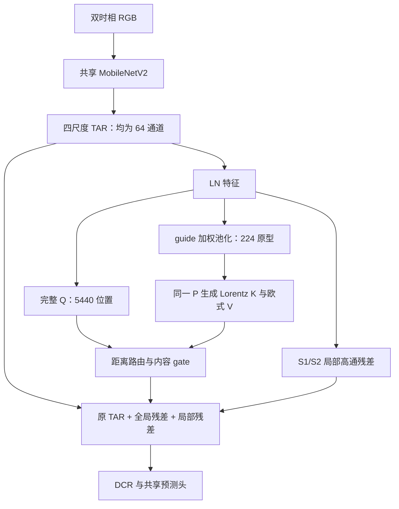

# CASA-CD / CASA-Pyramid Run7：代码、结果、机制与下一步研究

**核查日期：2026-10-30。对象：CASA-Pyramid Run7 双曲版及同轮 CTRL。** 与独立探索线的关系见[MoE Run1 分析与四专家候选](CASA_MoE_四专家架构设计_调研与验证方案.md)。

本文依据本地同步仓库、Run7 实际源码归档和正式日志；附录保留提交 `368e6cc09f7c08141dcdfea711dcb667d59ffdea` 的固定来源链接。Run7 的训练源码基线为 `8a54fa27676717b1962dc646f7c743baef7ba3a1`。正式指标重新读取了 8 份日志的最后一个完整 `TEST RESULTS` 区块；训练趋势核对了 1,268 条 epoch 记录，并分别提取最佳 epoch 和末轮的模块诊断。23 份冻结源码与当前对应源码核对一致（忽略文件末尾空白）。

文中使用四种证据标记：**事实**指源码、日志或明确的代数推导直接支持；**推断**指多个事实共同支持的解释；**假设**指还需要对照验证的机制；**缺口**指现有材料无法作答。全文的 pp 均指百分点，不能与相对百分比混用。

## 1. 核心判断

**Run7 是一套数值稳定、能够训练并部署的压缩检索实现，但尚未证明它值得作为当前主线的有效增量。主要薄弱点是“检索类别监督、压缩内容质量、最终纠错收益”之间的证据没有接起来。优先级应是完成归因，再改原型形成方式。**

1. **精度收益很弱，计算代价明确。** 四库相对同轮 CTRL 的 F1 为 `+0.0258 / +0.0932 / −0.2197 / −0.0474 pp`，等权平均 `−0.0370 pp`；部署参数只增加约 0.58%，实测延迟却增加约 79.1%。这不能描述为稳定、低代价的精度提升。
2. **SYSU 的主要问题是泛化和漏检；WHU 也不只是边界问题。** SYSU 双曲最佳在 epoch 15，之后训练损失继续下降，而选模集 F1 下降约 1.90 pp，内部前景召回同步恶化。WHU 在边界和内部都退步。单纯再加高频/边界模块缺乏足够依据。
3. **类别检索辅助损失约束的是“变化命名原型的注意力总量”，不是“读出的 V 对当前 query 是否有用”。** 它没有对 V、输出投影、gate 的直接梯度；存在检索辅助分类变好、全局修正仍为零的严格构造。这一点由冻结实现的计算依赖和常量场恒等式直接推出。它说明目标并不充分，不等于已经证明真实训练主要依赖这一捷径。
4. **全局分支没有失活；更值得警惕的是粗层主导和较大的写回。** 最佳模型已经存在细层检索偏向粗尺度、部分残差 RMS 超过原 TAR 特征的情况；SYSU 末轮进一步加重。但这些是首个 test batch 的关联证据，不能直接作为“粗尺度导致错误”的因果结论。
5. **双曲几何的独立贡献仍未建立。** 正式训练只有 H 与 CTRL；二者同时改变了全局检索、局部细节分支和辅助监督。短训中的匹配欧式版本很有价值，却不足以替代 40K、同结构、同监督的欧式对照。

**下一步选择：先用已有最佳权重做全局/局部分支和真实内容诊断，再训练严格匹配的欧式对照。若证据确认区域原型的混合内容是主要损失来源，唯一优先的结构方向是“一次区域内内容关联精炼”，保持完整 Q、224 个 KV、共享 K/V 内容及现有解码器。暂不增加新骨干、多专家、额外频域分支或一组新损失。**

## 2. 我们的任务，以及 Run7 实际完成了什么

### 2.1 任务定义与当前状态

项目是普通 RGB 双时相、全监督、二值遥感变化检测。四库为 LEVIR-CD-256、SYSU-CD-256、WHU-CD-256、CDD-CD-256；标签按灰度 `>=128` 二值化，预测阈值为 `prob>0.5`。研究约束是完整空间 Q、压缩 KV，部署参数目标不超过 5M，同时评估精度、延迟和显存。项目的 F1 目标 `92 / 84 / 95 / 97.5%` 是研究目标，不是本报告核定的统一 SOTA。

仓库记录 Run7 已于 **2026-10-29 00:38:32 CST** 完成：双曲与 CTRL 各四库，共 8 项；正式训练使用物理 GPU0。这里描述的是归档状态，未查询实时服务器。当前普通 QKV 保持 Run5 的实现，没有参加 Run7 正式训练。

Run7 的实际目的可以表述为：**在轻量 TAR–DCR 主干之间，以共享内容的区域原型构建 Lorentz 检索，用类别检索辅助监督训练路由，再用独立的内容 gate 决定相对修正。** 它已经完成了从机制实现、短训筛选到完整训练的闭环；现在应进入“验证净收益与解释失败”的阶段。

### 2.2 数据流

| 项目 | Run7 实际实现 | 对分析的影响 |
|---|---|---|
| 编码器 | MobileNetV2 原生四尺度 24/32/96/320 通道 | 不应拿历史 TinyViM/ChangeViT 结构解释本轮 |
| 时相融合 | TAR 的有序融合与局部重参数化分支 | 不保证严格时相交换不变；训练含随机时相交换 |
| 上下文位置 | TAR 之后、DCR 之前 | 不是直接对 A、B 做跨时相 attention |
| HFEA | 未使用 | 当前瓶颈不宜归因于已不存在的 HFEA |
| Query | 64²+32²+16²+8² = 5,440 个 | 保留完整 Q 不等于保留了 KV 中的细节 |
| KV | 网格 8/4/4/4，每格变化/背景各一个，共 128+32+32+32=224 | 是 112 个空间区域的双原型，不是全图只有两个原型 |
| 投影 | 单头、32 维；共享 Q/K 投影 | 正式普通 QKV 的 4×16 维不能当几何唯一变量对照 |
| 空间 | Q/K 的检索度量为双曲；V、主干、输出仍为欧式 | 不应称为全双曲网络 |
| 输出 | 四级深监督；推理只使用最高分辨率预测 | 辅助分支和训练开销必须与部署路径区分 |

### 2.3 训练和评价口径

统一设置为：256×256，batch 32，seed 2333，Adam，学习率 5e−4，betas=(0.9,0.99)，eps=1e−8；前 200 步 warmup，之后 poly^0.9。encoder/body 使用耦合 L2 衰减 1e−4；context 的 Conv/Linear 权重使用 decoupled weight decay 1e−4，LN/bias/温度/gamma/尺度 bias 为 0。

| 数据集 | epoch 数 | 实际优化步数 | 双曲最佳 epoch（从 0 开始） |
|---|---:|---:|---:|
| LEVIR | 181 | 40,182 | 179 |
| SYSU | 107 | 40,125 | 15 |
| WHU | 217 | 40,145 | 171 |
| CDD | 129 | 40,248 | 128 |

主损失是四级 BCEWithLogits + sigmoid Dice；guide 和类别检索辅助标签是面积下采样标签。双曲为 `主损失 + 0.1 guide + 0.1 retrieval`；CTRL 为 `主损失 + 0.2 guide`。**系数和同为 0.2，不代表梯度规模、正则化作用或优化难度相同。**

增强包括同步裁剪后恢复、水平/垂直翻转、90° 旋转和时相交换；无独立光度扰动。图像双线性缩放，标签最近邻；增强后做 RGB ImageNet 归一化。

**本轮按既定授权每个 epoch 在 test 上选最高 F1，并在同一 test 上最终复测；不是独立盲测。** `epochs.csv` 的 `val_` 前缀不能改变实际 split。报告保留该历史口径；下一轮机制设计和诊断应使用 train/val，不根据 test 选择阈值、seed 或新结构。这个协议限制影响外部泛化声明，不会自动使同轮数值作废，也不能解释成某一模块必然占便宜。

## 3. 正式结果：Run7 没有形成可信的净增益

### 3.1 八项正式 TEST 指标

以下六项均为百分数。H 表示 `M1_HYPER_QKV`。

| 数据集 | 变体 | Recall | Precision | OA | F1 | IoU | Kappa |
|---|---|---:|---:|---:|---:|---:|---:|
| LEVIR | CTRL | 90.2971 | 91.9292 | 99.1019 | 91.1058 | 83.6646 | 90.6329 |
| LEVIR | H | 90.0704 | 92.2180 | 99.1070 | 91.1316 | 83.7080 | 90.6614 |
| SYSU | CTRL | 81.8418 | 83.7642 | 91.9768 | 82.7919 | 70.6366 | 77.5617 |
| SYSU | H | 79.9096 | 86.0907 | 92.2174 | 82.8851 | 70.7724 | 77.8577 |
| WHU | CTRL | 93.5441 | 95.9815 | 99.5885 | 94.7471 | 90.0185 | 94.5330 |
| WHU | H | 92.8995 | 96.2134 | 99.5732 | 94.5274 | 89.6227 | 94.3054 |
| CDD | CTRL | 96.8945 | 97.0111 | 99.2482 | 96.9528 | 94.0858 | 96.5240 |
| CDD | H | 96.8899 | 96.9210 | 99.2362 | 96.9054 | 93.9966 | 96.4697 |

| 数据集 | H−CTRL F1（pp） | H−CTRL Recall（pp） | H−CTRL Precision（pp） | H 距项目 F1 目标（pp） |
|---|---:|---:|---:|---:|
| LEVIR | +0.0258 | −0.2267 | +0.2888 | 0.8684 |
| SYSU | +0.0932 | −1.9322 | +2.3265 | 1.1149 |
| WHU | −0.2197 | −0.6446 | +0.2319 | 0.4726 |
| CDD | −0.0474 | −0.0046 | −0.0901 | 0.5946 |

四库等权平均差值是 `−0.037025 pp`，只是描述性汇总，不是合并全部像素得到的 F1。单 seed 和单组 test 选模结果不支持显著性或稳定增益结论。LEVIR 的 +0.0258 pp 尤其不足以承担一个核心机制的有效性声明。

SYSU 和 WHU 呈现相近的“Precision 上升、Recall 下降”方向，说明应检查遗漏前景的代价。**不能直接从这一方向推出模型只是阈值偏移。** 应在 val 上比较 PR 曲线、固定 Precision 下的 Recall、固定阈值 F1：若 PR 曲线也变差，调阈值无法解决排序能力问题；若曲线基本重合，校准才更可能是主要因素。

### 3.2 边界与内部：不能只盯着边缘

下表来自同一正式评估的 `result.json/spatial_diagnostics`，属于补充诊断，未混入正式 TEST 六项指标。边界采用 3×3 形态学梯度，1px/2px 是输入空间的 Chebyshev 容差；内部排除 GT 膨胀 2px 与腐蚀 2px 之间的带状区域。

| 数据集 | CTRL 边界 F1@1px | H 边界 F1@1px | 差值（pp） | CTRL 内部 F1 | H 内部 F1 | 差值（pp） |
|---|---:|---:|---:|---:|---:|---:|
| LEVIR | 85.5486 | 85.8344 | +0.2858 | 96.6574 | 96.6563 | −0.0011 |
| SYSU | 20.6918 | 23.9109 | +3.2191 | 84.4493 | 84.5817 | +0.1324 |
| WHU | 82.6537 | 82.2837 | −0.3700 | 96.7249 | 96.5158 | −0.2091 |
| CDD | 90.9084 | 90.7754 | −0.1330 | 99.6962 | 99.6655 | −0.0307 |

几个有区分力的事实：

- **LEVIR：** 边界有所改善，内部 F1 基本相同。这仍不能证明改善由全局检索产生，因为 H 同时增加了局部细节分支。
- **SYSU：** H 相对 CTRL 的内部 FP 从 8,581,692 降到 6,906,687，但内部 FN 从 9,474,926 升到 10,569,255；内部 F1 的小幅提高来自明显的误报/漏检取舍。
- **WHU：** H 的内部 FN 比 CTRL 多 13,668，内部 FP 少 7,277。退步已经进入内部前景，不应归结为“仅边界不够锐利”。
- **CDD：** 边界、内部均小幅退步。现有归档没有足够样本证据把它专门归因于季节、阴影或光照。

SYSU 的边界 F1 绝对值远低于建筑数据集，但标注形态和目标类型不同。应在同库同定义下比较，不能仅凭跨库数值断言数据标签错误或边界算法失效。

### 3.3 参数小幅增加，实际延迟明显增加

| 指标 | CTRL | H | 相对变化 |
|---|---:|---:|---:|
| 训练参数 | 2,047,125 | 2,058,409 | +11,284 |
| 部署参数 | 1,935,810 | 1,947,094 | +0.583% |
| context 参数 | 193 | 11,477 | +11,284 |
| profiler 统计 FLOPs | 1.7341G | 2.0243G | +16.73% |
| 推理延迟中位数（p50） | 3.8627 ms | 6.9180 ms | +79.10% |
| 推理延迟均值 | 3.8950 ms | 7.0322 ms | +80.54% |
| 推理峰值 allocated 显存 | 54.7632 MiB | 73.9048 MiB | +34.95% |

测量来源为本轮 `inference_benchmark.json` 和 `tools/benchmark_casa.py`：RTX 5090，batch=1，256×256 双时相输入，FP32，随机初始化模型，部署折叠后 `predict`，30 次预热、100 次计时，CUDA 同步，cuDNN TF32 开启而 matmul TF32 关闭。记录已有均值和中位数，尚未提供 p95、逐次计时或多次独立测量的方差。

FLOPs 主要覆盖 profiler 支持的卷积/矩阵乘，**没有完整计入双曲逐元素运算**。单头也仍有 `5440×224=1,218,560` 个 query–prototype 配对；距离、中间张量、softmax、布局变换都可能影响延迟。具体哪个算子主导尚需性能 profile，不能把这 79% 全部归因于 acosh。

当前精度证据不足以抵消这项代价。更合理的目标是先确认哪条分支值得保留，再优化有价值的路径。只报告约 1.95M 参数会掩盖主要部署成本。

## 4. 训练动态与历史对照

### 4.1 最佳点之后发生了什么

下表 F1 为 epoch 选模评估，故与最终 TEST 复测可能存在末位舍入差异；正式结论仍采用上一节的 TEST 指标。

| 数据集 | 变体 | best→last epoch | train 主损失 best→last | 选模主损失 best→last | 选模 F1 best→last（%） |
|---|---|---|---|---|---|
| LEVIR | CTRL | 174→180 | 0.6507→0.6493 | 1.0085→1.0141 | 91.1058→91.0834 |
| LEVIR | H | 179→180 | 0.6498→0.6506 | 1.0124→1.0168 | 91.1318→91.1089 |
| SYSU | CTRL | 3→106 | 1.4990→0.2513 | 2.0243→3.4220 | 82.7918→79.7419 |
| SYSU | H | 15→106 | 0.8529→0.2582 | 2.1601→3.0976 | 82.8849→80.9848 |
| WHU | CTRL | 150→216 | 0.2716→0.2247 | 0.4565→0.5699 | 94.7471→94.1609 |
| WHU | H | 171→216 | 0.2787→0.2331 | 0.5263→0.5091 | 94.5274→94.1755 |
| CDD | CTRL | 128→128 | 0.4076→0.4076 | 0.4314→0.4314 | 96.9528→96.9528 |
| CDD | H | 128→128 | 0.4090→0.4090 | 0.4351→0.4351 | 96.9054→96.9054 |

**SYSU 是最明确的泛化问题。** H 从最佳到末轮，训练 guide 原始损失约 0.9016→0.6899，retrieval 原始损失约 0.7525→0.4511；同时主评估损失上升、F1 下降。末轮内部 FN 比最佳 epoch 多约 **295 万**，内部 Recall 从 **81.9337% 降至 76.8862%**，而边界 F1@1px 从约 23.911% 升至 24.595%。因此，末期“边缘分数更好”并不等价于整体检测更好。

这与过拟合/泛化退化一致；CTRL 也有明显退化，因此还包含共享训练方案或数据难度因素，不能全部归罪于双曲模块。下一步应看 train/val 的前景分组、对象大小与类别内容，而不是从 test 峰值倒推出一个新的停止 epoch。

**WHU 不能用单一 loss 解释。** H 的评估主损失在 best→last 反而下降，F1 却下降；连续概率损失与固定阈值 F1 并非同一目标，提示需要看置信分布及 PR，而不是笼统称“loss 爆炸”。

**CDD 最佳出现在末轮，不证明已经收敛。** 当前材料也不支持“再训一定超过 CTRL”；是否延长预算需要另行、成对验证。

### 4.2 短训筛选为什么没有保证正式收益

Run7 前置筛选是 8 个候选×LEVIR/SYSU，共 16 项、每项 12 epoch，使用 train/val，与正式 test 选模协议不同。训练与验证 loader 使用独立且跨臂配对的 generator；正式训练重新初始化，没有复用探针权重。

| 候选 | LEVIR 最佳 val F1 | LEVIR 末三轮均值 | SYSU 最佳 val F1 | SYSU 末三轮均值 |
|---|---:|---:|---:|---:|
| CTRL | 89.3840 | 89.0268 | 80.5914 | 79.3901 |
| direct_geometry（选入 Run7） | 89.4910 | 89.0441 | 81.2207 | 79.0410 |
| direct_euclidean（匹配短训） | 89.5358 | 88.9924 | 80.4533 | 79.2465 |

H 相对 CTRL 的最佳值在 LEVIR/SYSU 为 +0.1070/+0.6293 pp，但 SYSU 末三轮均值为 **−0.3491 pp**。相对匹配 E，H 在 LEVIR 的最佳值更低，在 SYSU 更高。短训给出了一个可以继续验证的候选，**没有给出跨库稳定性，更没有给出 40K 几何收益**。多个候选的峰值筛选还会增加选中偶然高点的机会。

归档中的 128 张 val 冻结权重干预也值得保留：

| 短训模型/数据 | 完整 F1 | 关全局 context 后 F1 | 完整−关闭（pp） |
|---|---:|---:|---:|
| direct_geometry / LEVIR | 89.9467 | 89.9982 | −0.0515 |
| direct_euclidean / LEVIR | 89.6322 | 89.6779 | −0.0457 |
| lean_half / SYSU | 82.0202 | 81.1607 | +0.8595 |

direct_geometry/LEVIR 中，全局分支纠正 2,543 个像素、损害 2,819 个像素。**这只是该短训 checkpoint 在这 128 张图上的干预结果，不能替代正式 best 的判断；纠正数减损害数也不是 F1 差值的等价表达。** 归档没有 direct_geometry/SYSU 同类内容干预，恰好缺了短训优势最明显数据集的关键归因证据。

### 4.3 应保留 Run4 正向锚点，但不要拼接最好数字

| 轮次 | LEVIR H−CTRL | SYSU H−CTRL | WHU H−CTRL | CDD H−CTRL |
|---|---:|---:|---:|---:|
| Run4 | +0.1684 | +0.4588 | +0.4194 | +0.0234 |
| Run5 | +0.0369 | −0.3083 | +0.0800 | −0.0473 |
| Run7 | +0.0258 | +0.0932 | −0.2197 | −0.0474 |

单位 pp。Run4 的正向组合值得作为结构消融的历史锚点。Run4→Run7，CTRL 在 LEVIR/SYSU/WHU/CDD 本身分别提高约 0.1576/0.4754/0.5580/0.0378 pp；H 的对应绝对变化约 +0.0150/+0.1098/−0.0811/−0.0330 pp。不能把共同基线抬升当作新模块的进步。

这些历史轮次不是多 seed 重复实验，不能拿来估计随机方差。尽管若干公共组件源码相同，同 seed 也不保证不同运行轨迹逐步相同；现有设置没有启用完整确定性约束。本报告不把轮间差异擅自归因于某一个随机源。

## 5. 从实际公式审查：问题到底落在哪一环

源码入口是 `models/model/layers/hyperbolic_context.py`。本节省略 batch/head 下标，所有原型均在单个样本内部形成，没有跨样本记忆库。

### 5.1 压缩、几何、路由、回写是四个不同环节

设第 s 层 TAR 特征为 $T_s$，通道归一化后为 $X_s=\operatorname{LN}(T_s)$，局部 guide 为 $p_i=\sigma(W_gX_i+b_g)$。区域 r、类别 c 的 membership 为 $m_{i,+}=p_i$、$m_{i,-}=1-p_i$。

**区域压缩：**

$$
w_{i,r,c}=\frac{(m_{i,c}+\epsilon)^2}{\sum_{j\in r}(m_{j,c}+\epsilon)^2},\qquad
P_{r,c}=\sum_{i\in r}w_{i,r,c}X_i,\qquad
r_{r,c}=\sum_{i\in r}w_{i,r,c}m_{i,c}.
$$

这里的支持度是 membership 的**一阶**加权均值；不要套用普通 QKV 中的二阶支持度公式。

**共享内容生成 K/V：**

$$
z_i=W_{qk}X_i/\sqrt{32},\quad z_{r,c}=W_{qk}P_{r,c}/\sqrt{32},\quad
\phi(z)=(\sqrt{1+\|z\|^2},z),\quad V_{r,c}=W_vP_{r,c}.
$$

Q/K 在曲率 −1 的 Lorentz 模型上，内禀半径为 $\rho=\operatorname{asinh}\|z\|$。这是直接提升，不是 exp-map，也没有人为指定“高置信度对应大半径”。K 与 V 来源一致，是 Run7 的合理设计；它避免用一套几何代表检索另一套不相干的值。

**注意力：**

$$
\ell_{i,j}=-\frac{d_{\mathbb H}(Q_i,K_j)^2}{2\tau^2}+\log r_j+b_{s,\operatorname{src}(j)}-\log M_{\operatorname{src}(j)},\qquad A_{i,:}=\operatorname{softmax}(\ell_{i,:}).
$$

$M=(128,32,32,32)$，$\tau=\operatorname{softplus}(\text{raw temperature})$。每个源尺度减去 $\log M_s$ 是对 token 数量的校正；所有分数相同时，四尺度总先验相同。粗尺度主导不能简单解释成“粗尺度 token 更多”。Run7 没有与压缩原型竞争的 self/null 候选，注意力总和恒为 1。

**回写：**

$$
v_i=W_vX_i,\quad \bar v_i=\sum_jA_{ij}V_j,\quad
g_i=\sigma\left(W_{gate}[v_i,\bar v_i-v_i,p_i,\bar p_i]+b_{gate}\right),
$$

$$
T'_s=T_s+\gamma_s^{ctx}\odot W_o\big[g_i(\bar v_i-v_i)\big]
+\mathbf 1_{s\le2}\,\gamma_s^{local}\odot W_{local}\operatorname{DW}_3\big(X_s-\operatorname{Avg}_3X_s\big).
$$

其中 $\bar p_i=\sum_jA_{ij}\sigma(W_gP_j+b_g)$；gate 为单头、单标量，跨 32 个值通道共享。两个 gamma 都逐通道、零初始化。

### 5.2 最关键的缺口：类别路由正确，不代表内容能纠错

检索辅助 logit 是：

$$
e_i=\log\sum_{j\in +}\exp\ell_{ij}-\log\sum_{j\in -}\exp\ell_{ij}
=\operatorname{logit}\left(\sum_{j\in +}A_{ij}\right).
$$

因此 BCE 直接监督的是变化命名原型的总注意力质量。它没有判断同属“变化”类的两个原型哪个更适合修正当前 query，也没有判断原型 V 中包含的是目标结构、混合背景还是无用的共性特征。

**事实一：梯度覆盖不等于功能监督。** 检索辅助损失可直接训练 QK、guide、温度、尺度 bias、LN，以及上游 TAR 特征；但不经过 V、输出投影、gate 或 gamma。从 `geometric_logits` 到损失的计算路径不包含 `v.weight/out.weight/gate.weight/gamma_context`，因此这部分损失对这些参数没有直接梯度。V/gate 仍然接受主分割损失的训练，不能据此称它们“没有被训练”。

**事实二：存在明确的辅助分类捷径。** 假设各尺度所有位置是同一个通道向量，guide 概率为常量 t，则每个区域两类原型完全相同：

$$
P_{r,+}=P_{r,-}=X,\quad r_{r,+}=t,\quad r_{r,-}=1-t.
$$

当 $10^{-6}<t<1-10^{-6}$、支持度未触发下限时，所有 Q/K 的距离为零，变化/背景的证据比正好是 $t/(1-t)$。于是 $e=\operatorname{logit}(t)$，但 $\bar v-v=0$，局部高通也为零。**降低 retrieval BCE 可以与重复降低 guide BCE 等价，并不要求产生任何有效的上下文修正。** 这一恒等式允许共享于同层两类的任意尺度 bias 和任意 gamma；它是计算图的解析反例，不是正常样本已经发生退化的统计证据。

这不是浮点问题，也不是要求正常样本真的成为常量场。它证明了当前目标的**充分性缺陷**：retrieval loss 下降并不能单独证明内容检索机制成立。真实模型是否依赖该捷径，需要进一步看无内容/共享注意力干预以及分类质量与实际纠错的关系。

更具体地，BCE 对正类原型 logit 的梯度为 $(\sigma(e_i)-y_i)\operatorname{softmax}_{+}(\ell_{ij})$，负类则带相反号。当前类内分数高的原型获得较大梯度；目标没有引入按“纠错效用”区分类内原型的信号。**这可能放大已有路由偏好，但是否导致粗层集中仍是假设。**

### 5.3 原型标签、支持度与真实内容是三回事

一块区域即使没有真实变化，也仍然构造一个“变化原型”。它只是用预测 p 的平方加权，并不保证该原型含有足够真实前景。在前景稀疏、guide 漏检或区域内特征混合时，两类原型可能都主要来自背景。

归档短训 direct_geometry/LEVIR 的前景 query（面积标签≥0.5）诊断说明了这种区分：

| 层 | guide 对面积标签的 MAE | 变化命名原型总权重对标签的 MAE | 按实际 GT 占比加权的检索 MAE |
|---|---:|---:|---:|
| S1 | 0.6075 | 0.4920 | 0.5346 |
| S2 | 0.3096 | 0.2429 | 0.3171 |
| S3 | 0.1381 | 0.1198 | 0.1960 |
| S4 | 0.0951 | 0.1047 | 0.1528 |

S2/S3 上，名义类别质量更接近标签，实际检索内容占比却更差。全 query 的某些名义/实际差异均值仅约 0.016～0.021，容易被大量背景位置稀释。这里的 GT 只用于前向之后的诊断，不参与模型输入；GT 占比也不等于完整语义效用。因此它是内容错配的线索，还不是对正式最佳模型的定论。

还有两个容易混淆的量：

$$
r_j=\sum_iw_i\sigma(a_i),\qquad \hat p_j=\sigma\left(\sum_iw_ia_i\right).
$$

由于 sigmoid 非线性，通常二者不相等。前者进入 attention 先验，后者进入内容 gate。它们都是模型内部估计，**都不是独立校准过的正确性概率**；不能把两者一致或数值高直接解释为“可信检索”。

面积标签也不是 epistemic uncertainty：粗尺度标签 0.5 可能只是一个确定的半前景、半背景区域。将 occupancy、置信度、可靠性和不确定性混用，会使后续 gate 设计缺乏准确的监督对象。

### 5.4 K/V 一致修复了一类问题，也保留了均值压缩的限制

只要区域加权均值 P 一样，K 和 V 就一样；具有不同离散度、不同细小目标形状的两组内容，可以对检索完全不可区分。现有 `test_direct_geometry.py` 专门验证了这种“相同均值、不同散布”的一致性。

**推断：** 对普通背景区域，这种丢弃可能有利于压缩；对变化边界、稀疏目标和一类内多种地物混合，它可能丢失有用内容。二值任务只有两个标签，特征内容却并不只有两种模式。仅增加几何类别分类约束，无法恢复已经在 P 中丢掉的信息。

线性投影还带来 $z_K=\sum_iw_iz_i$。若区域内方向相抵，key 的空间范数就会缩小；在各点范数相同时，其半径不超过各点半径。因此 key 半径的一部分变化可能反映**池化抵消和内容一致性**，不应自动解释成语义抽象层级。方向方差日志目前只是诊断，不参与 K 的形成。

需要注意测试结论的边界：`content_and_guide_independence` 在**固定 P** 后改变 guide，K 坐标不变；完整前向中 guide 会改变池化权重 w，从而改变 P 和 K。不能把该测试扩写为“端到端的 key 与 guide 无关”。

### 5.5 独立 gate 有价值，但不能保证安全采用

当前设计允许 gate 根据本地值、检索差值和两个 occupancy 判断是否采用上下文。这比“attention 大就一定写回”多了一层自由度，是合理改进。不过仍有三个限制：

- **它不知道所有候选是否都离 query 很远。** 对全部 attention logits 加同一个常数，A、读出内容和当前 gate 输入都不变。gate 可以从内容判断，却没有显式的绝对匹配质量输入。弱匹配候选之间也必然分完总质量 1。
- **sigmoid gate 不限制最终残差范数。** V、输出投影和 gamma 都可放大，gamma 还能为负。即使 g≤1，也不能称其为有界修正或原特征与上下文的凸组合。
- **全局修正位于至多 32 维的输出子空间。** 对某层，修正属于 `diag(gamma) W_out` 的列空间；原特征为 64 维。它是轻量取舍，尚无证据证明是主要瓶颈，不应立即翻倍通道。

Run5 已试过 self 候选竞争且结果并不理想，因此不能从这里直接跳到“恢复 self 就能解决”。应先检验错误采用是否真的与绝对距离或候选覆盖不足相关，再决定 gate 是否需要额外信息。

## 6. 最佳模型的诊断，比末轮描述更重要

下表全部取**双曲最佳 epoch 的首个 test batch**；“ctx/TAR”是全局残差 RMS / 原 TAR RMS，“local/TAR”同理。它们不是全测试集均值，也不是纠错收益。

| 数据集 / 层 | S3+S4 注意力质量 | 其中 S4 | gate 均值 | ctx/TAR | local/TAR |
|---|---:|---:|---:|---:|---:|
| LEVIR / S1 | 94.04% | 41.23% | 0.847 | 3.087 | 0.943 |
| LEVIR / S2 | 86.77% | 28.13% | 0.818 | 0.656 | 0.539 |
| SYSU / S1 | 91.53% | 81.20% | 0.575 | 0.272 | 0.144 |
| SYSU / S2 | 89.59% | 77.61% | 0.575 | 0.185 | 0.162 |
| WHU / S1 | 99.65% | 41.78% | 0.753 | 1.656 | 0.764 |
| WHU / S2 | 90.00% | 32.51% | 0.734 | 0.713 | 0.560 |
| CDD / S1 | 98.21% | 95.72% | 0.822 | 2.389 | 0.482 |
| CDD / S2 | 98.57% | 94.18% | 0.847 | 2.543 | 0.895 |

SYSU 最佳到末轮变化最清楚：

| 层 | S4 质量 best→last | gate best→last | ctx/TAR best→last | local/TAR best→last |
|---|---|---|---|---|
| S1 | 81.20%→98.53% | 0.575→0.734 | 0.272→0.923 | 0.144→0.638 |
| S2 | 77.61%→99.73% | 0.575→0.804 | 0.185→0.772 | 0.162→0.586 |

**事实：** 末期更依赖最粗层、更强地改写细层，同时内部召回下降。**推断：** 粗尺度内容可能越来越倾向于压制局部前景，或与更强的平滑/背景偏好共同出现。**仍待验证：** 原因可能来自尺度 bias、距离、支持度、值表示或主干共同适应；单看注意力质量不能区分这些因素。

对这些诊断有五条必要解释：

1. SYSU 的“约 99%”是末轮 S1/S2 的现象，不能直接用来解释最终选择的 best；best 是约 78%～81% 的 S4 依赖。
2. 检索对 query 仍有变化，日志中 query attention TV 非零。因此它不是已经退化为对每个位置完全相同的全局向量。
3. 高 ctx/TAR 不等于“放大三倍必然有害”：分母 TAR 可能在联合训练中变小，后续 DCR 也可重新组合。它提供干预优先级，不提供因果判决。
4. `context_mass_mean` 在本 H 实现里被覆盖为 **gate 均值**；不是原型 attention 总质量，也不能与普通 QKV 的同名量直接比较。
5. 平均半径约 0.91～1.34、CV 约 0.088～0.216，不支持全体塌到原点或恒定半径。CV 小也不等于几何无效。

### 6.1 双曲到底有没有独立作用

双曲距离满足：

$$
\cosh d=\cosh\rho_q\cosh\rho_k-\sinh\rho_q\sinh\rho_k\cos\theta.
$$

若固定 query 半径、所有候选 key 半径相同，距离排序与角度排序单调等价；但径向变化、非线性距离与 softmax 温度仍可能改变权重。当前半径约 1，不能凭其他论文中近原点的发现把 Run7 直接称为欧式近似。

能成立的表述是：**Run7 确实使用了合法的双曲距离，且半径和方向可学习；现有正式实验尚未识别其中哪部分带来任务收益。** 还缺：

- 与 H 完全同构、同 224 KV、同 1×32、同 support/gate/辅助损失的完整预算 E 对照；
- 半径固定/置乱而保持方向与值不变的敏感性，以及分组后的半径增量信息；
- 角度、径向、尺度先验分别贡献了多少检索差异和实际纠错。

把已训练 H 的距离临时换成 E，只能测冻结权重敏感性。它改变了距离尺度及运行分布；即便性能下降，也不能代替匹配 E 从头训练的结果。温度校准应在 val 预设流程中完成，并同时保留未经校准的干预结果。

## 7. 实现质量与记录中的具体缺口

### 7.1 已有实现与运行证据

实际冻结源码保留完整 5440 Q、224 KV、同 P 生成 K/V，以及相对内容回写。Lorentz 距离实现对 acosh 平方使用近零展开，避免直接在零距离处求不稳定导数。对应单元检查文件覆盖几何约束、梯度、常量场与 token 布局；测试代码的存在与正式训练结果分别作为证据。

8 项正式运行完成，归档的部署折叠检查最大绝对差为 3.397e−6，首级二值差均为 0。正式日志未提供将本轮弱收益归因于 NaN、几何爆炸或折叠错误的证据。§5.2 的辅助梯度覆盖与常量场结论来自实际公式，不依赖另一个环境中的合成探针。

### 7.2 需要修正或补齐的地方

| 问题 | 已核实事实 | 建议 |
|---|---|---|
| 检索辅助损失的评价记录缺失 | `CASANet._decode` 仅在 `return_aux and self.training` 时计算 `geometric_logits`；`evaluate()` 使用 eval；CSV 没有 val retrieval BCE | 在独立诊断函数里计算 guide/retrieval 的 val 指标，保持部署 `predict` 不计算辅助输出 |
| 项目说明与执行不完全一致 | 项目指令写“训练与评价分别记录”检索辅助监督，当前实现实际上没有上述评价记录 | 更新表述；不能把主评估 loss 上升写成“检索辅助验证 loss 上升” |
| 全局/局部/辅助监督混在 H−CTRL 中 | H 加入两条残差及不同辅助目标 | 补分支干预和匹配训练对照，再写贡献归因 |
| 模块诊断采样范围窄 | 每轮只记录第一个评价 batch | 全 val 做分层聚合，报告分位数及对象/边界分组；原始记录保留首 batch 标签 |
| 部署一致性证据范围较小 | 检查调用使用 `image[:1]`；四级差异有记录，断言针对首级；8 项检查二值差为 0、最大绝对差 3.397e−6 | 准确写为抽样检查通过；若发布模型，增加若干代表样本和阈值附近像素统计 |
| CTRL 推理仍执行辅助 guide | identity context 仍算 LN+guide，尽管 `predict` 不使用 guide 输出 | 可在部署路径移除，另行确认输出与速度；这个冗余并不能解释 H 的弱收益 |
| 多 seed 入口不足 | 正式脚本与 context 初始化存在固定 2333 | 为成对复现实验显式区分 run seed 与 context seed；记录是否固定 context；不要挑最优 seed |
| 性能证据不完整 | 已有单组均值/p50，缺少 p95 与跨次方差；FLOPs 漏部分几何逐元素运算 | 同设备重复计时，单独 profile pooling/距离/softmax/readout；不拿并发训练总时长作速度对比 |

其中前两项是已定位的文档/诊断不一致，不是训练目标完全没有执行；训练中的 retrieval BCE 确实存在。其余多数是证据覆盖问题或工程改进，不应全部称为模型 bug。

## 8. 定向文献调研：哪些证据能帮助 Run7

选文围绕三个问题：压缩代表如何形成、几何贡献如何识别、上下文与细节如何分工。优先核对 2024–2026 年原始论文和官方实现；2022/2023 年文献只用作直接相关的基础方法。这里没有用其他数据划分上的论文 F1 排名替代 Run7 的同轮实验。

### 8.1 文献与可迁移部分

| 文献 | 已核实出处 | 对 Run7 有用的机制或研究方法 | 不能外推的部分 |
|---|---|---|---|
| [R1] HyperProtoSeg | CVPR 2026，34694–34703 | 将像素–原型关系放入预测空间，并区别处理可靠区域和不确定区域；说明原型几何应落实到实际任务读出 | 持续测试时语义分割适应，使用 Poincaré 类原型和额外训练目标；不是四库二值 CD，也不是压缩 KV 的直接证据 |
| [R2] Is the Geometry Doing the Work? | arXiv:2607.05268v3，2026-07-16，预印本 | 用运行半径、角度/径向拆分、置乱和匹配训练检验几何是否被任务利用 | 其 VLM 的近欧式工作点和锥退化不能套到 Run7；本轮曲率固定、没有 entailment cone |
| [R3] Understanding Hyperbolic Metric Learning Through Hard Negative Sampling | WACV 2024，1891–1903 | 比较几何时同时控制温度和采样/相似度效应，避免把锐化程度误当成几何收益 | 它研究图像度量学习，不证明 CASA 的双曲检索优于欧式；不将 WACV 写成 CVPR 或 CCF-A |
| [R4] Rethinking Semantic Segmentation: A Prototype View | CVPR 2022，2582–2593，基础方法 | 用一类内多个内容代表描述多模态分布；原型与像素嵌入关系直接服务分割 | 全局类原型、子簇分配和更新机制与本项目逐图区域 KV 不同，不整体搬入记忆库与对比损失 |
| [R5] Vision Transformer with Super Token Sampling | CVPR 2023，基础方法 | 通过局部稀疏内容关联形成代表，比固定空间均值多一个内容选择环节 | 完整 STA 包括 super-token 自注意力和映射回原空间；本项目只参考原型形成，不替换完整 Q 路径 |
| [R6] Frequency-Aware Feature Fusion for Dense Image Prediction | IEEE TPAMI 2024，46(12):10763–10780 | 把区域内一致性与边界高频恢复分开看，适合指导内部/边界联合诊断 | 原方法含重采样和多项融合机制；不能据此认定再堆一个频域模块会修复 SYSU 内部漏检 |
| [R7] Frequency-Dynamic Attention Modulation for Dense Prediction | ICCV 2025 | 提醒检查 attention 的频率响应和细节衰减 | 不提供 Run7 的因果证据，也不证明所有 coarse retrieval 都有害 |
| [R8] TransNeXt | CVPR 2024 | 局部与池化上下文的共同建模，提供轻量上下文的邻近对照 | Run7 已有局部路径；不能只换模块名便称新的局部–全局机制 |
| [R9] Learning Visual Hierarchies in Hyperbolic Space for Image Retrieval | ICCV 2025 | 层级要靠任务关系、读出和验证建立，而非只靠负曲率 | 检索中的局部–整体关系不自动等于双时相二值变化或金字塔层级 |
| [R10] Hypformer | KDD 2024 | 直接构造合法 Lorentz 坐标，帮助理解当前空间坐标参数化 | 更完整的双曲 Transformer 不意味着本项目需要把 V/decoder 一起搬入流形 |

[R1]–[R4] 全文保存在[机制诊断文献目录](../参考文献/Run7与MoE_Run1_机制诊断/README.md)；[R5]–[R10] 复用已有文献。与本节直接相关的精简实现为 [HypMix](../../others/HypMix/README.md) 和 [STViT](../../others/STViT/README.md)，已有 [TransNeXt](../../others/TransNeXt/README.md) 可继续参考，FreqFusion 使用论文与官方在线实现。ProtoSeg、STViT 在此用于算法比较，未把其完整分割器或骨干引入 CASA。

[R11] **SPFormer（TMLR 2025）**通过局部像素—超像素关联维护少量代表与细粒度内容的对应，为固定网格内容混合提供邻近研究依据。它允许相邻代表竞争，与 §9.3 的“同一区域内一次重加权”不同；前者改变归属，后者只调整区域内平均。两者不能称为同一个算法。[正式论文](https://openreview.net/forum?id=nu1SjVgSuy)

STViT 官方 `StokenAttention` 的迭代关联构造使用 `no_grad`，随后以关联聚合内容；因此不能引用它证明当前候选的关联更新必然需要端到端梯度。CASA 的一次精炼须独立记录梯度与收益。[官方实现](https://github.com/hhb072/STViT/blob/main/models/stvit.py)

### 8.2 调研对当前设计的具体约束

**第一，类原型有用，不意味着“按二值 guide 池化”已经足够。** [R4] 强调同一语义类别的内容多样性，[R5] 提供内容关联形成压缩代表的基础。它们支持检查区域混合问题；不支持未经验证就增加大量 KV 或跨样本原型库。

**第二，几何的合理性与几何的有效性必须分别证明。** [R3] 提醒温度是重要混杂因素，[R2] 提供干预式诊断思路，[R9] 提醒层级需要任务证据。Run7 当前证明了距离可计算、梯度可传播；下一步要证明在匹配 E 后仍有收益，以及径向信息是否能解释有用纠错。

**第三，细节和语义一致性应当联合测量。** [R6][R7] 有助于解释为什么上下文增强可能改善一致性却损害局部结构；但 SYSU 的内部召回下降已经表明，单独追求边界分数不够。保留现有 local 分支，先做其贡献对照，比直接叠加完整 FreqFusion 更有信息量。

**第四，现阶段不宜把“任务校准的双曲原型”作为已经完成的创新结论。** 当前辅助任务仍然是按命名类别分配注意力质量，未校准实际内容效用。即使新候选让 F1 上升，也还需要证明提升来自所声称的机制，而非额外监督、局部分支或更强先验。

## 9. 下一步：先让三个归因问题可回答

### 9.1 第一阶段：已有最佳权重，优先做无训练诊断

优先顺序是 **SYSU → WHU → LEVIR → CDD**：前两库分别暴露泛化和净退步，LEVIR 用于检查微小正收益来源，CDD 检查高采用量但无收益的反例。使用完整 val；快速调试可先用固定子集，最终分组结论不只来自首 batch。至少对 best 做检查，SYSU 再配对 last，避免把末轮现象套给最终模型。

| 诊断 | 最小实现/输出 | 它回答什么 | 不能替代什么 |
|---|---|---|---|
| 全局与局部 2×2 开关 | 原模型；仅 `gamma_context=0`；仅 `gamma_detail=0`；二者都置零 | 当前模型依赖哪条残差、两条路径是否互相补偿 | 从头训练的模块增益 |
| 内容质量 | 每个 P 的真实面积占比、区域特征离散度；记录 nominal mass 与实际 GT 加权占比 | 名义类别路由与内容是否脱节 | V 的全部语义价值 |
| 纠错分解 | 完整/关闭分支的 TP、FP、FN、F1，分别计 TP 恢复、TP 损害、FP 消除、FP 新增 | 是压制误报还是修复漏检；净收益出在哪里 | 单用“corrected−harmed”推出 F1 |
| query 内容依赖 | 将每样本每层 A 换成该层跨 query 的平均 A，保持 V 不变 | 位置特异的检索权重是否确有作用 | 新结构的重训结果 |
| 路由来源拆分 | 分别记录距离项、log support、尺度 bias 的分布与源尺度总质量 | 粗层集中主要随哪个分量变化 | 仅凭尺度质量断言 bias 崩塌 |
| 几何敏感性 | 半径固定及同尺度内半径置乱；保持角度与 V；记录 F1 和预测变化 | 半径信息是否影响实际预测 | 双曲优于从头训练 E |

现有 `models/analyze_hyperbolic.py` 已包含 context-off、固定半径、固定方向、gate-open 和距离替换，可在独立分析副本上扩展。固定半径当前分别处理 query 层和联合 key 库；新增比较宜进一步按 key 源尺度保持边际分布，避免把源尺度差异与径向机制混在一起。

分组至少覆盖：前景/背景、边界/内部、小连通域、混合 occupancy 区域。小目标分组应根据 val 的面积分布预先固定，并报告对象召回；不能仅使用“小目标前景像素 Recall”代替对象是否被检出。影像来源若有空间相关性，置信区间优先按原场景分组做配对 bootstrap，避免把相邻像素当独立样本。

**进入结构改造的条件：** 正式 best 上存在可重复的内容错配，并且这些位置与分支造成的漏检/损害相联系。若高纯度、正确内容的原型仍大量损害预测，应先检查 gate/readout；若关全局基本不损失，则先质疑全局分支的必要性。

### 9.2 第二阶段：最小训练对照与几何归因

**先验证 retrieval BCE 的边际作用，再用完整预算回答几何问题。** 优先在 SYSU/WHU 比较原 H-class（0.1 guide+0.1 retrieval）与 H-none（0.1 guide，移除 retrieval）；224 KV、压缩、gate、local、初始化和训练预算全部相同。只有一个损失系数变化，能够回答类别检索目标究竟帮助还是妨碍主任务。0.2 guide 的 H 是重新分配辅助权重的另一个问题，不能混入这一对。

这一对照不应靠几千步峰值裁决。短训可排查失活与梯度，正式结论仍需共同的完整预算；若原 H 的训练日志不足以复现同协议锚点，两臂配对重训。若 H-none 改善真实检索内容、内部召回与 F1，下一步以更简单目标为底座；若去掉后下降，则保留原项并继续定位它的具体作用。

**几何贡献的必要证据是严格匹配 H/E。** 使用上述确定的共同辅助目标；两者均保持 224 KV、单头 32 维、同一 P 构造 K/V、平方 membership、一阶 support、尺度 bias、内容 gate、local 分支、零初始化 gamma、优化器和预算，仅替换 Lorentz 与欧氏平方距离。这里的 E 不等于 Run5 普通 QKV，也不等于 MoE Run1 的单位方向 E。

两臂保留同数量可学习温度，采用相同初始投影，记录初始距离和熵；温度尺度如需校准，预先定义共同 train/val 规则。若 E 相当或更好，优先保留有效压缩并降低双曲研究优先级；若 H 可重复更好，再用径向干预解释差异。推理时临时换距离不能替代从头训练的匹配 E。

若冻结干预表明 local 是主要有效路径，再训练全局 gamma 固定为零、保留相同辅助训练计算的对照，隔离“几何辅助正则化”和“全局写回”。该配置不是普通 CTRL。对照随已有证据逐项追加，不将损失、距离、压缩、局部结构同时改动。

内容占比读出可作为诊断：以原池化权重计算原型 GT 占比 t_j，再观察 q_i=Σ_j A_ij t_j 与 query 标签的偏差。GT 只用于 train/val 诊断。q_i 受 {t_j} 的凸包约束，混合原型可能无法给出接近 0/1 的预测；全部 t_j 相同时对注意力无区分信号。因此它能揭示内容不足，不能直接承诺成为更好的损失，更不作为主创新。

通过归因后，再做四库及预先固定的至少三个配对 seed，保留每个 seed、均值和标准差。后续建议独立 val 选模、test 最终评估，所有比较臂统一；与历史 test 选模结果分栏，不把协议变化算成模块收益。若继续原协议，则继续明确其非盲测性质。

### 9.3 唯一优先的结构候选：一次区域内内容关联精炼

**适用前提：** 诊断支持“guide 给对了类，但该类区域均值混入不相干内容，造成有害读出”。这个前提目前有短训线索，还缺正式 best 的证据。

保留 Run7 的每区域两类、224 KV、完整 Q 和 shared K/V。先按当前权重得到初始 $P^0_{r,c}$，再在同一类、同一区域内做一次内容兼容性重加权：

$$
\tilde w_{i,r,c}=\frac{(m_{i,c}+\epsilon)^2\exp\{\beta\,\cos(X_i,P^0_{r,c})\}}
{\sum_{j\in r}(m_{j,c}+\epsilon)^2\exp\{\beta\,\cos(X_j,P^0_{r,c})\}},\qquad
P^1_{r,c}=\sum_{i\in r}\tilde w_{i,r,c}X_i.
$$

K 和 V 都从 $P^1$ 生成，support 同步使用 $\sum_i\tilde w_i m_i$，保持名称与定义一致。使用普通有 eps 的 cosine 实现；不增加特殊激活、全图两两聚类、跨样本记忆、额外 token 或额外损失。第一版只做一次更新，固定一个事先选定的温和 β（例如 1），β=0 是原压缩的精确对照；β=1 只是实验起点，不是已经验证的最优值。

这一改动的目的很具体：**让同一 guide 类别内的压缩权重同时考虑内容一致性，检查能否减少均值中的无关混合。** 额外计算限于区域内像素与两个代表的关联，随密集位置数与通道数线性增长，而不是再构造完整 Q–Q attention。仍需实际测时，不能凭复杂度直接宣称开销可忽略。

为何优先它：现有证据首先指向“名义类别与实际检索内容不一致”；K/V 已共享，不宜重新分离；直接恢复 dense-manifold centroid 又会重新引入历史内容对应问题。内容关联聚合已有 [R4][R5] 的基础，因此它是一个**可检验候选，不是已被文献空白保证的新颖贡献**。

它也有明确的失败可能：初始均值可能处于两个模式之间；相似度可能偏向较大的背景模式；弱 guide 下可能进一步排斥稀有目标；两类仍各一个代表，无法完整表达多模态。若发生这些情况，不能继续通过叠加 gate/loss 掩盖。

**最小验证只改压缩：** 在同一个通过验证的底座上比较原压缩与一次精炼；保持其他结构、监督和预算不变。先看实际检索占比、前景纠错与对象召回，再看最终 F1 和延迟。若新压缩有效，还要在匹配 H/E 上验证它与几何的关系，避免把压缩改进归功于双曲。

以下结果会否定或降低这个方向的优先级：

- 原型“纯度”提高，但小目标/内部 Recall 或 F1 下降：说明挑选更同质内容牺牲了任务覆盖。
- 名义分类 BCE 改善，实际内容占比和分支净纠错不改善：仍未修复监督与内容的脱节。
- 正式 best 关闭全局并不变差，且重训无全局对照相当或更好：应删除或重审全局分支，而非继续强化它。
- 匹配 E 持续不弱于 H：保留有益压缩，收缩双曲优越性叙事。
- 只有单 seed 的极小改善，或延迟增加仍明显超过任务收益：不进入四库“新主线”阶段。

## 10. 研究结论与已知局限

Run7 已实现任务监督下的 Lorentz 压缩检索，正式部署抽样一致；四库平均收益 −0.0370 pp，尚未支持当前额外延迟。最需要改善的是压缩内容的任务效用、辅助目标的边际价值与几何贡献的可归因性。下一轮保留完整 Q 和同源 K/V，先完成冻结 best 的内容干预与单因素训练，再决定是否采用一次内容关联精炼。

MoE Run1 并未为 Run7 提供双曲有效性的独立佐证：其 448 KV、占比半径、独立 H/E 投影和频率融合均不同。动态四专家在四库低于同轮 CTRL/等权的结果，反而说明当前不能用增加更多专家来跳过基础检索归因。两条线共同需要证明“压缩/专家写回纠正了哪些错误”。

**已知局限。** 正式结果只有 seed2333，且 test 每 epoch 参与选模；最佳 checkpoint 的大部分模块诊断只覆盖首 batch。正式 best 的全 val 干预、对象召回、场景配对统计及匹配 E 完整训练仍缺失。短训中的内容错配不能直接当作正式模型的全数据结论；常量场反例说明目标不充分，不证明常量退化实际发生。§9 的方案均为待验证实验，不包含已实现的精度或速度提升。

## 附录 A：可追溯的项目证据

以下链接固定到本次审查提交，避免未来 main 更新后含义漂移。

| 证据 | 固定来源 |
|---|---|
| 项目研究准则 | [ChatGPT_Project_Settings.md](https://github.com/YuqiWang-code/CASA-CD/blob/368e6cc09f7c08141dcdfea711dcb667d59ffdea/docs/ChatGPT_Project_Settings.md)；[AGENTS.md](https://github.com/YuqiWang-code/CASA-CD/blob/368e6cc09f7c08141dcdfea711dcb667d59ffdea/AGENTS.md) |
| Run7 完整归档 | [Run7 目录](https://github.com/YuqiWang-code/CASA-CD/tree/368e6cc09f7c08141dcdfea711dcb667d59ffdea/docs/experiments/CASA-Pyramid/Run7)；各 `M0_CTRL/M1_HYPER_QKV/<dataset>/train_log.txt`、`epochs.csv`、`result.json` |
| 实际运行源码来源 | [source_manifest.json](https://github.com/YuqiWang-code/CASA-CD/blob/368e6cc09f7c08141dcdfea711dcb667d59ffdea/docs/experiments/CASA-Pyramid/Run7/source_manifest.json)；[Run7 冻结 TXT](https://github.com/YuqiWang-code/CASA-CD/blob/368e6cc09f7c08141dcdfea711dcb667d59ffdea/docs/temporary/models_and_metrics_CASA-Pyramid_Run7.txt) |
| 双曲压缩与 gate | [hyperbolic_context.py](https://github.com/YuqiWang-code/CASA-CD/blob/368e6cc09f7c08141dcdfea711dcb667d59ffdea/models/model/layers/hyperbolic_context.py#L15) |
| 数值几何 | [lorentz_ops.py](https://github.com/YuqiWang-code/CASA-CD/blob/368e6cc09f7c08141dcdfea711dcb667d59ffdea/models/model/layers/lorentz_ops.py) |
| 网络与辅助推理条件 | [casa_net.py](https://github.com/YuqiWang-code/CASA-CD/blob/368e6cc09f7c08141dcdfea711dcb667d59ffdea/models/model/casa_net.py#L29) |
| 损失、选模与部署检查 | [train_CASA.py](https://github.com/YuqiWang-code/CASA-CD/blob/368e6cc09f7c08141dcdfea711dcb667d59ffdea/models/train_CASA.py#L44) |
| 已有干预工具 | [analyze_hyperbolic.py](https://github.com/YuqiWang-code/CASA-CD/blob/368e6cc09f7c08141dcdfea711dcb667d59ffdea/models/analyze_hyperbolic.py#L19) |
| 短训和内容证据 | [selection 目录](https://github.com/YuqiWang-code/CASA-CD/tree/368e6cc09f7c08141dcdfea711dcb667d59ffdea/docs/experiments/CASA-Pyramid/Run7/selection)；`selection_summary.json`、`retrieval_evidence_summary.json`、`retrieval_direct_geometry_LEVIR.json` |
| 实测效率 | [inference_benchmark.json](https://github.com/YuqiWang-code/CASA-CD/blob/368e6cc09f7c08141dcdfea711dcb667d59ffdea/docs/experiments/CASA-Pyramid/Run7/inference_benchmark.json)；[benchmark_casa.py](https://github.com/YuqiWang-code/CASA-CD/blob/368e6cc09f7c08141dcdfea711dcb667d59ffdea/tools/benchmark_casa.py) |

本地实验入口为 [Run7 归档说明](../experiments/CASA-Pyramid/Run7/README.md)及 [Run7 结果分析](../experiments/CASA-Pyramid/Run7/analysis.md)。后续特征、预测与干预产物放入 `outputs/CASA-Pyramid/Run7/analysis/`，与历史正式日志分开。

## 附录 B：参考文献与官方来源

- **[R1]** Siddhant Gole, Akash Pal, Amit More, S Divakar Bhat, Subhasis Chaudhuri, Biplab Banerjee. *Hyperbolic Prototype Learning with Uncertainty-Aware Consistency for Continual Test-Time Segmentation*. CVPR, 2026, pp. 34694–34703. [CVF 正式页](https://openaccess.thecvf.com/content/CVPR2026/html/Gole_Hyperbolic_Prototype_Learning_with_Uncertainty-Aware_Consistency_for_Continual_Test-Time_Segmentation_CVPR_2026_paper.html)。本次未核实作者官方代码。
- **[R2]** Jaeyoung Kim, Eunseok Kim, Dongsuk Jang. *Is the Geometry Doing the Work? An Operating-Point Audit of Hierarchy in Hyperbolic Vision–Language Models*. arXiv:2607.05268v3, 2026-07-16，**预印本**。使用下载的 v3 原始 PDF；未作为已正式录用论文引用。[arXiv](https://arxiv.org/abs/2607.05268v3) / [PDF](https://arxiv.org/pdf/2607.05268v3)。本次未核实作者官方代码。
- **[R3]** Yun Yue, Fangzhou Lin, Guanyi Mou, Ziming Zhang. *Understanding Hyperbolic Metric Learning Through Hard Negative Sampling*. WACV, 2024, pp. 1891–1903. [CVF](https://openaccess.thecvf.com/content/WACV2024/html/Yue_Understanding_Hyperbolic_Metric_Learning_Through_Hard_Negative_Sampling_WACV_2024_paper.html) / [官方 HypMix](https://github.com/YunYunY/HypMix)。
- **[R4]** Tianfei Zhou, Wenguan Wang, Ender Konukoglu, Luc Van Gool. *Rethinking Semantic Segmentation: A Prototype View*. CVPR, 2022, pp. 2582–2593（按 CVF 元数据）. [CVF](https://openaccess.thecvf.com/content/CVPR2022/html/Zhou_Rethinking_Semantic_Segmentation_A_Prototype_View_CVPR_2022_paper.html) / [官方 ProtoSeg](https://github.com/tfzhou/ProtoSeg)。
- **[R5]** Huaibo Huang, Xiaoqiang Zhou, Jie Cao, Ran He, Tieniu Tan. *Vision Transformer with Super Token Sampling*. CVPR, 2023；arXiv 首版发表于 2022，不能混同年份。[作者论文](https://arxiv.org/abs/2211.11167) / [作者机构主页，含会议记录](https://people.ucas.edu.cn/~huanghuaibo) / [官方 STViT](https://github.com/hhb072/STViT)。
- **[R6]** *Frequency-Aware Feature Fusion for Dense Image Prediction*. IEEE TPAMI 46(12):10763–10780, 2024. [DOI](https://doi.org/10.1109/TPAMI.2024.3449959) / [作者开放版](https://arxiv.org/abs/2408.12879) / [官方 FreqFusion](https://github.com/Linwei-Chen/FreqFusion)。
- **[R7]** *Frequency-Dynamic Attention Modulation for Dense Prediction*. ICCV, 2025. [CVF](https://openaccess.thecvf.com/content/ICCV2025/html/Chen_Frequency-Dynamic_Attention_Modulation_For_Dense_Prediction_ICCV_2025_paper.html) / [官方 FDAM](https://github.com/Linwei-Chen/FDAM)。
- **[R8]** *TransNeXt: Robust Foveal Visual Perception for Vision Transformers*. CVPR, 2024. [CVF](https://openaccess.thecvf.com/content/CVPR2024/html/Shi_TransNeXt_Robust_Foveal_Visual_Perception_for_Vision_Transformers_CVPR_2024_paper.html) / [官方代码](https://github.com/DaiShiResearch/TransNeXt)。
- **[R9]** *Learning Visual Hierarchies in Hyperbolic Space for Image Retrieval*. ICCV, 2025. [CVF PDF](https://openaccess.thecvf.com/content/ICCV2025/papers/Wang_Learning_Visual_Hierarchies_in_Hyperbolic_Space_for_Image_Retrieval_ICCV_2025_paper.pdf) / [作者开放版](https://arxiv.org/abs/2411.17490)。
- **[R10]** *Hypformer: Exploring Efficient Transformer Fully in Hyperbolic Space*. KDD, 2024. [ACM DOI](https://doi.org/10.1145/3637528.3672039) / [作者开放版](https://arxiv.org/abs/2407.01290) / [官方代码](https://github.com/Graph-and-Geometric-Learning/hyperbolic-transformer)。

- **[R11]** Jieru Mei, Liang-Chieh Chen, Alan Yuille, Cihang Xie. *SPFormer: Enhancing Vision Transformer with Superpixel Representation*. TMLR, 2025；作者预印本 2024。[正式论文](https://openreview.net/forum?id=nu1SjVgSuy) / [作者版](https://arxiv.org/abs/2401.02931)。

全文、来源与代码提取范围见[机制诊断文献目录](../参考文献/Run7与MoE_Run1_机制诊断/README.md)及[文献索引](../参考文献/文献索引.md)。
